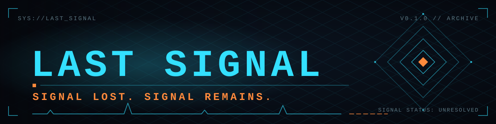
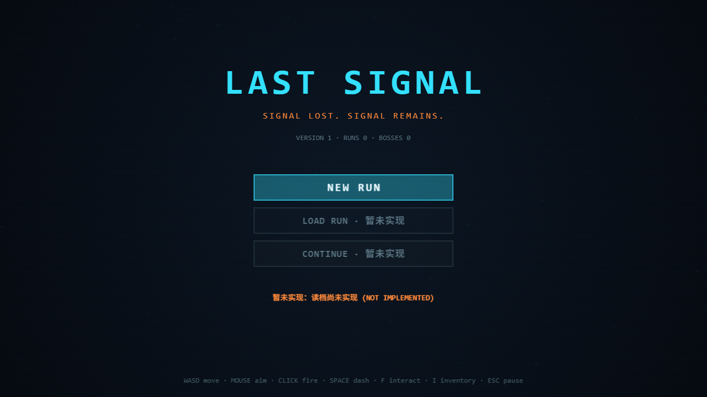
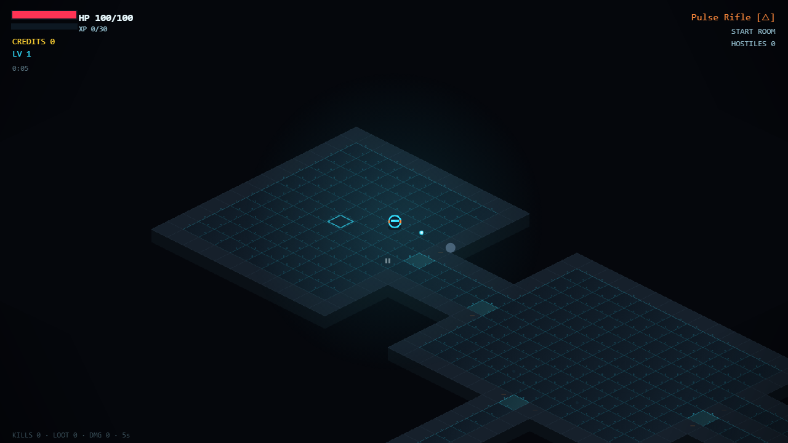
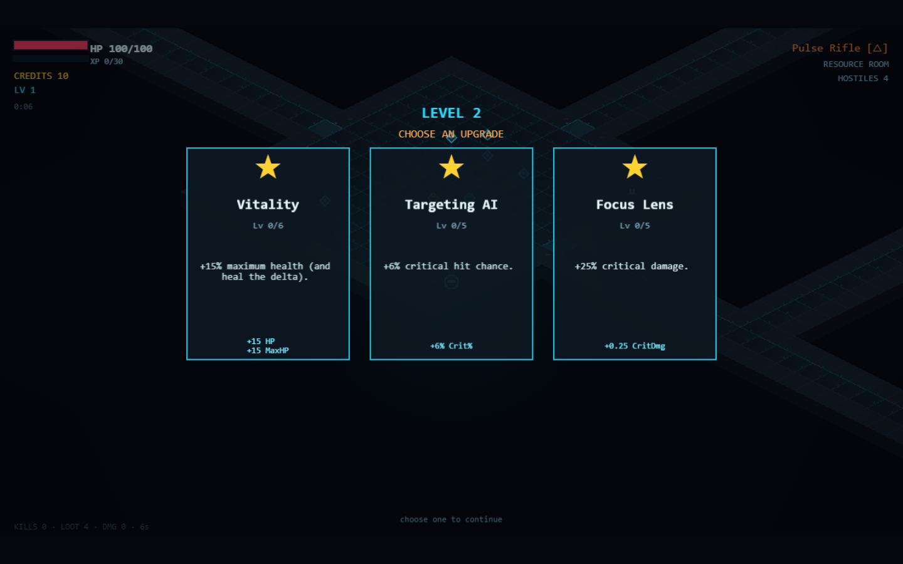
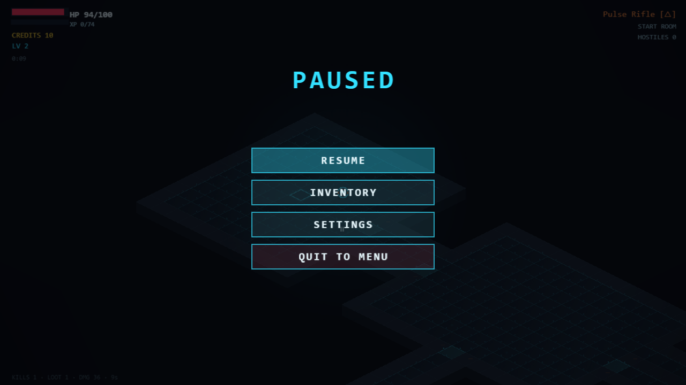
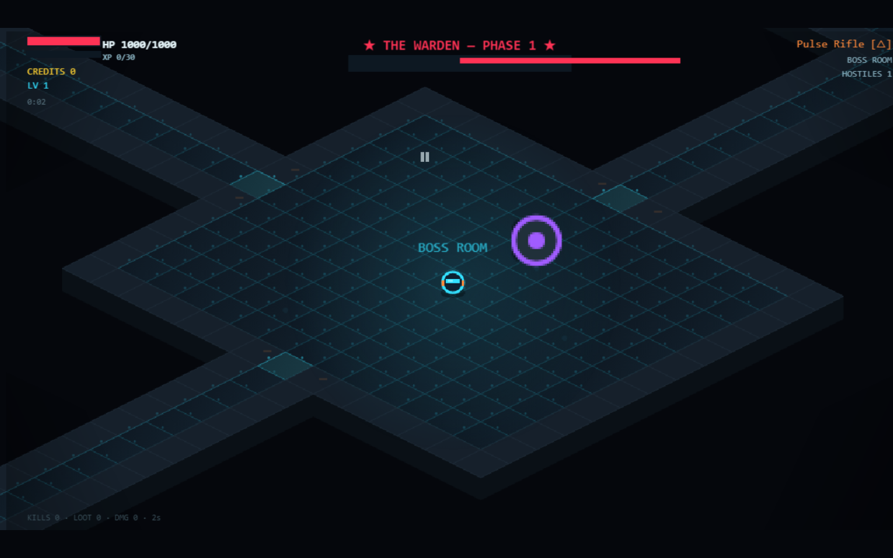
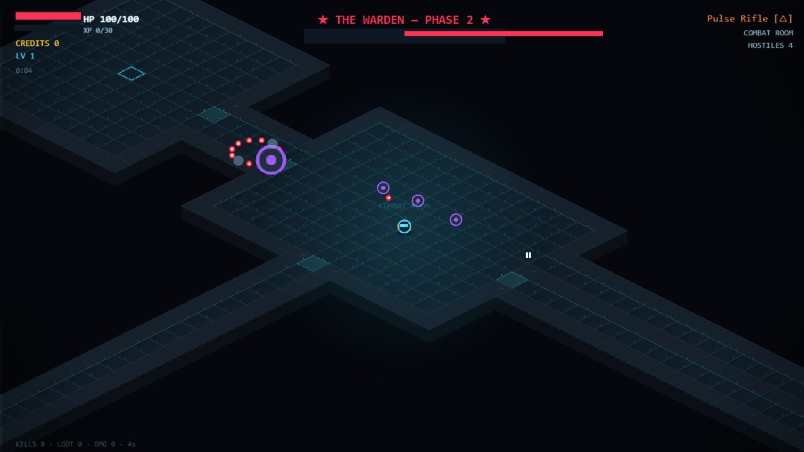

<p align="center">
  
</p>

<p align="center">
  <strong>SIGNAL LOST. SIGNAL REMAINS.</strong><br>
  <em>A Game for Humans and Agents.</em>
</p>

<p align="center">
  <a href="https://github.com/ShengxuanLing/LAST_SIGNAL/actions/workflows/ci.yml"></a>
  <a href="LICENSE"></a>
  <a href="https://phaser.io/"></a>
  <a href="https://www.typescriptlang.org/"></a>
  <a href="https://vitejs.dev/"></a>
  <a href="https://playwright.dev/"></a>
</p>

---

## 项目简介

**LAST SIGNAL** 是一款 2.5D 等距（isometric）科幻射击 Roguelite 浏览器游戏，当前版本 `0.1.0` 是一个**可玩纵向切片（playable vertical slice）**：核心循环（生成房间 → 清理敌人 → 拾取 → 升级 → 进入下一房间 → 击杀 Boss）已经能在浏览器里完整跑通。

技术栈与定位：

- **Vite 5 + TypeScript 5 + Phaser 3.90**（`Phaser.CANVAS` 渲染），纯前端、零后端。
- **Vitest** 覆盖纯逻辑单测，**Playwright** 覆盖端到端可玩性回归。
- **不使用任何外部图片资源**：所有美术（玩家机体、敌人、道具、房间、HUD）均由 `src/core/GraphicsFactory.ts` 与 `src/world/WorldRenderer.ts` 用 Canvas 程序化生成；音效由 `src/systems/AudioSystem.ts` 用 Web Audio API 实时合成。
- **无云端 AI 依赖**：游戏逻辑在浏览器本地运行。Station Zero 提供独立的 Signal 玩法原型。

> 项目愿景是 *A Game for Humans and Agents*（为人类与 AI Agent 共同游玩而设计的游戏）。Agent Bridge 与 Human+AI Co-op 的规划见 `docs/`。

## 当前可玩特性

### 多层地牢

在主菜单选择 **SECTOR RUN**，依次穿过中继场（1-1、1-2）、低温库（2-1、2-2）和熔炉核心（3-1、3-2）。每层有 5–6 个随机布局的房间，包含战斗、精英和补给房。战斗房封锁出口，清完全部敌人波次才解锁。小地图上橙色标记当前层的出口或 Boss 房，清完其他房间后才能进入下一层。

各区域使用不同的敌群、掩体和 Boss 弹幕。站在金色传送门旁按 `F` 下层，保留生命、弹药、武器、升级和信用点。**CONTINUE** 会恢复到最近的安全检查点。**NEW RUN** 进入原有的单图玩法。两个入口共用一个局内检查点槽，开始新的一局时会提示是否替换。

关卡结构参考了《元气骑士》的随机地牢和分区 Boss 推进。[凉屋官方游戏介绍](https://play.google.com/store/apps/details?id=com.ChillyRoom.DungeonShooter) · [关卡结构资料](https://soul-knight.fandom.com/wiki/Level_Mode)

以下特性均来自 `0.1.0` 真实源码（已逐文件复核）：

- **主菜单**：`NEW RUN` 开始新的随机地牢。已有一局时，会先确认是否替换检查点。`LOAD RUN` 查看检查点，`CONTINUE` 直接恢复。
- **角色外观**：在主菜单右侧切换 `OPERATOR` / `WHALE-CHAN`。鲸鱼娘使用 Q 版等距精灵，附移动水纹、冲刺残影和开火水花。[制作与署名](docs/WHALE_CHAN.md)
- **等距房间与地图**：`src/world/MapGenerator.ts` 生成房间深度（RoomDepth）结构，`WorldRenderer` 把整张地图烘焙成单张等距纹理；带小地图（minimap）与相机跟随 / 缩放（`CAM_ZOOM_MIN 0.8` ~ `CAM_ZOOM_MAX 1.25`）。
- **战斗**：鼠标瞄准、按住左键射击；`SPACE` 冲刺（dash）；敌人含 drone / stalker / hunter / sentinel 四型（随房间深度解锁更强类型），掉落资源 / 经验 / 信用点（credits）。
- **武器系统**：4 把武器（Pulse Rifle / Scatter Gun / Plasma Cannon / Arc Drone），`Q` / `E` 切换，`F` 与场景互动物（传送门 / 拾取）交互；弹匣耗尽自动换弹。
- **升级与成长**：击杀获得经验，升级时从加权池中随机给 3 选 1 升级卡（共 12 项局内升级）。击败 Boss 可获得 1 枚永久核心，在主菜单的 `PERMANENT TALENTS` 中购买生命、伤害或护甲天赋。永久天赋在新开局时生效。
- **Boss 房**：深层房间生成三阶段 Boss（含激光、环形弹幕与召唤无人机），击破后进入胜利结算。
- **暂停 / 局内统计 / 结算**：`ESC` 暂停并显示当前武器与升级；死亡进入 GameOver 结算页。
- **本地存档**：每个浏览器地址保留一个局内检查点。开始游戏、清房和安全区域内拾取时自动保存，包含房间进度、生命、经验、弹药、信用点、升级卡和未捡掉落。战斗中退出会回到上一处安全检查点。死亡或击败 Boss 后清除这局的检查点，信用点和升级卡不会计入永久档。旧存档中的设置、统计、武器解锁和已有永久加成会保留。

## 截图

> 以下截图取自当前 `0.1.0` 可玩纵向切片，由仓库美化流程生成，对应 `assets/screenshots/` 下的文件。
>
> `assets/social-preview.png` 是为 GitHub Social Preview 准备的品牌图；在仓库 Settings → Social preview 手动上传即可。

| 主菜单 | 战斗 |
| --- | --- |
|  |  |

| 升级 | 暂停 |
| --- | --- |
|  |  |

| Boss 房 | Boss 弹幕 |
| --- | --- |
|  |  |

## 快速开始

环境要求：Node.js 20 LTS 及以上（Vite 5 / TypeScript 5）。

```bash
npm ci            # 安装与 package-lock.json 完全一致的依赖
npm run dev       # 启动 Vite 开发服务器
# 然后在浏览器打开：http://localhost:5173/
```

同一地址下的 `/station-zero.html` 是独立原型入口。穿过实验室后，可以清除守卫再建桥，也可以用一次压制留守卫过桥。[操作与存档说明](docs/VS_01_IMPLEMENTATION.md)

可选：

```bash
npm run build     # 生产构建（输出到 dist/）
npm run preview   # 预览生产构建
```

## 操作表

| 操作 | 按键 / 方式 |
| --- | --- |
| 移动 | `W` `A` `S` `D` |
| 瞄准 | 移动鼠标 |
| 射击 | 按住鼠标左键 |
| 冲刺（dash） | `SPACE` |
| 切换武器 | `Q`（上一把）/ `E`（下一把） |
| 场景交互（传送门 / 拾取） | `F` |
| 打开 / 关闭物品面板 | `I`，点击 `EQUIP` 或按 `1`–`4` 装备对应武器 |
| 暂停 / 继续 | `ESC` |
| 选择升级 | 点击升级卡或按卡片标出的数字键 |
| 开始游戏 | 主菜单点击 `NEW RUN` |

> 弹匣耗尽后会自动换弹，无需手动操作。

## 测试命令

```bash
npm run typecheck   # tsc --noEmit，类型检查
npm test            # Vitest 单测（src/core/runtime.test.ts，15 个用例）
npm run test:watch  # Vitest 监听模式

npm run playwright  # Playwright 端到端回归（tests/ 下 audit/canvas/gameplay/checkpoint/boss-room/runtime-bugs）
```

运行 Playwright 前**需同时启动两个 Vite dev server**（见 `CONTRIBUTING.md`）：

- `tests/audit.spec.ts`、`tests/gameplay.spec.ts` 走 `http://localhost:5173/`（默认 `PORT=5173`）。
- `tests/canvas.spec.ts` 硬编码 `http://localhost:5199/`。

```bash
npm run dev                    # 终端 1：5173
npm run dev -- --port 5199     # 终端 2：5199
LS_SHOT_DIR=</path/out> npm run playwright   # 把截图输出指向仓库外目录
```

## 项目结构

```text
LAST_SIGNAL/
├─ assets/                     # 文档用资源（由仓库美化流程创建）
│  ├─ banner.svg
│  └─ screenshots/            # 01-main-menu.png … 06-boss-barrage.png
├─ docs/                      # 设计文档（详见下节）
├─ src/
│  ├─ main.ts                 # Phaser.Game 入口、全局 __game、SaveSystem
│  ├─ config/                 # game / enemies / items / upgrades / weapons
│  ├─ core/                   # GraphicsFactory / eventbus / iso / random / runtime.test
│  ├─ entities/               # Player / Enemy / Boss
│  ├─ scenes/                 # Boot / Preload / MainMenu / Game / LevelUp / GameOver / Pause
│  ├─ systems/                # AudioSystem（Web Audio 合成）/ SaveSystem（localStorage）
│  ├─ types/                  # 共享类型
│  └─ world/                  # MapGenerator / World / WorldRenderer / roomdepth
├─ tests/                     # Playwright 端到端规格
├─ index.html                 # 挂载 #game，全局 error 监听
├─ vite.config.ts             # server.port 5173
├─ vitest.config.ts           # 单测配置
├─ playwright.config.ts       # baseURL = localhost:PORT(默认5173)
├─ tsconfig.json
├─ package.json               # version 0.1.0
└─ .gitignore
```

## 已有设计文档

> 这些文档是 `0.2.0 Technical Design & Architecture Audit` 的交付物——**全部为设计与现状审计，不包含任何已实现的代码**。除 `STYLE_GUIDE.md` 外，其余 6 篇一律标注「需新建 / 需扩展 / TBD」，代表未来提案，不代表 `0.1.0` 现状。

| 文档 | 内容 |
| --- | --- |
| [`docs/README.md`](docs/README.md) | 设计文档索引与历史快照说明；解释审计文档里的 Git / 测试状态为何不能再当作当前状态。 |
| [`docs/STYLE_GUIDE.md`](docs/STYLE_GUIDE.md) | 美术风格指南（暗底单色辉光、几何极简、青色为「系统/我方」、程序化纹理，无外部图片资源）——**已生效**，改动美术须遵守。 |
| [`docs/PROJECT_ROADMAP.md`](docs/PROJECT_ROADMAP.md) | 项目路线图（PHASE 0–5 与 `0.2.0-alpha/beta/rc` 节奏）。 |
| [`docs/ARCHITECTURE_DECISIONS.md`](docs/ARCHITECTURE_DECISIONS.md) | 架构决策记录（ADR 集合）。 |
| [`docs/SIGNAL_SYSTEM_DESIGN.md`](docs/SIGNAL_SYSTEM_DESIGN.md) | Signal 系统技术设计（PHASE 2，Scan/Jam/Decoy 等）。 |
| [`docs/AGENT_BRIDGE_ARCHITECTURE.md`](docs/AGENT_BRIDGE_ARCHITECTURE.md) | Agent Bridge 与本机 Harness 接入设计（PHASE 3，WebSocket / MCP）。 |
| [`docs/HUMAN_AGENT_COOP_DESIGN.md`](docs/HUMAN_AGENT_COOP_DESIGN.md) | Human–Agent Co-op 设计（PHASE 4，Mode A/B/C、输入仲裁）。 |
| [`docs/IMPLEMENTATION_TASKS.md`](docs/IMPLEMENTATION_TASKS.md) | 0.2.0 实施工单拆解（PHASE 0–5 任务清单）。 |

> **Game Design Bible（V1.0 Draft，归档版）**：[`docs/GAME_DESIGN_BIBLE.md`](docs/GAME_DESIGN_BIBLE.md) 记录世界观、核心玩法、叙事、AI 角色与开发方向。配套设计对齐报告与待决问题登记册见 `docs/README.md`。

## 路线图简述

`0.1.0` → 计划 `0.2.0`，按 PHASE 0–5 推进（全部日期 `TBD`）：

- **PHASE 0 — 工程基线**：Git/CI 固化、坐标与屏震根因修复、生产包分包。
- **PHASE 1 — 可玩闭环与内容深度**：真实读档与局内快照、首房到 Boss 通关 E2E、房间差异化、武器/升级数值细化、世界观。
- **PHASE 2 — Signal 系统核心**：Signal 数据模型、确定性传播/falloff、Scan/Jam/Decoy、敌人感知接入 FSM。
- **PHASE 3 — Agent Bridge 与本机 Harness 接入**：Local WebSocket Bridge、独立 Node stdio MCP Server、Observation/Action API。
- **PHASE 4 — Human–Agent Co-op**：Mode A/B/C、Input Arbitration、AI 状态面板、接管与断线降级。
- **PHASE 5 — 0.2.0 集成、加固与发布验收**：性能/分包、回归矩阵、文档对齐、发布验收。

> 以上路线图与 6 篇设计文档记录 `0.2.0` 的规划。Station Zero 的已实现范围见 [走廊原型说明](docs/VS_01_IMPLEMENTATION.md)。

## 已知限制

- **Station Zero** 的 Signal 原型覆盖实验室门和失稳走廊。Agent Bridge 与 Human+AI Co-op 仍处于设计阶段。
- **无云端 AI 依赖，也无任何 AI 功能**：全部逻辑在浏览器本地运行，无网络请求、无远端服务。
- **不使用外部图片资源**：美术与音效均程序化生成（见 `docs/STYLE_GUIDE.md`）。
- **仅桌面键鼠**：未做移动端触控适配（Touch API 已禁用，专注 pointer/keyboard）。
- **局内检查点（checkpoint）仅在安全点 / 清房点保存**：开始游戏、清房、安全区域内拾取时自动写入当前浏览器地址的 `run` 检查点；战斗中途退出会回到上一处安全检查点，而非实时快照。
- **`NEW RUN` 会替换并覆盖旧检查点**：同一地址只保留一个局内检查点，开始新一局即弃用上一局的 `run`。
- **失败 / 胜利结算会清档**：死亡或击败 Boss 进入结算时清除这局的 `run` 检查点；本局信用点（credits）与升级卡只在本局有效，不计入永久档（永久 `cores` 与天赋仅在击败 Boss 后写入 `permanent`）。
- **生产包为单 chunk（≈1.5 MB / gzip ≈364 kB）**，有 >500 kB 警告，分包待 PHASE 0 处理。
- **`gameBus` 事件总线暂无消费者**；通关（首房到 Boss 胜利）尚无非人工的端到端验收用例。

## 许可

本项目以 [MIT 许可证](LICENSE) 发布。版权所有 © 2026 LAST SIGNAL contributors。
