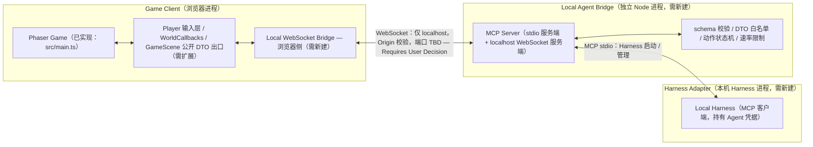
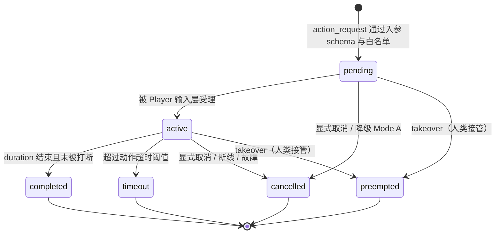

# LAST SIGNAL 0.2.0 — Agent Bridge 架构设计（PHASE 3）

> 文档状态：`0.2.0` 技术设计与架构审计交付物，**只做设计与现状审计，不实现功能**。
> 本阶段只完成设计审计，未授权实现
> 当前源码版本 `0.1.0`；目标计划版本 `0.2.0`；技术栈 Vite 5 + TypeScript 5 + Phaser 3.90（`Phaser.CANVAS`）。
> 愿景 *A Game for Humans and Agents*。本文件属 **PHASE 3 — Agent Bridge 与本机 Harness 接入**（阶段定义严格按统一事实基座 §7.1）。
> 事实基座：`FACTS.md`（统一口径 §7.3、7 个必答问题 §7.5、不虚构 §6）；本文所有现状描述均已自行复核真实源码。
> **现状基线**：源码中**没有任何 WebSocket / MCP / Agent / Harness 代码**，`src/bridge/`、`src/agent/`、`src/mcp/`、`server/`、`tools/` 等目录均不存在；`MCPServer`、`AgentBridge`、`HarnessAdapter`、`ObservationAPI`、`ActionAPI`、`ObservationDTO` 等类名**均不代表现有代码**。因此本文所有设计条目一律是 `0.2.0` 提案，标注 `【需新建】` / `【需扩展】`；现状条目标注 `【已实现】`；未定决策逐项标注 `TBD — Requires User Decision` 并写明需要用户决定的具体问题。
> 本阶段**不创建任何 MCP Server / Bridge 源码文件或示例工程**，文中出现的路径仅为提案路径。

---

## 0. 范围、状态约定与现状澄清
> 本阶段唯一交付物为 `docs/` 下 6 个新建设计文档；本文只写自身，不写 6 个文档之外的任何文件；不改源码、不装依赖、不初始化 Git、不提交 commit

### 0.1 状态标签与阶段口径

| 标签 | 含义 |
|---|---|
| `【已实现】` | `0.1.0` 源码中真实存在，且已逐文件复核 |
| `【需扩展】` | 在已有真实文件 / 真实输入层 / 真实类型上增加能力（提案） |
| `【需新建】` | 全新文件、全新进程、全新通道、全新测试（提案，本阶段不落盘） |
| `TBD — Requires User Decision` | 待用户拍板，正文与文末「待用户确认事项」均写明具体问题 |

- 阶段编号统一为 `PHASE 3 — Agent Bridge 与本机 Harness 接入`（`FACTS §7.1`）。前置依赖：`PHASE 0` 工程基线、`PHASE 1` 可玩闭环、`PHASE 2` Signal 系统核心；后继为 `PHASE 4` Human–Agent Co-op、`PHASE 5` 集成发布。版本节奏建议 `0.2.0-rc` = PHASE 3–4，具体日期 `TBD — Requires User Decision`（需用户决定：交付日期、以及是否存在既定总计划书 PHASE 定义；若有，请以总计划书原文为准重新对齐阶段编号）。
- Git 初始化统一表述：**PHASE 0 Task 0.1，本阶段未授权，需用户确认后执行**。本阶段不修改游戏源码、不修改 `docs/STYLE_GUIDE.md`、不安装依赖、不写 `dist/` / `test-results/` / `tests/screens/` / `node_modules/`、不初始化 Git、不创建 `.gitignore`、不提交 commit。

### 0.2 措辞澄清（为避免虚构，按真实源码逐字对齐）

1. `【已实现】` W/A/S/D 与 SPACE 的 Key 对象由 `src/world/World.ts` 构造函数通过 `kb.addKey` / `createKey` 创建，并调用 `Player.registerInput(keys, cursors)` 注入 `Player`；`src/scenes/GameScene.ts` 的 `create()` 额外注册 `addKey('SPACE')`、空的 `keydown_SPACE`、`keydown-ESC` / `keydown-I` / `keydown-F` / `keydown-Q` / `keydown-E`，以及 `pointerdown` / `pointerup`。因此「WASD/鼠标/SPACE/ESC/I/F/Q/E」是**跨 `World` 与 `GameScene` 两处的真实人类输入集合**，本文第 6 节按此精确映射。
2. `【已实现】` **`Player` 类中没有 `switchWeapon()` 方法**。真实实现是 `src/scenes/GameScene.ts` 的 `private switchWeapon(dir: number)`，由 `keydown-Q` / `keydown-E` 触发，直接改写 `this.world.player.data.weaponKey`。任务描述中「`Player.switchWeapon()`」与源码不符，本文一律按 `GameScene.switchWeapon(dir)` 引用，并把「是否把该方法下沉到 `Player` 输入层」列为 `TBD — Requires User Decision`（需用户决定：是否允许为 `action_switch_weapon` 在 `Player` 输入层新增公开意图入口，还是由 Bridge 复用 `GameScene.switchWeapon(dir)` 的现有语义）。
3. `【已实现】` `index.html` 只提供 `#game` / `#loader`、全局 `error` / `unhandledrejection` 监听与 `/src/main.ts` 引入；`window.__game` 实际由 `src/main.ts` 末尾 `;(window as any).__game = game;` 赋值，被 `tests/audit.spec.ts`、`tests/canvas.spec.ts`、`tests/gameplay.spec.ts` 当作运行时状态探针使用。本文第 9 节据此说明隔离要求。

### 0.3 与 7 个必答问题的对应关系（`FACTS §7.5`）

- 第 3 问（Agent 不直接操作 Phaser 对象）→ 第 6、8、9 节；第 4 问（MCP 连本机 Harness）→ 第 2、3 节；第 5 问（人类输入优先）→ 第 7、8 节；第 6 问（不拿隐藏信息）→ 第 5、8 节；**第 7 问（无 AI 也能玩）→ 第 11 节**；第 1、2 问（复用/扩展/新建清单、Signal 接 FSM）仅在涉及 `observe_signals` / `action_signal` 的依赖处引用，Signal 系统本身属于 `PHASE 2`，不在本文设计范围。

---

## 1. 三层架构与统一链路（`【需新建】` / `【需扩展】`）

### 1.1 逐字统一口径

- 三层架构（逐字统一）：`Game Client / Local Agent Bridge / Harness Adapter`
- 链路（逐字统一）：`Phaser Game <-> Local WebSocket Bridge <-> MCP Server <-> Local Harness`
- MCP Server 为**本地独立 Node stdio 进程**；浏览器 WebSocket **只连 localhost**；双通道 = **MCP stdio + WebSocket**。
- 安全铁律（逐字统一）：**不把 MCP 塞进 Phaser 核心**；**不允许 Agent 直接操作 Phaser 内部对象**；**不暴露隐藏信息**；**不把 API Key 放前端**。

三层是**逻辑分层**，不等于进程分层：进程边界在下表与第 1.4 节单独说明，避免把「Layer」误读为「Process」。

### 1.2 分层职责表

| 层 | 包含实体（现状 / 提案） | 主要职责 | 进程边界 | 数据边界（进 / 出） | 信任边界 | 状态 |
|---|---|---|---|---|---|---|
| `Game Client` | `Phaser Game`（`src/main.ts` 的 `game`，`【已实现】`）；浏览器侧 `Local WebSocket Bridge` 客户端（`【需新建】`） | 渲染与人类输入；把观察数据组装为**公开 DTO** 外发；把 `action_request` 落成与人类同层的输入意图；断线降级到 Mode A | 浏览器标签页进程（Vite dev server 提供的静态页面 + `Phaser.CANVAS` 主循环）；**不得**内嵌 MCP stdio、不得持有任何凭据 | 出：`observation` / `event` / `action_result`（白名单 DTO）；入：`action_request` / `takeover` / `ping` / `hello` | **不可信侧**：一切来自 Bridge 的报文均视为外部输入，须经 schema 入参校验、动作白名单、速率限制；不得让报文触达 `Phaser.Scene` / `World` / `Player` 内部对象 | `【需新建】`（Bridge 侧）/ `【需扩展】`（输入层与 DTO 出口） |
| `Local Agent Bridge` | 独立 Node 进程内的 `MCP Server`（stdio 服务端 + localhost WebSocket 服务端）、协议转换器、schema 校验器、DTO 白名单裁剪器、动作状态机（`【需新建】`） | 面向 Harness 暴露严格 6 + 9 个工具；面向浏览器维护唯一 localhost WebSocket 连接；做版本协商、请求-响应关联、心跳/超时、审计与错误信息脱敏 | **与浏览器进程隔离的独立 Node 进程**，由本机 Harness 以 stdio 启动/管理；WebSocket 监听仅绑定 loopback | 入（来自 Harness）：MCP stdio 帧；入（来自浏览器）：WebSocket JSON 信封；出：双向转发并在出参侧再做一次字段白名单校验 | **策略执行点 / 唯一可信中介**：隐藏信息过滤、Origin/握手校验、凭据持有（仅此层与 Harness 侧）、速率限制都在这里落地；它不信任浏览器、也不信任工具入参 | `【需新建】` |
| `Harness Adapter` | 本机 `Local Harness` 及其 MCP 客户端（`【需新建】`，由用户侧 Harness 提供）；进程启动器 / 生命周期管理者 | 以 stdio 启动与管理 MCP Server；发起 `tools/list` / `tools/call`；持有 Agent 凭据；决定规划、接管与断线策略 | 本机 Harness 进程（**非浏览器进程**）；与 MCP Server 之间是父子进程 + stdio 管道关系 | 出：MCP stdio 请求；入：MCP stdio 响应 / 通知 | **凭据与决策侧**：API Key 只在此层与 `Local Agent Bridge` 的 Node 进程内可见，绝不进入浏览器；Harness 只说 MCP 协议，不直接说浏览器 WebSocket 协议 | `【需新建】` |

### 1.3 Mermaid 架构图



链路（逐字统一，文字版）：

```
Phaser Game <-> Local WebSocket Bridge <-> MCP Server <-> Local Harness
```

### 1.4 进程边界、数据边界与信任边界说明（`【需新建】`）

- **进程边界**：① 浏览器标签页（`Phaser Game` + 浏览器侧 Bridge 客户端）；② 独立 Node 进程（`MCP Server`，同时是 stdio 服务端与 WebSocket 服务端）；③ 本机 Harness 进程（MCP 客户端与凭据持有者）。三者互不共享内存，`Phaser.Game` 实例、`GameScene`、`World`、`Player` 只存在于 ①。
- **数据边界**：② 是唯一允许把「内部状态」翻译为「公开 DTO」的地方；① 只向上报 DTO、只向下接受输入意图；③ 只看到 15 个工具与脱敏后的错误。跨边界一律为 JSON 文本（stdio 帧 / WebSocket 帧），禁止传递对象引用、函数、Phaser 对象、`Set` 等不可序列化结构（`ProjectileData.hitSet: Set<number>` 即属禁止外传之列）。
- **信任边界**：① 不可信，② 是策略执行点，③ 是凭据与决策侧。任何 `action_request` 必须经过「入参 schema → 动作白名单 → 速率限制 → 状态机 → 输入层意图」五道关口；任何 `observation` 出参必须经过「DTO 白名单 → 出参 schema → 隐藏字段黑名单」三道关口。
- `TBD — Requires User Decision`（TBD-24：需用户决定：三进程是否允许合并为「Harness 内嵌 MCP Server」的变体；若合并，需重新界定 stdio 生命周期与 ② 的隔离保证）。

---

## 2. MCP Server：本地独立 Node stdio 进程（`【需新建】`）

- **定位**：`MCP Server` 是**本机独立 Node stdio 进程**，不是浏览器模块、不是 Phaser 插件、不是 Vite 中间件。它同时承担两个角色：面向 Harness 的 MCP **stdio 服务端**，以及面向浏览器 Bridge 的 **localhost WebSocket 服务端**；两个角色在同一进程内汇聚，形成链路中的 `Local WebSocket Bridge <-> MCP Server <-> Local Harness`。
- **由本机 Harness 以 stdio 启动 / 管理**：`Local Harness` 作为父进程按约定命令启动该 Node 进程，通过 `stdin/stdout` 交换 MCP 帧；启动命令、Node 运行时路径、工作目录均为 `TBD — Requires User Decision`（TBD-10、TBD-18；需用户决定：Harness 侧可用启动方式与配置格式，以及是否复用项目 `package.json` 的 `type: module`）。
- **与浏览器进程隔离**：浏览器侧只知道 `ws://127.0.0.1:<port>`（端口 `TBD — Requires User Decision`，TBD-07）；MCP 的 stdio 管道、进程环境变量、任何凭据都不进入浏览器；`Phaser.Game` 与其场景树无法被 Node 进程反向引用。
- **生命周期（提案）**：`未启动 → 启动中 → 握手（hello / 版本协商）→ 就绪（WebSocket 等待浏览器接入）→ 运行（工具调用）→ 降级（浏览器断连但 stdio 仍活）→ 退出`。父进程退出 / stdio 关闭时 MCP Server 必须关闭 WebSocket 监听并释放端口；浏览器刷新只重建 WebSocket 连接，不重启 MCP Server；浏览器断开不导致 Agent 侧状态丢失，但所有进行中动作按第 7 节转为 `cancelled` / `preempted`。
- **日志与错误通道（提案）**：`stdout` **专用于 MCP 协议帧**，禁止混入日志；运行日志、审计日志、异常堆栈一律走 `stderr`（由 Harness 采集）；面向 Agent 的 `error` 消息只返回结构化错误码与脱敏描述，不返回堆栈、文件路径、环境变量或内部状态（见第 4.5、8.6 节）。
- `TBD — Requires User Decision`（需用户决定：崩溃重启策略、单实例/多实例约束、stdio 关闭与 WebSocket 关闭的先后顺序、日志落盘位置与保留期；以及 MCP 协议版本/帧格式以 Harness 实际支持范围为准）。

---

## 3. 双通道：MCP stdio + WebSocket（`【需新建】`）

| 通道 | 端点 | 承载内容 | 校验责任 | 状态 |
|---|---|---|---|---|
| **MCP stdio** | `Local Harness <-> MCP Server` | 15 个工具的 `tools/list` / `tools/call`、请求-响应关联、工具级错误信息 | 版本协商、工具入参 schema、错误脱敏、凭据保护 | `【需新建】` |
| **WebSocket** | `MCP Server <-> 浏览器侧 Local WebSocket Bridge` | `hello / observation / action_request / action_result / event / error / takeover / ping` 的 JSON 信封 | 入参/出参双向 schema、Origin/握手校验、心跳与超时、速率限制 | `【需新建】` |

### 3.1 双通道存在理由

- **不把 MCP 塞进 Phaser 核心**（铁律 1）：浏览器没有 stdio，无法承载 MCP 进程模型；若把 MCP 逻辑塞进 `src/main.ts` / `GameScene`，必然把进程管理、凭据、`Phaser.Game` 生命周期耦合进渲染主循环，且会让「无 AI 也能玩」的零依赖前提失效。MCP 只能存在于独立 Node 进程。
- **不把 WebSocket 直接暴露给 Harness**：Harness 只讲 MCP stdio 协议，工具发现、参数 schema、权限与审计都由 MCP 层收口；若让 Harness 直连浏览器 WebSocket，就需要 Harness 实现浏览器私有协议、绕过出参白名单与双向 schema、把 localhost 端口与 Origin 策略扩散到 Harness 侧，且每次浏览器刷新都会打断 Agent 会话。由 `MCP Server` 统一做协议转换、校验、裁剪与连接管理，浏览器刷新只是 WebSocket 重连。
- **双通道汇聚点**：`MCP Server` 是唯一同时理解两种协议的组件，也是唯一同时执行入参与出参校验的地方。

### 3.2 浏览器 WebSocket 只连 localhost（`【需新建】`）

- **禁用远程**：WebSocket 服务端**禁止**绑定 `0.0.0.0` / 局域网地址 / 公网地址；浏览器侧 URL 白名单只允许 `ws://127.0.0.1:<port>` 与 `ws://[::1]:<port>`（`【需新建】` 的连接器在运行时硬校验，拒绝任何其它 host，包括 `localhost` 之外的别名与隧道域名）。
- **绑定地址**：仅绑定 `127.0.0.1` / `::1`；是否同时启用 IPv4 与 IPv6 loopback `TBD — Requires User Decision`（需用户决定：双栈监听还是单栈，以及端口冲突时的回退策略）。
- **Origin 校验**：握手阶段校验 `Origin` / `Host`，只允许本地 Vite dev server 来源（例如 `http://127.0.0.1:5173`、`http://localhost:5173`、`http://127.0.0.1:5199`、`http://localhost:5199` 等，具体白名单 `TBD — Requires User Decision`，需用户决定允许的 Origin 精确取值、是否允许 `null` Origin、以及是否追加一次性握手挑战/令牌）；校验失败立即关闭连接并只写 `stderr` 审计日志，不回传细节。
- **端口约定**：`TBD — Requires User Decision`（需用户决定：固定端口号或动态端口 + 发现机制；不得与 `vite.config.ts` 的 `server.port: 5173`、`tests/canvas.spec.ts` 硬编码的 `5199` 冲突；端口不得写入前端硬编码凭据）。
- **凭据**：握手**不携带**任何 API Key；凭据只存在于 Harness / MCP Server 侧（第 8.6 节）。

---

## 4. 协议设计（`【需新建】`）

> 本节全部为候选提案。`version`、所有字段名、字段类型、必填性、枚举取值、端口、超时数值**均为未定项**，逐项 `TBD — Requires User Decision`；具体问题汇总于文末「待用户确认事项」。

### 4.1 JSON 消息信封（字段提案）

提议统一信封：`{ version, type, id, timestamp, payload, seq, correlation_id, session_id, channel, status }`。下表每个字段的字段名、类型、必填性都是候选，逐项标注：

| 字段（候选） | 类型（候选） | 必填（候选） | 用途 | 决策状态 |
|---|---|---|---|---|
| `version` | string | 是 | 协议版本，握手时协商；不兼容则拒绝并回 `error` | `TBD — Requires User Decision` |
| `type` | string（枚举） | 是 | 第 4.2 节统一候选消息类型之一 | `TBD — Requires User Decision` |
| `id` | string | 是 | 消息唯一标识，用于请求-响应关联与幂等去重 | `TBD — Requires User Decision` |
| `timestamp` | number | 是 | 发送时刻（毫秒），用于超时判定与重放排序 | `TBD — Requires User Decision` |
| `payload` | object | 是 | 按 `type` 由独立 schema 约束的载荷 | `TBD — Requires User Decision` |
| `seq` | number | 是 | 单调递增序号，检测乱序 / 丢帧 / 重放攻击 | `TBD — Requires User Decision` |
| `correlation_id` | string | 响应必填 | 指向被响应的 `id` | `TBD — Requires User Decision` |
| `session_id` | string | 握手后必填 | 会话隔离，浏览器刷新后重新协商 | `TBD — Requires User Decision` |
| `channel` | string（枚举） | 是 | 标记来源通道：`mcp-stdio` / `websocket` | `TBD — Requires User Decision` |
| `status` | string（枚举） | 仅响应 | 结果状态，如 `ok` / `rejected` / `timeout` / `cancelled` / `preempted` | `TBD — Requires User Decision` |
| `...`（扩展字段） | — | — | 任何额外字段必须先加入白名单，否则按第 4.5 节拒绝 | `TBD — Requires User Decision` |

`TBD — Requires User Decision`（TBD-02：需用户决定最终字段集合、命名风格、类型与必填性、是否保留 `...` 扩展位；TBD-01：需用户决定 `version` 初值与版本协商/降级/不兼容拒绝策略）。

### 4.2 统一候选消息类型（逐字统一，8 个）

| 类型 | 方向（提案） | 语义 | 状态 |
|---|---|---|---|
| `hello` | 双向 | 握手：交换 `version`、`session_id`、能力集与 15 个工具清单摘要 | `【需新建】` |
| `observation` | `Game Client -> MCP Server -> Local Harness` | 6 个 Observation 工具的出参 DTO（白名单裁剪后） | `【需新建】` |
| `action_request` | `Local Harness -> MCP Server -> Game Client` | 9 个 Action 工具之一的调用意图 | `【需新建】` |
| `action_result` | `Game Client -> MCP Server -> Local Harness` | 动作状态机终态与结果摘要 | `【需新建】` |
| `event` | `Game Client -> MCP Server -> Local Harness` | 世界事件通知（房间进入/清理、升级、死亡等，字段白名单） | `【需新建】` |
| `error` | 双向 | 结构化错误码 + 脱敏描述 | `【需新建】` |
| `takeover` | 双向 | 人类接管 / 让权信号，触发动作抢占（第 7 节） | `【需新建】` |
| `ping` | 双向 | 心跳探活与超时判定 | `【需新建】` |

`TBD — Requires User Decision`（TBD-03：需用户决定是否在 8 个候选之外扩充类型；扩充后 6 个文档必须全文一致）。

### 4.3 请求-响应关联与序号（`【需新建】`）

- 每个 `action_request` 携带唯一 `id`；对应 `action_result` / `error` 必须以 `correlation_id` 回指该 `id`，不得复用、不得省略。
- `seq` 在单个 `session_id` 内单调递增；接收方检测回退、跳号、重复 `id`：重复 `id` 视为**同一请求的幂等重放**，返回首次结果而不二次执行（与第 7 节幂等要求一致）。
- `observation` / `event` 为单向推送，但同样携带 `id` / `seq` / `timestamp` 以支持重放与乱序检测；取消与接管消息必须携带被影响动作的 `id`。
- `TBD — Requires User Decision`（TBD-04：需用户决定 `id` 生成规则、`seq` 作用域是每连接还是每会话、序号溢出与重放窗口大小）。

### 4.4 心跳与超时（`【需新建】`）

- `ping` 双向周期发送；连续丢失 N 次判为断连，触发第 8.7 节降级到 Mode A。
- 每个 `action_request` 有请求级超时；动作本身有状态机超时（第 7 节）；`hello` 有握手超时；超时后回 `error` 并将动作置 `timeout`。
- 心跳间隔、丢失阈值、各超时默认值的**具体数值**一律 `TBD — Requires User Decision`（TBD-05：需用户决定心跳周期、连续丢失次数、握手/请求/动作超时数值与计时源）。

### 4.5 schema 验证（`【需新建】`）

1. **入参与出参双向校验**：`action_request.payload`、工具调用入参、`hello` 能力集走入参 schema；`observation` / `event` / `action_result` 走出参 schema。两端都用同一套 schema 定义，防止「只校验输入、输出把内部对象带出去」。
2. **拒绝未知字段**：所有对象 schema 关闭附加属性（等价 `additionalProperties: false`），白名单之外的字段（含嵌套对象里的隐藏字段）一律拒绝或剔除；出参侧先按 DTO 白名单组装再校验，校验失败不得降级为「原样发送」。
3. **版本协商**：`hello` 交换 `version` 与能力集；主版本不兼容直接拒绝连接并回脱敏 `error`；能力集差异按最小公共集运行。
4. **错误信息不泄漏内部状态**：`error` 只有结构化错误码与固定文案，不含堆栈、`Phaser` 对象内容、`World` 私有字段、`SaveData` 内容、环境变量、文件路径、端口、seed、RNG 状态；详细原因只写 `stderr` 审计日志。
5. `TBD — Requires User Decision`（TBD-06：需用户决定 schema 实现方式是引入校验库还是自研、严格度级别、错误码枚举全集与脱敏等级；本阶段不安装依赖，故不得要求现在引入新库）。

---

## 5. Observation API — 严格 6 个工具（`【需新建】` / `【需扩展】`）

> 统一命名（逐字）：`observe_state`、`observe_entities`、`observe_map`、`observe_signals`、`observe_inventory`、`observe_events`。**不得增删、不得改名**；扩充需 6 个文档全文一致并 `TBD — Requires User Decision`（TBD-25：是否允许扩充 6 个工具集）。
> **总原则**：观察数据必须由**公开 DTO** 生成，不得序列化 `Phaser.Scene` / `World` / `Player` 内部对象；DTO 字段名、刷新频率、可见性裁剪阈值全部 `TBD — Requires User Decision`（TBD-12、TBD-13）。输入统一只接受工具自身的过滤参数，输出统一为白名单对象，禁止返回 `Set`、函数、`sprite`、`scene`、`renderer` 等引用。
> 下表「输出 DTO 字段白名单」为**候选白名单**（字段名取自 `src/types/index.ts` / `src/world/World.ts` 中真实存在的公开类型字段，仅作提案依据），最终字段名 `TBD — Requires User Decision`（TBD-12）。

| 工具 | 输入（候选） | 输出 DTO 字段白名单（候选） | 刷新频率（候选） | 可见性裁剪规则 | 状态 |
|---|---|---|---|---|---|
| `observe_state` | `scope`（如 `self` / `run`）、`fields`（可选白名单子集） | 玩家：`hp`、`maxHp`、`level`、`xp`、`xpToNext`、`currency`、`weaponKey`、`wx`、`wy`（取自 `PlayerData` / `Player.wx/wy`）；局内：`clock`、`currentRoom.id`、`currentRoom.kind`、`paused`；**禁止**：`aimYaw` 私有量、`seed`、计时器、`Player` 私有字段 | 每帧或每 N 帧推送 | 只回当前局、当前玩家；非当前场景（`MainMenuScene` 等）回 `OFFLINE` 语义而非场景树 | `【需新建】`（DTO 生成器）+ `【需扩展】`（`GameScene` / `WorldCallbacks` 公开读数出口） |
| `observe_entities` | `kinds`（敌人类型过滤）、`roomId`、`radius` | 敌人：`id`、`kind`、`hp`、`maxHp`、`x`、`y`、`alive`；Boss：`phase`、`hp`、`maxHp`；弹丸：`side`、`pos`；掉落：`kind`、`key`、`amount`、`x`、`y`；**禁止**：`EnemyData.stateTimer`、`patrolPoints`、`patrolIndex`、`stunTimer`、`targetId`、`aggroRange`、FSM `state` | 每 N 帧 / 事件驱动 | 仅当前房间与可见半径内实体；未进入房间不返回任何实体；半径与「可见」定义 `TBD — Requires User Decision`（TBD-13） | `【需新建】` |
| `observe_map` | `roomId`、`includeTiles`（布尔） | 房间：`id`、`kind`、`gx`、`gy`、`w`、`h`（`RoomInfo` 真实字段）；`explored`（提案标记）、`currentRoomId`、`connectedTo` 的**已探索子集**；可选 `Tile.type` 的已探索区域摘要；**禁止**：`MapData.seed`、`tiles` 全量、`doorways` 全量、未来/未探索房间内容 | 进入房间 / 清理房间时事件驱动 | 未探索房间只回 `id` 或完全不回；`extraction` 等未分配房间角色不得凭类型声明推断内容；裁剪口径 `TBD — Requires User Decision`（TBD-13） | `【需新建】` |
| `observe_signals` | `types`、`radius`、`since` | 依 `FACTS §7.2` 的 Signal 数据模型候选字段白名单子集（`id` / `sourceId` / `type` / `position` / `intensity` / `radius` / `createdAt` / `duration` / `faction` / `metadata` 的可见子集）；**禁止**：传播内部状态、RNG 状态、`seed` | 事件驱动 | 只回玩家可感知 / 可见半径内信号；Signal 系统属于 `PHASE 2` **设计提案、当前未实现**，本工具在其落地前不可用 | `【需新建】`（依赖 PHASE 2） |
| `observe_inventory` | `includeUpgrades`、`includeWeapons` | `weapons[].key`、`level`、`ammo`、`magazine`、`reloading`（`WeaponState` 真实字段）、`upgrades[].key` / `level`（`UpgradeProgress`）、`abilities`、`currency`；**禁止**：`reloadTimer`（内部计时）、`SaveData.permanent` / `settings` / `stats` / `createdAt` / `updatedAt` / `unlockedWeapons` 等存档内部字段 | 状态变更时事件驱动 | 只回当前局装备；永久进度与存档内部字段一律不回 | `【需新建】` |
| `observe_events` | `since`（序号/时间戳）、`types`（`GameEventType` 子集） | `type`、`tick`、`payload` 的白名单子集（`GameEvent` / `GameEventType` 已在 `src/types/index.ts` **声明但全项目无消费者**）；**禁止**：内部回调闭包、堆栈、未公开 payload | 事件驱动 | 只回已发生且已脱敏的事件；顺序按 `seq`；事件类型枚举是否扩充 `TBD — Requires User Decision`（TBD-19、TBD-03） | `【需扩展】`（可选复用 `EventBus` / `gameBus`）+ `【需新建】`（通道绑定） |

- 每个工具的刷新频率都必须有上限与背压策略，具体数值 `TBD — Requires User Decision`（TBD-12：需用户决定 6 个工具各自的推送频率上限与合并窗口）。
- 可见性裁剪由 `Local Agent Bridge` 层统一执行，浏览器侧只负责组装 DTO；两侧都要过出参 schema，防止裁剪在某一侧被绕过（TBD-13：需用户决定视野半径、已探索判定依据、`EnemyData.state` 是否对 Agent 可见、Signal 可见性规则）。
- 工具名与数量的任何改动 `TBD — Requires User Decision`（TBD-25：需用户决定：是否允许在 6 个之外新增；若允许需在 `FACTS §7.3` 与 6 个文档同步）。

---

## 6. Action API — 严格 9 个工具（`【需新建】` / `【需扩展】`）

> 统一命名（逐字）：`action_move`、`action_aim`、`action_fire`、`action_dash`、`action_reload`、`action_switch_weapon`、`action_interact`、`action_signal`、`action_wait`。**不得增删、不得改名**。
> **落地铁律**：`action_request` 只能转换成「与人类输入同层」的**输入意图**（布尔 / 方向 / 时长 / 标量），由 `Player` 输入层在既有 `update(dt)` 主循环里消费；**不得**直接写 `Player.wx/wy`、`Player.data`、`World.enemies`、`Phaser.GameObjects.*`，也不得调用 `spawnProjectile()` / `spawnEnemy()` / `scene.start()` 等改变世界或场景的能力。参数取值范围、默认持续时间、动作白名单最终集合 `TBD — Requires User Decision`（TBD-14）。

### 6.1 真实输入基准（`【已实现】`，逐字核对）

| 真实入口 | 位置 | 现状 |
|---|---|---|
| W/A/S/D / SPACE 的 Key 对象 + `Player.registerInput(keys, cursors)` | `src/world/World.ts` 构造函数 | `Player.updateKeys()` 读 `k.W/S/A/D.isDown` 填 `this.input.{up,down,left,right}`；`cursors.space.isDown` 在 `Player.update(dt)` 中判定冲刺 |
| `keydown_SPACE`（空实现）、`keydown-ESC`、`keydown-I`、`keydown-F`、`keydown-Q`、`keydown-E` | `src/scenes/GameScene.ts` 的 `create()` | `ESC`→`onPause()`、`I`→`toggleInventory()`、`F`→`World.tryInteract(this.world.player)`、`Q/E`→`this.switchWeapon(-1/+1)` |
| `pointerdown` / `pointerup` | `src/scenes/GameScene.ts` 的 `create()` | 左键按下/抬起写 `GameScene.fireHeld`；`update()` 里调 `Player.setFireHeld(this.fireHeld)` |
| `Player.aimFromPointer(pointer)` / `Player.setFireHeld(v)` / `Player.fireHeld()` / `Player.updateKeys()` | `src/entities/Player.ts` | `aimFromPointer` 取 `cam.getWorldPoint` → `World.screenToWorld` → 私有 `aimYaw`；`tryFire()` 由 `fireHeld()` 驱动 |
| `GameScene.switchWeapon(dir)` | `src/scenes/GameScene.ts`（`private`，**不是 `Player` 的方法**） | 直接改写 `this.world.player.data.weaponKey`（见 §0.2 第 2 条） |
| `World.tryInteract(player)` | `src/world/World.ts` | 靠近传送门时 `player.reset(cx, cy)` 切房间 |

### 6.2 9 个工具的参数、语义与真实输入映射

| 工具 | 参数（候选） | 语义 | 与现有真实输入的映射 | 状态 |
|---|---|---|---|---|
| `action_move` | `direction`（`Direction` 八向或 `up/down/left/right`）、`duration`（秒）、`intensity`（0–1） | 在持续时间内保持方向意图，松开即结束；不得直接改坐标 | 写 `Player.input.{up,down,left,right}` 同层布尔意图（现由 `Player.updateKeys()` 从 W/A/S/D 填入）；移动/碰撞仍由 `Player.update(dt)` 经 `IsoMath` 与 `World.isWalkable()` 处理 | `【需扩展】`（`Player` 输入层增加受控意图注入） |
| `action_aim` | `yaw`（弧度）或 `target:{x,y}`（**网格坐标 `wx/wy`**） | 设定瞄准方向；坐标一律用 `wx/wy` 网格坐标，禁止屏幕像素 / `worldToScreen()` 输出 | 对齐 `Player.aimFromPointer(pointer)` 的最终效果（私有 `aimYaw`）；因 Bridge **不得构造 `Phaser.Input.Pointer`**，需 `【需扩展】` 一个纯数值输入入口（如设定瞄准角的输入层方法），不得直接写私有 `aimYaw` | `【需扩展】` |
| `action_fire` | `held`（布尔）、`duration`（秒） | 持续按压 / 松开开火意图；射速、弹匣、装填仍由 `Player.tryFire()` 与 `fireCooldown()` 决定 | 对齐 `pointerdown`/`pointerup` → `GameScene.fireHeld` → `Player.setFireHeld(v)` → `fireHeld()` → `tryFire()` | `【需扩展】` |
| `action_dash` | 无（或 `direction`） | 一次性冲刺意图；冷却/无敌帧仍由 `Player.update(dt)` 判定 | 对齐 `cursors.space.isDown`（SPACE，Key 对象由 `World` 构造注入 `registerInput(keys, cursors)`）；`【需扩展】` 一个布尔意图，不得直接写 `dashTimer` / `invuln` | `【需扩展】` |
| `action_reload` | 无（或 `weaponKey`） | 请求装填当前武器 | **现状无显式装填输入**：弹匣打空时 `Player.tryFire()` 自行置 `WeaponState.reloading = true`，`Player.update(dt)` 递减 `reloadTimer` 并补满 `ammo`。需 `【需扩展】` 一个「请求装填」意图，不得直接写 `WeaponState` | `【需扩展】` |
| `action_switch_weapon` | `dir`（-1 / +1）或 `weaponKey` | 在已拥有武器间切换 | 对齐 `keydown-Q` / `keydown-E` → **`GameScene.switchWeapon(dir)`**（真实归属，见 §0.2 第 2 条），只在 `data.weapons` 已拥有键集合内切换；不得凭空解锁 `arc` 等未解锁武器 | `【需扩展】` |
| `action_interact` | 无 | 触发一次交互 | 对齐 `keydown-F` → `World.tryInteract(this.world.player)`；不得直接改 `portal` / `currentRoomId` / `enteredRooms` | `【需扩展】` |
| `action_signal` | `ability`（`Scan` / `Jam` / `Decoy` 候选）、`params` | 发起 Signal 能力 | **现状无任何 Signal 输入或能力**（`FACTS §7.2` 为设计提案，`src/config/weapons.ts` 的 `WEAPONS` 无 signal 字段）；依赖 `PHASE 2` 落地后才有映射目标 | `【需新建】`（依赖 PHASE 2） |
| `action_wait` | `duration`（秒）或 `ticks` | 不产生输入意图，等待后返回 `completed` | 无对应人类按键；仅推进状态机计时，不触碰 Phaser 对象 | `【需新建】` |

- `ESC`（暂停）与 `I`（背包）**不纳入 9 个 Action 工具**：它们改变场景栈（`onPause()` / `toggleInventory()` 会 `scene.launch('PauseScene')`），属于人类 UI 控制权，避免 Agent 越权冻结/切换场景。是否开放 `TBD — Requires User Decision`（TBD-25：需用户决定：Agent 是否允许请求暂停/恢复；若允许需归入 `takeover` 流程而非新工具）。
- 所有参数名、取值范围、默认持续时间、是否允许组合动作 `TBD — Requires User Decision`（TBD-14）。

---

## 7. 动作持续时间 / 超时 / 取消 / 人类接管（`【需新建】`）

### 7.1 统一动作状态机（逐字口径）

`pending → active → completed / timeout / cancelled / preempted`



- `pending`：已入队、尚未被 `Player` 输入层受理；`active`：正在产生输入意图；`completed` / `timeout` / `cancelled` / `preempted` 为终态，每个终态都回一条 `action_result`（`status` 对应）并带 `correlation_id`。
- **持续时间**：`action_move` / `action_fire` / `action_wait` 为持续型；`action_aim` / `action_dash` / `action_reload` / `action_switch_weapon` / `action_interact` / `action_signal` 为一次性或短动作。默认值提案（均 `TBD — Requires User Decision`）：默认 `duration`、`maxDuration`、请求超时、心跳超时、装填/冲刺等不可中断窗口；需用户决定具体秒数、是否允许 `duration=0`、以及持续型动作是否可续期（TBD-05、TBD-14）。
- **超时**：任一动作超过阈值即置 `timeout`，立即清除其输入意图（避免「按住不放」），回脱敏 `error` + `action_result`；连续超时计入故障计数并触发降级（第 8.7 节）。
- **取消语义**：取消只作用于 `pending` / `active`；终态动作收到重复取消视为幂等无操作；取消必须清除已注入的输入意图并把 `Player` 输入层恢复为人类输入控制。
- **幂等**：同一 `id` 的重复 `action_request` 返回首次结果、不二次执行；抢占/取消/超时消息都携带目标 `id`；`seq` 回退或乱序不触发新动作（TBD-04、TBD-16：需用户决定幂等键与重放窗口）。

### 7.2 人类接管（对齐 `FACTS §7.5` 第 5 问）

- **人类输入最高优先级**：任何真实人类输入（W/A/S/D、鼠标、SPACE、F、Q/E、ESC/I）立即覆盖 Agent 的同层意图；检测到人类输入即发送 `takeover`，把该 Agent 动作置 `preempted`，AI 状态面板进入 `YIELDED`（`FACTS §7.4` 的 7 种状态命名）。
- **抢占**：`takeover` 由浏览器侧 Bridge 发起、经 `MCP Server` 转发；`MCP Server` 同时取消所有 `pending` / `active` 动作并清理意图；被抢占动作不得继续写 `Player.input`。
- **幂等**：重复 `takeover` 不产生副作用；让权回 Mode B / Mode C 需显式新握手与 `session_id` 协商。
- **动作不得越权修改 Phaser 对象**：所有动作终点是 `Player` 输入层的标量/布尔意图；`Phaser.Scene` / `World` / `Player.data` / `sprite` / `camera` 的修改只能由既有 `GameScene.update()` / `World.update(dt)` / `Player.update(dt)` 主循环完成。Bridge 层不得持有 `Phaser.Game` 引用，也不得读取 `window.__game`（第 9 节）。
- `TBD — Requires User Decision`（TBD-16：需用户决定人类输入「抢占判定窗口」、接管后自动恢复 Mode B/C 的条件与时长、以及 `takeover` 由浏览器侧还是 Harness 侧发起为准）。

---

## 8. ★ 安全设计（`【需新建】` / `【需扩展】`）

### 8.1 四条铁律（逐字）与逐条落地措施

| 铁律（逐字） | 落地措施 |
|---|---|
| **不把 MCP 塞进 Phaser 核心** | MCP Server 只作为本机独立 Node stdio 进程存在（第 2 节）；`src/main.ts` / `GameScene` / `World` / `Player` 对 Bridge **零依赖**（第 11 节）；浏览器侧只保留一个可选 WebSocket 客户端与 DTO 组装器，不含任何 MCP 协议实现、进程管理或凭据；无 AI 时该旁路整体不加载。 |
| **不允许 Agent 直接操作 Phaser 内部对象** | 9 个动作只映射到 `Player` 输入层意图（第 6 节）；协议栈禁止传递对象引用 / `Set` / 函数；`window.__game` 被隔离在测试用途（第 9 节）；Bridge 不得读写 `Phaser.Game`、`Phaser.Scene`、`World` 私有字段、`Player.data` 的写操作；写入口全部经 `GameScene.update()` / `World.update(dt)` / `Player.update(dt)` 既有主循环。 |
| **不暴露隐藏信息** | Observation 由**公开 DTO** 生成（第 8.2 节）+ 字段白名单 + 出参 schema + 隐藏信息黑名单（第 8.3 节）+ 可见性裁剪（第 5 节）；出参校验失败不降级为原样发送；错误与日志脱敏。 |
| **不把 API Key 放前端** | 凭据只在 `Local Harness` 与 `MCP Server` 的 Node 进程内；`index.html` / Vite 前端 bundle / WebSocket 握手 / Observation DTO / 错误消息中均不得出现任何密钥、令牌或环境变量；浏览器侧零凭据、握手不带 Authorization；`stderr` 日志脱敏（第 8.6 节）。 |

### 8.2 Observation 由公开 DTO 生成，而非序列化 `Phaser.Scene` / `World`

- `【需新建】` 一个 DTO 组装器，只从**公开可读出口**取数：`World.currentRoom()`（`RoomInfo` 的 `id/kind/gx/gy/w/h`）、`WorldCallbacks`（`onRoomEntered` / `onRoomCleared` / `onStats` / `onLevelUp` 等真实回调）、`GameScene` 的 HUD 读数来源（`refreshHud()` 读 `p.data`、`w.currentRoom()`、`w.enemies.length`）。`【需扩展】` 指在这些已有公开读数处补一个只读投影层，而不是把场景对象交出去。
- 严禁 `JSON.stringify(scene)` / `JSON.stringify(world)` / 直接返回 `map.tiles` / `enemies[].data` / `player.data` 全量；`ProjectileData.hitSet: Set<number>` 等不可序列化或内部结构必须剔除。
- 出参 schema 二次校验（第 4.5 节），白名单之外字段一律拒绝。

### 8.3 隐藏信息黑名单（必须全部屏蔽）

| 类别 | 具体屏蔽项（真实字段 / 事实） |
|---|---|
| 未探索房间 | 未进入房间的 `kind`、`w/h`、敌人、掉落、传送门目标；`World.enteredRooms` 是私有 `Set`，不得外传；`extraction` 等仅类型声明、无运行时逻辑的内容不得推断 |
| 敌人内部状态 | `EnemyData.stateTimer`、`patrolPoints`、`patrolIndex`、`stunTimer`、`targetId`、`aggroRange`、FSM `state`；`Enemy.detects()` 的判定阈值与内部计时 |
| RNG 内部状态与 `seed` | `MapData.seed`、`GameScene.seed`、`World` 的 `RNG` 实例状态、`bestSeed`；确定性生成内部序列 |
| `SaveData` 内部字段 | `version` / `createdAt` / `updatedAt`、`permanent.*`（含 `unlockedWeapons` / `unlockedAbilities`）、`settings.*`、`stats.*`；`SaveSystem` 的 `STORAGE_KEY` 与 `_upgrade()` 细节 |
| 未来关卡内容 | 未生成 / 未解锁的房间角色、Boss 阶段脚本、武器/升级配置全表、`WEAPONS` / `UPGRADES` / `ENEMY_STATS` 的内部数值（除非已在局内可见） |

- `TBD — Requires User Decision`（TBD-13：需用户决定 `EnemyData.state` 与 `aggroRange` 是否以聚合形式对 Agent 可见、可见半径数值、以及「已探索」判定依据；默认一律不暴露）。

### 8.4 localhost-only + Origin / 握手校验

见第 3.2 节：绑定 `127.0.0.1` / `::1`、禁用远程、端口 `TBD — Requires User Decision`、握手校验 `Origin` / `Host`、失败即断连、不回传细节。补充：每个 `session_id` 只接受一个浏览器 Bridge 连接；重复连接按新会话重新 `hello`，旧会话动作全部 `cancelled`；`TBD — Requires User Decision`（TBD-08、TBD-09：需用户决定双栈监听、Origin 白名单精确取值、是否追加一次性握手挑战/令牌、并发连接上限）。

### 8.5 动作白名单与速率限制（`【需新建】`）

- 白名单 = 严格 9 个 `action_*` 工具 + 统一候选消息类型；任何其它 `type`、任何未在白名单的参数、任何指向 Phaser 对象的字段一律拒绝并回脱敏 `error`。
- 速率限制落在 `MCP Server`：每工具 QPS、全局并发动作上限、持续型动作最大数量、令牌桶参数、超限时 `error` 且**不排队执行**。
- `TBD — Requires User Decision`（TBD-15：需用户决定各项速率数值、超限是拒绝还是丢弃、是否按 `session_id` 隔离计数）。

### 8.6 无凭据前端（`【需新建】`）

- 前端 bundle（`index.html` + `/src/main.ts` 产物）、WebSocket 帧、Observation DTO、`error` 消息、Vite 环境变量中均不得出现 API Key / Token / Harness 配置；凭据只存在于 Harness 与 `MCP Server` 的 Node 进程。
- `stdout` 只走 MCP 协议帧，日志走 `stderr` 且脱敏；`index.html` 现有的全局 `error` / `unhandledrejection` 监听会把内容打到 `console.error`，因此 `【需扩展】` 要求 Bridge 相关异常不得把内部状态写入浏览器控制台（避免从控制台侧泄漏）；`TBD — Requires User Decision`（TBD-26：需用户决定前端控制台日志策略与是否禁用该全局监听在 Agent 模式下的输出）。

### 8.7 断线 / 故障降级到 Mode A（`【需新建】`）

- 触发条件：`ping` 超时、WebSocket 断开、MCP Server 退出 / stdio 关闭、schema 连续校验失败、动作连续超时、握手版本不兼容。
- 降级动作：清除所有已注入的 `Player` 输入层意图；进行中动作置 `cancelled`；按 `FACTS §7.4` 从 Mode B / Mode C **降级到 Mode A Human**（Mode A 为默认且无 AI 时可独立运行）；AI 状态面板按 `FAULT` → `OFFLINE` 顺序迁移，触发链为「心跳超时 / 断线 → `FAULT` → `OFFLINE` + Mode A」；游戏继续由真实人类输入驱动，不弹错误、不冻结、不重启场景。
- 恢复：仅在重新 `hello` + 版本协商 + Origin 校验通过后按显式让权回到 Mode B/C。
- `TBD — Requires User Decision`（TBD-17：需用户决定断线判定时长、是否自动重连、降级是否允许自动回切 Mode B/C）。

---

## 9. 接入点（真实路径，`【需扩展】` / `【需新建】`）

### 9.1 浏览器侧 Bridge 的唯一合法落点

| 方向 | 唯一合法落点 | 真实依据 | 状态 |
|---|---|---|---|
| **写入（Action）** | `src/entities/Player.ts` 的**输入层**（`Player.input.{up,down,left,right}`、`setFireHeld()`、`aimFromPointer()` 的等效数值入口、`registerInput(keys, cursors)` 注入的 `cursors.space` 意图） | `Player.updateKeys()` 读 W/A/S/D；`GameScene.update()` 调 `aimFromPointer(ptr)` / `setFireHeld(this.fireHeld)`；`Player.tryFire()` 由 `fireHeld()` 驱动 | `【需扩展】` |
| **写入（交互/切武器）** | `src/world/World.ts` 的 `World.tryInteract(player)`、`src/scenes/GameScene.ts` 的 `switchWeapon(dir)` 的调用语义 | `keydown-F` → `tryInteract`；`keydown-Q/E` → `switchWeapon` | `【需扩展】` |
| **读出（Observation）** | `src/world/World.ts` 的 `WorldCallbacks` 与 `currentRoom()` 等公开读数、`src/scenes/GameScene.ts` 的 HUD 读数出口（只读投影为公开 DTO） | `WorldCallbacks` 是当前真正的解耦机制（`onLevelUp` / `onDeath` / `onRoomCleared` / `onRoomEntered` / `onLoot` / `onStats` / `onBossWin`）；`onLoot` 在 `GameScene.create()` 中是空实现 | `【需扩展】` |
| **禁止的落点** | `Phaser.Game` / `Phaser.Scene` / `World` 私有字段 / `Player.data` 直写 / `window.__game` / `sprite` / `camera` / `SaveSystem` | 见 §8.1 铁律 2 | — |

### 9.2 `src/core/eventbus.ts` 的 `EventBus` / `gameBus`：可选事件通道（`【需扩展】`）

- `【已实现】` `src/core/eventbus.ts` 导出 `class EventBus`（`on` / `emit` / `emitDeferred` / `flush` / `has` / `clear`）与单例 `export const gameBus = new EventBus()`；`src/types/index.ts` 声明 `GameEventType`（15 个字面量/事件名）与 `GameEvent`。
- **关键事实**：经全项目 grep 复核，`gameBus` 在整个 `src/` 与 `tests/` 中**只有定义处一次出现，没有任何文件 import、订阅或发布**；`emitDeferred` / `flush` 也无任何外部调用者；`GameEventType` / `GameEvent` **同样没有任何使用点**；当前真正的解耦机制是 `WorldCallbacks`。
- 因此 `observe_events` 可把 `EventBus` / `gameBus` 作为**可选事件通道**（`【需扩展】`：为 Bridge 建立订阅、把 `GameEventType` 事件转成白名单 DTO、并明确 `flush` 时机），也可以另建独立通道；选择 `TBD — Requires User Decision`（TBD-19：需用户决定复用 `gameBus` 还是新建独立事件通道；若复用，需定义事件名与 DTO 的映射以及 `emitDeferred`/`flush` 的消费方）。**不得**把 `gameBus` 写成已有的 Signal 事件总线或已有消费者。

### 9.3 `window.__game` 不能被当作 Agent 接口（必须隔离）

- `【已实现】` `index.html` 提供 `#game` / `#loader` 与全局 `error` / `unhandledrejection` 监听，并引入 `/src/main.ts`；`src/main.ts` 末尾 `;(window as any).__game = game;` 暴露 `Phaser.Game` 实例。
- `【已实现】` 它是**现有测试探针**：`tests/audit.spec.ts`（`gridToScreen` / `worldState` 通过它读 `GameScene.world`、改 `player.data`、调用 `spawnEnemy` / `spawnBoss`）、`tests/canvas.spec.ts`、`tests/gameplay.spec.ts` 都用它做运行时状态读取与注入。
- **隔离要求**（`【需新建】` 的 Bridge 约束）：Agent Bridge **不得**通过 `window.__game` 读写 `Phaser.Game` / `Scene` / `World` / `Player`；测试探针的注入能力（`w.spawnEnemy()`、`player.reset()`、`boss.doAttack()` 等）属于测试专用，绝不能成为 Action API 的实现路径；`window.__game` 与 Bridge 的 DTO 出口必须互不可见。是否要在 Agent 模式下移除或包装该全局 `TBD — Requires User Decision`（需用户决定：是否在非测试构建中移除 `window.__game`，以及现有 3 个 Playwright 文件如何继续读取状态）。

### 9.4 提案落盘路径（本阶段不创建，仅列设计位置）

- `【需新建】` 浏览器侧 Bridge 客户端层（提案路径如 `src/bridge/`，当前不存在）、`【需新建】` 独立 Node MCP Server 进程（提案路径如 `server/` 或 `tools/mcp-server/`，当前不存在）、`【需新建】` 独立测试客户端（提案路径如 `tools/agent-bridge-test-client/`，当前不存在）、`【需新建】` 新测试文件。
- `【需扩展】` `src/entities/Player.ts`（输入层）、`src/scenes/GameScene.ts`（DTO 读数出口）、`src/world/World.ts`（`WorldCallbacks` 只读投影）、`src/types/index.ts`（公开 DTO 类型）、`src/core/eventbus.ts`（可选事件通道）。
- `TBD — Requires User Decision`（TBD-18：需用户决定上述提案路径、语言/运行时、以及是否允许在 `0.2.0` 引入新的 Node 侧包；本阶段不安装依赖、不创建任何目录）。

---

## 10. 测试客户端与 MCP stdio 接入（`【需新建】` 设计，本阶段不执行）

### 10.1 独立测试客户端设计

| 能力 | 设计（`【需新建】`） |
|---|---|
| 双端模拟 | 同时扮演「Harness 侧 MCP stdio 客户端」与「浏览器侧 localhost WebSocket Bridge 客户端」，可独立启停两端以做故障注入 |
| 握手 | 发送 `hello`，断言 `version` 协商、`session_id` 生成、能力集与 15 个工具清单（6 Observation + 9 Action）逐字一致；断言 `Origin` 非法握手被拒绝 |
| schema 校验 | 入参 / 出参双向：`additionalProperties:false` 生效、未知字段被拒、字段类型错误被拒、版本不兼容被拒；`error` 不含堆栈/路径/seed/存档字段 |
| 重放 | 录制 `observation` / `action_request` / `action_result` 序列并按 `seq` 确定性重放；重复 `id` 必须返回同一结果且不二次执行（幂等）；断言乱序 / 跳号被检出 |
| 故障注入 | WebSocket 断连、`ping` 超时、动作超时、超大 `payload`、非法 `Origin`、错误 `version`、越权动作（非 9 工具）、尝试返回隐藏字段（未探索房间 / `stateTimer` / `patrolPoints` / `stunTimer` / `seed` / `SaveData`）、人类 `takeover` 抢占 |
| 断言 | 不泄漏隐藏信息、不写入 Phaser 对象、断线降级到 Mode A、无 `pageerror` / `console.error`、`stdout` 只含协议帧 |

- 提案路径、实现语言、是否复用 `@playwright/test` / `vitest` `TBD — Requires User Decision`（TBD-18：需用户决定测试客户端落盘位置与运行时，本阶段不创建文件、不安装依赖）。

### 10.2 MCP stdio 手工接入验证步骤（提案步骤，本阶段不执行）

1. 在 `Local Harness` 侧配置 MCP Server 的 Node 启动命令（命令与路径 `TBD — Requires User Decision`，TBD-10、TBD-18），确认进程以 **stdio** 启动、`stdout` 只输出协议帧、日志走 `stderr`。
2. 由 Harness 完成 MCP 初始化握手，执行工具列举，断言返回且仅返回 6 个 `observe_*` 与 9 个 `action_*`（逐字命名，见第 5、6 节）。
3. 调用 `observe_state`，核对出参字段白名单与隐藏信息黑名单，确认无 `seed` / `SaveData` / 未探索房间 / 敌人内部计时。
4. 调用 `action_move`（短 `duration`），核对 `action_result.correlation_id` 回指请求 `id`、状态机终态为 `completed`、玩家 `wx/wy` 由 `Player.update(dt)` 产生变化。
5. 注入人类输入触发 `takeover`，断言动作转 `preempted`、输入意图被清除、AI 状态 `YIELDED`。
6. 断开浏览器 WebSocket / 终止 stdio，断言降级到 Mode A、既有 4 个测试在无 Agent 情况下仍可运行。
7. 具体 MCP 帧格式、初始化顺序与工具调用细节以本机 Harness 实际支持的 MCP 客户端能力为准，`TBD — Requires User Decision`（TBD-10：需用户决定 MCP 协议版本与 Harness 侧支持范围）。

### 10.3 回归要求（无 Agent 时必须继续通过）

`【已实现】` 现有 4 个测试文件，在无 Bridge / 无 MCP / 无 Harness 的情况下必须**继续通过**：

| 文件 | 测试内容（逐字） |
|---|---|
| `tests/audit.spec.ts` | `fixed-seed playability regression: menu -> movement -> fire -> kill -> loot -> upgrade -> pause -> teleport`；`P2 regression: boss bullets, screen-locked light, unlocked weapons, single UI sound` |
| `tests/canvas.spec.ts` | `full HUD renders and stays locked during camera movement`（硬编码 `http://localhost:5199/`） |
| `tests/gameplay.spec.ts` | `menu + gameplay render` |
| `src/core/runtime.test.ts` | 7 个 Vitest 用例：`iso projection` / `applyUpgrade` / `validate` 三组 describe 下的逐字用例（含 `round-trips a grid point through screen space`、`uses the 64x32 isometric grid` 等） |

真实命令（逐字）：

```
npm run typecheck
npm test
npx playwright test
```

执行约束（`【已实现】` 的配置事实）：

- `playwright.config.ts` 的 `baseURL = http://localhost:${process.env.PORT ?? 5173}/`，`testDir:'./tests'`，`fullyParallel:false`；`vite.config.ts` 的 `server.port: 5173`。
- Playwright **需要 5173 与 5199 双 dev server 同时运行**：`tests/audit.spec.ts` / `tests/gameplay.spec.ts` 用 `5173`，`tests/canvas.spec.ts` 硬编码 `http://localhost:5199/`。
- `tests/audit.spec.ts` 的 `SHOT_DIR` 取 `process.env.LS_SHOT_DIR`；`tests/gameplay.spec.ts` 写相对当前 cwd 的 `tests/screens/errors.json` 与截图。因此验证时 `LS_SHOT_DIR` 与 Playwright `--output` 必须指向 workspace 目录，**不得写入项目 `tests/screens/` / `test-results/` / `dist/`**。
- 新增的 Bridge 测试（第 10.1 节）为 `【需新建】`，不得修改上述 4 个既有文件；`TBD — Requires User Decision`（TBD-26：需用户决定回归矩阵是否纳入 CI、以及双 dev server 的启动方式）。

---

## 11. 没有 AI 时游戏必须正常运行（对齐 `FACTS §7.5` 第 7 问）

- **Bridge 为可选旁路**：`GameScene` / `World` / `Player` 对 Agent Bridge、MCP Server、WebSocket、Harness **零依赖**；`【需扩展】` 只允许在 `Player` 输入层增加「受控意图注入」与在 `WorldCallbacks` / `GameScene` 增加「只读 DTO 投影」，不得让这些模块 import 任何 Bridge 模块。
- **Mode A 为默认**：按 `FACTS §7.4`，`Mode A Human / Mode B Agent / Mode C Co-op` 中 `Mode A Human` 是默认且无 AI 时可独立运行；Bridge 未启动、握手失败、版本不兼容、断线、超时、凭据缺失时都保持或降级到 Mode A。
- **主循环不变**：`GameScene.update()` → `World.update(dt)` → `Player.update(dt)` 的人类输入链路（`W/A/S/D` → `Player.updateKeys()`、鼠标 → `setFireHeld()` / `aimFromPointer()`、SPACE 冲刺、F 交互、Q/E 切武器、ESC/I 暂停/背包）原样保留；Agent 意图只在 Mode B/C 下与人类输入同层仲裁，人类最高优先级。
- **测试保证**：第 10.3 节的 4 个既有测试文件在无 Bridge 情况下必须继续通过；`window.__game` 测试探针保持隔离（第 9.3 节），不得被 Bridge 用作运行时依赖。
- `TBD — Requires User Decision`（TBD-26 / TBD-18：需用户决定：Bridge 客户端是否按需动态加载以保证 Mode A 的 bundle 完全不含 Bridge 代码；以及「零依赖」是否允许以可选注册/依赖注入方式实现）。

---

## 本文件依据的源码文件

以下文件均已逐字读取 / grep 复核，构成本文全部现状陈述的依据（不含任何虚构文件、类、函数或测试）：

| 文件 | 本文引用的关键事实 |
|---|---|
| `src/main.ts` | `new Phaser.Game({ type: Phaser.CANVAS, ... scene:[BootScene, PreloadScene, MainMenuScene, GameScene, LevelUpScene, GameOverScene, PauseScene] })`；`export const saveSystem = new SaveSystem()`；`;(window as any).__game = game;` |
| `src/scenes/GameScene.ts` | `create()` 的 `keydown-ESC/I/F/Q/E`、`keydown_SPACE`、`pointerdown/pointerup`；`WorldCallbacks` 对象（`onLoot: () => {}` 空实现）；`update()` 的 `aimFromPointer(ptr)` / `setFireHeld(this.fireHeld)`；`private switchWeapon(dir)`；`refreshHud()` 的 HUD 读数 |
| `src/entities/Player.ts` | `registerInput(keys, cursors)`、`updateKeys()`、`aimFromPointer(pointer)`、`setFireHeld(v)` / `fireHeld()`、`tryFire()`、`update(dt)` 的 WASD 移动 / SPACE 冲刺 / 装填计时；**无 `switchWeapon()` 方法**；私有 `aimYaw` / `dashTimer` / `invuln` |
| `src/world/World.ts` | `WorldCallbacks`（7 个回调）、`RoomInfo`、`currentRoom()`、`tryInteract(player)`、`worldToScreen()` / `screenToWorld()`、`tileAt()` / `isWalkable()`、`update(dt)`、构造函数内 `kb.addKey` 注册 W/A/S/D/SPACE 并 `player.registerInput(...)`、私有 `enteredRooms` / `rng` / `portal` / `roomClearedHandlers`、`statsSnapshot()` |
| `src/core/eventbus.ts` | `class EventBus`（`on` / `emit` / `emitDeferred` / `flush` / `has` / `clear`）与 `export const gameBus = new EventBus()`；全项目仅定义处出现，无消费者 |
| `src/types/index.ts` | `PlayerData` / `WeaponState` / `EnemyData`（`stateTimer` / `patrolPoints` / `stunTimer` / `patrolIndex`）/ `RoomKind` / `MapData`（含 `seed`）/ `SaveData` / `SAVE_VERSION=1` / `ProjectileData.hitSet: Set<number>` / `GameEventType` / `GameEvent` / `Direction` |
| `src/systems/SaveSystem.ts` | `STORAGE_KEY`、`validate()`、`emptySave()`、`_upgrade()`、`save()` / `load()` / `clear()`；`SaveData` 内部字段清单 |
| `src/config/game.ts` | `GAME.PIXEL_TO_TILE=64`、`DEFAULT_SETTINGS`、`SAVE_KEY`、`SAVE_VERSION` re-export、`basePlayerData()` |
| `index.html` | `#game` / `#loader`、全局 `error` / `unhandledrejection` 监听、`<script type="module" src="/src/main.ts">`；**不含** `window.__game` 定义 |
| `vite.config.ts` | `server.port: 5173`、`base:'./'`、`build.outDir:'dist'` |
| `playwright.config.ts` | `testDir:'./tests'`、`baseURL = http://localhost:${process.env.PORT ?? 5173}/`、`fullyParallel:false`、chromium project |
| `tests/audit.spec.ts` | 2 个逐字测试名、`PORT=5173`、`SEED=424242`、`SHOT_DIR = process.env.LS_SHOT_DIR`、`gridToScreen()` / `worldState()` 通过 `window.__game` 读状态 |
| `tests/canvas.spec.ts` | 硬编码 `http://localhost:5199/`、测试名 `full HUD renders and stays locked during camera movement` |
| `tests/gameplay.spec.ts` | `PORT=5173`、测试名 `menu + gameplay render`、写 `tests/screens/errors.json` |
| `src/entities/Enemy.ts`（grep 复核） | `EnemyData.stateTimer` / `patrolPoints` / `stunTimer` / `patrolIndex` 真实存在；FSM 内部计时字段 |
| `package.json` | `version: 0.1.0`；`typecheck=tsc --noEmit`、`test=vitest run`、`playwright=playwright test`；依赖 `phaser ^3.90.0`、devDeps 清单 |
| `src/core/runtime.test.ts`（依 `FACTS §4.10` 逐字测试名核对） | 7 个 Vitest 用例，`iso projection` / `applyUpgrade` / `validate` 三组 describe |

补充事实来源：`FACTS.md`（统一事实基座，§7.1 阶段编号、§7.3 Agent Bridge 统一口径、§7.4 Mode A/B/C 与 7 种 AI 状态、§7.5 七个必答问题、§6 不虚构白名单/黑名单、§4.10 测试基线）。`docs/STYLE_GUIDE.md` 仅确认存在，未修改、未引用其内容。

---

## 待用户确认事项

> 本文全部 `TBD — Requires User Decision` 事项汇总如下；每条均写明**需要用户决定的具体问题**。核心协议、安全与安全边界的未定项已全部覆盖。

| 编号 | 主题 | 需要用户决定的具体问题 | 影响范围 |
|---|---|---|---|
| TBD-01 | 协议版本 | `version` 初始值、主/次版本规则、版本不兼容时是拒绝连接还是降级到最小公共能力集 | 协议、版本协商 |
| TBD-02 | 消息信封字段 | `version/type/id/timestamp/payload/seq/correlation_id/session_id/channel/status` 与 `...` 扩展位的最终字段名、类型、必填性、命名风格；是否保留扩展位 | 协议、schema |
| TBD-03 | 消息类型集合 | 是否在 `hello / observation / action_request / action_result / event / error / takeover / ping` 8 个之外扩充；扩充后需在 6 个文档全文一致 | 协议、术语 |
| TBD-04 | 请求-响应关联 | `id` 生成规则、`seq` 作用域（每连接 / 每会话）、序号溢出与重放窗口大小、幂等键 | 协议、幂等 |
| TBD-05 | 心跳与超时 | 心跳周期、连续丢失次数阈值、握手/请求/动作/默认 `duration` 与 `maxDuration` 的秒数、计时源 | 协议、动作状态机 |
| TBD-06 | schema 实现 | 引入校验库还是自研、`additionalProperties:false` 严格度、错误码枚举全集、错误信息脱敏等级（本阶段不得安装依赖） | 协议、安全 |
| TBD-07 | WebSocket 端口 | 固定端口还是动态端口 + 发现机制；不得与 `5173` / `5199` 冲突；端口不得作为凭据写入前端 | 安全边界 |
| TBD-08 | 绑定地址 | 同时绑定 `127.0.0.1` 与 `::1` 还是单栈；端口冲突回退策略；并发连接上限 | 安全边界 |
| TBD-09 | Origin / 握手校验 | 允许的 `Origin` 精确取值、是否允许 `null` Origin、是否追加一次性握手挑战/令牌、合法 Host 集合 | 安全边界 |
| TBD-10 | MCP 协议细节 | Harness 实际支持的 MCP 版本与帧格式、`tools/list` / `tools/call` 初始化顺序、stdio 日志/错误通道规范 | Harness 接入 |
| TBD-11 | 进程生命周期 | MCP Server 崩溃是否自动重启、单实例/多实例约束、stdio 关闭与 WebSocket 关闭顺序、日志落盘位置与保留期 | 进程边界 |
| TBD-12 | Observation 输出 | 6 个工具各自的 DTO 字段白名单最终命名、推送频率上限与合并窗口、`payload` 大小上限 | Observation API |
| TBD-13 | 可见性裁剪 | 视野半径数值、「已探索」判定依据、`EnemyData.state` 与 `aggroRange` 是否以聚合形式可见、未探索房间是否回 `id`、Signal 可见性规则（默认一律不暴露） | 隐藏信息 |
| TBD-14 | Action 参数 | 9 个工具参数名与取值范围、默认持续时间、是否允许组合动作、`action_wait` 的 `ticks` 语义、是否允许 Agent 请求暂停/恢复（ESC/I） | Action API |
| TBD-15 | 速率限制 | 每工具 QPS、全局并发动作上限、持续型动作数量上限、令牌桶参数、超限时拒绝还是丢弃、是否按 `session_id` 隔离计数 | 安全边界 |
| TBD-16 | 人类接管 | 人类输入「抢占判定窗口」、`takeover` 由浏览器侧还是 Harness 侧发起为准、接管后自动恢复 Mode B/C 的条件与时长、幂等键策略 | Input Arbitration |
| TBD-17 | 断线降级 | 断线判定时长、是否自动重连、降级到 Mode A 后是否允许自动回切 Mode B/C | 安全边界、Co-op |
| TBD-18 | 落盘路径与运行时 | 浏览器 Bridge 客户端层、独立 Node MCP Server、独立测试客户端的提案路径与语言/运行时；是否允许 `0.2.0` 引入新 Node 侧包；Bridge 客户端是否按需动态加载 | 工程边界（本阶段不创建） |
| TBD-19 | 事件通道 | `observe_events` 复用 `EventBus` / `gameBus` 还是新建独立通道；若复用，`GameEventType` → DTO 映射与 `emitDeferred` / `flush` 的消费方 | 接入点 |
| TBD-20 | 跨阶段依赖 | `observe_signals` / `action_signal` 与 `PHASE 2` Signal 系统、Mode A/B/C 与 `PHASE 4` 的先后顺序与验收边界；Signal 能力（`Scan`/`Jam`/`Decoy`）参数以 `FACTS §7.2` 为准 | 阶段编排 |
| TBD-21 | 阶段与日期 | `0.2.0-alpha` / `beta` / `rc` / `0.2.0` 的具体日期；是否存在既定总计划书 PHASE 定义——**若有，请以总计划书原文为准重新对齐阶段编号** | 全局口径 |
| TBD-22 | 措辞/映射口径 | 任务描述中的「`Player.switchWeapon()`」与源码不符（真实为 `GameScene.switchWeapon(dir)`）：是否为 `action_switch_weapon` 在 `Player` 输入层新增公开意图入口，还是直接复用 `GameScene.switchWeapon(dir)` 语义；同时确认「WASD 由 `World` 构造注册、`GameScene.create()` 注册 ESC/I/F/Q/E 与鼠标」的输入映射口径 | Action API、事实一致性 |
| TBD-23 | `window.__game` 隔离 | 是否在非测试构建中移除或包装 `window.__game`；若移除，现有 `tests/audit.spec.ts` / `tests/canvas.spec.ts` / `tests/gameplay.spec.ts` 如何继续读取运行时状态 | 接入点、回归 |
| TBD-24 | 分层变体 | 是否允许「Harness 内嵌 MCP Server」的三进程合并变体；若允许需重新界定 stdio 生命周期与「与浏览器进程隔离」的保证 | 进程/信任边界 |
| TBD-25 | 工具集合与 UI 控制权 | 是否允许在严格 6 个 `observe_*` / 9 个 `action_*` 之外扩充工具（若允许需 `FACTS §7.3` 与 6 个文档同步）；Agent 是否允许请求暂停 / 恢复（对应 `ESC` / `I`），若允许应归入 `takeover` 流程还是新增工具；工具名与数量改动是否一律禁止 | Observation / Action API、术语一致性 |
| TBD-26 | 回归与日志策略 | 回归矩阵是否纳入 CI（`PHASE 0` 基线）、`5173` / `5199` 双 dev server 的启动方式、Agent 模式下 `index.html` 全局 `error` / `unhandledrejection` 监听是否禁用或脱敏、Bridge 客户端是否按需动态加载以保证 Mode A 的 bundle 不含 Bridge 代码、「零依赖」是否允许以可选注册 / 依赖注入方式实现 | 回归、安全边界、零依赖 |
