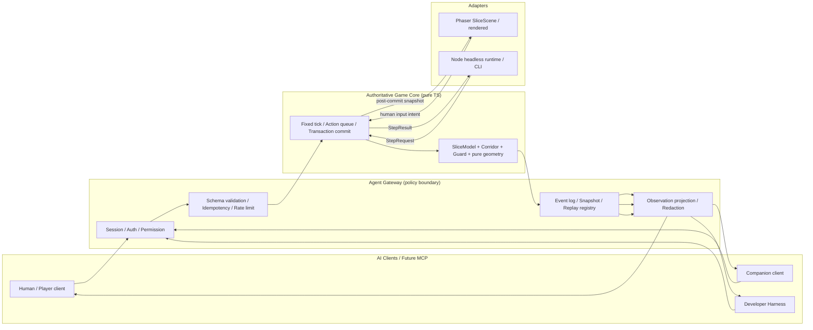

# AI-NATIVE-01 P0 — AI-Native 架构契约

> 状态：**P0 技术契约，供 Leader 验收后由 Developer 实现**。本文不是产品/世界观批准，不冻结剧情、ECHO 身份、数值平衡或关卡布局。
> 范围：同一纯 TypeScript 权威核心支持 `Phaser` 渲染端与 `Node` 无头端，并给 `PLAYER` / `COMPANION` / `DEVELOPER` 三类主体提供统一结构接口。
> 开发授权：AI-NATIVE-01 已正式授权编码/测试；历史文档里的「未授权实现」只描述当时状态，不覆盖本次授权。
> 基线：分支 `feat/ai-native-runtime`，本任务分支 `HEAD` 与 `origin/main` 均为 `c656f788227f44efec993315bfb65a323e398377`；ALIGN-01 报告中的本地 `main` `d85784d` 是历史快照，不把历史本地 HEAD 当当前基线。
> 本 Worker 只写本文、`docs/AI_NATIVE_PROTOCOL.md`、`docs/AI_NATIVE_PERMISSION_MODEL.md`；不写 `src/`，不切分支，不提交，不改旧存档 key/版本。

---

## 0. P0 收敛口径（Leader 裁决）

本节为三份契约的共同收敛口径，优先级高于正文里任何早期措辞：

- `actorId` 保持不透明，角色只由不可变 `actorRegistry` 绑定；`pause` / `resume` 接受为 `SessionCommandV1`，仍按权限矩阵由人类 UI / Gateway / Dev test 调用，PLAYER Agent / COMPANION 不得自行暂停或恢复。
- `SnapshotV1` / `ReplayV1` 是**服务端私有存储格式**，可承载内部生产状态用于服务端内部恢复；绝不作为 `PLAYER` / `COMPANION` 响应。仅 `DEVELOPER` + `kind:"test"` 可导出原始帧，不允许删去 `dev` 段后给 Player。Player 恢复走服务端内部路径，本轮不新增公开恢复凭据接口。
- `ObservationEvidenceV1` 统一带 `protocolVersion: 1`。
- P0 只交付类型、常量、schema 校验、canonical JSON、hash 字符串形状与纯比较；真实 tick 推进、幂等缓存、事件日志、restore / replay 执行留 P1–P3。文档中的运行时契约是后续实现边界，不代表 P0 已实现运行时。
- 不新增运行时或能力，不改旧存档 key/版本，不 commit、不切分支。
- P0 实现/验收范围以 `docs/AI_NATIVE_PROTOCOL.md` §0.1 实现状态表为准；对照当前 `src/ai-native/protocol.ts` / `protocol.test.ts`，未实现握手/AuthContext/devTicket/Gateway 命令、refs、audience/hash projection、新 guard、summary 投影及真实运行时统一列 P1–P3 计划，不冒充现状。

---

## 1. 事实基线与证据边界

### 1.1 真实源码事实

| 事实 | 源码依据 | P0 含义 |
| --- | --- | --- |
| Station Zero 已有纯 TS 规则模型，无 Phaser/DOM 依赖 | `src/slice/rules.ts` 的 `SliceModel`；`src/slice/corridor.ts`、`corridorGuard.ts`、`room.ts`、`corridorRoom.ts`、`tuning.ts` | 权威核心必须复用并适配这些模块，禁止另写一套门/桥/感知规则 |
| `SliceModel.step(deltaMs, onTick)` 固定 60Hz 累加器，`MAX_FRAME_DELTA_MS=250`、`MAX_TICKS_PER_FRAME=15` | `src/slice/rules.ts`、`src/slice/tuning.ts` | 渲染端沿用；无头端用显式逻辑 tick 调用等价单步，不用墙钟 `deltaMs` 推进 |
| 实验室与走廊的「移动 vs 到期/提交」顺序不同 | `SliceModel.tickOnce()`：实验室先 `onTick()` 再 `tickIndex++`/计时器/门求解；走廊先 `tickIndex++`/计时器/`Corridor.advance()`，未救援且未失败才 `onTick()` | 固定 tick 顺序必须保留现有房间相关顺序，不能用抽象 P0–P7 覆盖源码事实 |
| `SliceModel.snapshot()` 是完整内部读数，包含 `manualOpenIntent`、`sealSourcePresent`、`pendingSafeClose`、`occupancy`、`reveal*` 等 | `src/slice/rules.ts` | **绝不能**把它当 Observation DTO 直接外发；必须做白名单投影 |
| 实验室扫描证据未持久化，`restore()` 按新位置重算 `revealDoorReceiver/revealSealSource` | `SliceModel.serialize()` 与 `restore()`；`ALIGN-01` 观察契约报告 | 即 R9 观察证据缺陷；恢复时不得重新扫描或凭空补全证据 |
| 走廊 `CorridorCheckpoint.reveal` 已持久化，但仍是布尔集合，缺观察时刻/目标/关系语义 | `src/slice/corridor.ts` | 统一为 `ObservationEvidenceV1`，不能继续把实验室与走廊做成两套证据语义 |
| 原型存档自有 key `last_signal_station_zero_vs00_v1`，`schema` 同名，`version=1`；坏档锁写 | `src/slice/storage.ts` | P0 不改旧 key/schema/version；AI-Native 快照是独立导出信封，不写浏览器 localStorage |
| 主档 `SAVE_VERSION=2`、key `last_signal_save_v1`；死亡 `finishRun` 清 run，新开局从 R0；退出/刷新才走最近安全点 | `src/types/index.ts`、`src/systems/SaveSystem.ts`、`src/world/World.ts`、`docs/GDD_03_TEST_SPEC.md` | **死亡 ≠ checkpoint 恢复**；AI-Native `reset` 必须开新 run/epoch，不得把死亡态恢复成续局 |
| 主 `World` 变长 `dt`、直接读 `Player`、仍有 `Math.random()` | `src/world/World.ts`、`src/entities/*`、`src/scenes/*`、`docs/ARCHITECTURE_DECISIONS.md` ADR-08 | 主 World 非完全确定性；P0 只声明 Station Zero 规则核心可重放，不宣称全游戏逐帧确定性 |
| 当前仓库尚无 `src/ai-native/` 或 MCP/Bridge 运行代码 | 仓库文件清单；`docs/AGENT_BRIDGE_ARCHITECTURE.md` 为历史设计 | `src/ai-native/protocol.ts` 是 Developer 的 P0 实现目标；本 Worker 不写代码 |

### 1.2 ALIGN-01 六报告的证据更正

Lead 初始派工说明「仓库内未找到 ALIGN-01 六报告」。本 Worker 在仓库外只读发现：

```text
D:/Project/ALIGN-01-20261112/docs/ALIGN_01_ARCHITECTURE_DECISION.md
D:/Project/ALIGN-01-20261112/docs/ALIGN_01_FINAL_REPORT.md
D:/Project/ALIGN-01-20261112/docs/ALIGN_01_GAMEPLAY_VALIDATION.md
D:/Project/ALIGN-01-20261112/docs/ALIGN_01_OBSERVATION_CONTRACT.md
D:/Project/ALIGN-01-20261112/docs/ALIGN_01_TEST_RELIABILITY.md
D:/Project/ALIGN-01-20261112/docs/ALIGN_01_UI_FINDINGS.md
```

六份已逐份阅读。本文引用其中的 R9 复现、12 类观察回归建议、方案 A 架构建议与「文档验收 ≠ 人类理解验收」结论，均注明为仓库外审计证据，不冒充仓库内已实现功能，也不把其 PROPOSED 推荐冒充已批准 ADR。注意：本文所说 **R9** 指 ALIGN-01 的观察证据缺陷，不是 `docs/PROJECT_ROADMAP.md` 里「4 把武器 / 12 项升级差异不明显」的同名编号。`ALIGN_01_FINAL_REPORT.md` §B 记录当时本地 `main` 为 `d85784d`、远端 `main` 为 `c656f78`；本任务分支从最新 `origin/main` 创建，二者不冲突。

---

## 2. 目标、非目标与硬边界

### 2.1 P0 目标

1. 冻结 DTO schema v1、ID 语义、tick 顺序、校验错误顺序、事件排序、观察白名单/历史证据、权限与 session 生命周期、取消超时、snapshot/replay 兼容、资源限制。
2. 让 Developer 能在 `src/ai-native/protocol.ts` 写**纯 TS、无 Phaser/DOM/Node 运行时依赖**的类型与 schema 校验，并配最小可运行测试。
3. 为 P1 无头核心、P2 观察/动作/session、P3 MCP/Dev Harness 提供单一权威契约。

阶段编号说明：本文 `P0`/`P1`/`P2`/`P3`/`P4`/`P5` 指 AI-NATIVE-01 工作包；RER §7 的 `P0–P7` 是单个逻辑 tick 内部阶段；GDB / VS 文档的 `P0–P5` 是历史开发阶段。三者不得混用。

### 2.2 非目标

- 不改世界观、主 `World`、旧存档 key/版本，不删测试。
- 不复制 `SliceModel` / `Corridor` 玩法；不在 P0 实现 MCP Server、WebSocket、真实 LLM、ECHO 人格或完整主战斗迁移。
- 不把旧 `AGENT_BRIDGE_ARCHITECTURE.md` 的严格 6 `observe_*` / 9 `action_*` 工具名当作本轮已实现接口；那是历史候选。P0 定义类型化 DTO/命令，未来 MCP 工具映射另定。
- 不宣称主 World 全确定；速度各向异性、变长 `dt`、`Math.random()` 仍为已记录风险。
- ECHO/COMPANION 在 P0 只保留角色与权限位；后续若做双 Actor，也只允许**隔离的最小测试场景**，不定身份、记忆真相或世界观。

---

## 3. 分层架构与状态所有权



| 状态/能力 | 唯一所有者 | 禁止事项 |
| --- | --- | --- |
| 权威玩法状态、碰撞、Energy、Scan/Jam/门/Relay/桥/Guard、完成/失败 | 纯 TS 核心，复用 `SliceModel` / `Corridor` | Phaser Scene、Node CLI、MCP、LLM 不得直写内部字段；不得复制规则 |
| `sessionId`、`epoch`、`runId`、actor 注册表、权限集、幂等缓存、速率计数 | Agent Gateway / Session Manager | 不得用全局可变单例保存；不得由 Action 参数覆盖 |
| 有序事件日志、snapshot/replay 信封、证据数组 | Gateway 持久化层 + 核心提交出口 | 事件顺序不得由订阅者/回调注册顺序决定 |
| Observation DTO | Gateway 白名单投影层 | 不得 `JSON.stringify(scene/world/model)`；不得返回 `SliceSnapshot` 原对象 |
| 人类输入、渲染、音频 | Phaser 适配层 | 不得把 `window.__game` 暴露给 AI；不得让 Agent 直接操作 Phaser 对象 |
| 无头逐 tick、批量、回放执行 | Node 适配层 | 不得伪造 DOM/Canvas 跑 Phaser Scene；不得用墙钟补 tick |
| seed / RNG state / Dev fixture / 全图 / 存档内部字段 | 仅 `DEVELOPER` + `kind:"test"` 会话的私有调试域 | 对 `PLAYER` / `COMPANION` 的观察、错误、事件及 `SnapshotV1` / `ReplayV1` 独立帧一律不得出现；独立帧本身仅 Dev/test 导出 |

`src/ai-native/protocol.ts` 位于 Core 与 Gateway 的共享契约边界，**只导出类型、常量、纯校验/规范化函数**；不 import `phaser`，不触碰 `localStorage`，不读 `Date.now()`/`performance.now()`，不持有 Session 实例。

---

## 4. 权威核心如何复用现有规则

### 4.1 单一规则源

P1 无头运行时应通过 adapter 调用现有 `SliceModel` 的公开动作入口：`scan()`、`jam(target)`、`interact()`、`shootGuard()`、`setPlayerPos()`、`canStand()`、`setPaused()`、`reset()`、`serialize()`，以及 `step(TICK_MS, onTick)` 的固定单步等价物。`Corridor` / `CorridorGuard` / `room.ts` / `corridorRoom.ts` 继续作为权威依赖，不迁移成第二套实现。

`enterCorridor()` / `markPassed()` 是 adapter 依据权威位置/房间条件触发的内部转移，不是 Player/Companion 可直接调用的 Action；`setSealSourcePresent()` 是领域测试 hook，只能由 `DEVELOPER` 的 `inject_fixture` 在 test 会话调用。`interact()` 本身无 target 参数，adapter 按当前 `roomId` 选择实验室或走廊分支；协议 DTO 的 `targetId` 只做房间与授权可见性校验。

`SliceScene` 的 W/A/S/D 到 `wx/wy` 方向映射、轴分离 `canStand` 碰撞、`SLICE.MOVE_SPEED` 是 Station Zero 当前规则；无头 `move` 动作只提交方向向量与持续 tick，由 adapter 走同一 `canStand` / `setPlayerPos`，**不传送、不写坐标、不绕碰撞**。主 `World` 的屏幕→网格各向异性速度不得用 `SLICE.MOVE_SPEED` 代替。

### 4.2 固定 tick 与房间相关顺序

- `TICK_HZ=60`、`TICK_MS=1000/60`、`MAX_FRAME_DELTA_MS=250`、`MAX_TICKS_PER_FRAME=15` 来自 `src/slice/tuning.ts`，仅作为渲染帧上限。
- 无头 `step` 用显式 `ticks` 逐 tick 推进：每次等价于 `SliceModel.step(SLICE.TICK_MS, onTick)` 一次；禁止用 `Date.now()` 或离线墙钟补帧。
- 实验室顺序：`onTick` 移动（用上一提交态的 `doorPassable`）→ `tickIndex++` → Energy/冷却/TTL/Jam 到期 → 占位/安全延迟 → `solveDoor()`。
- 走廊顺序：`tickIndex++` → Energy/冷却/TTL → `Corridor.advance()` 按上一位置解析桥/Relay/Guard 与救援 → 未救援且未失败才 `onTick` 移动（用本次提交后的 `bridgePassable`）。
- 动作提交在目标 tick 的预提交阶段完成；结果、事件与观察均标记为**提交后 tick**。完整阶段表见 `docs/AI_NATIVE_PROTOCOL.md` §7。

### 4.3 观察不是内部状态

`SliceModel.snapshot()`、`CorridorSnapshot`、`GuardSnapshot`、`PersistedSliceState` 都是内部读数。Gateway 必须先构造白名单 DTO，再跑出参 schema；出参校验失败时**丢弃并返回脱敏错误**，绝不降级为原样发送。隐藏字段黑名单、两档普通 detail（`summary|standard`）与独立 `DebugInspectionV1`、历史证据结构见协议文档。

### 4.4 R9：观察证据的事务边界

ALIGN-01 已复现：实验室 `serialize()` 不存扫描集合，`restore()` 用当前位置/LOS 重算，导致「保存前只看到源，刷新后凭空看到接收器/连接」。这对未来 ECHO/AI 决策是污染：

1. Scan 成功才在同一事务里扣费、采样、写 `ObservationEvidenceV1`；空扫合法扣费但证据为空；非法零扣费且无证据。
2. 证据绑定 `sceneEpoch`、`roomId`、`observerPosition`、`targetId`/`relationId`、`observedAtTick`、`expiresAtTick`、白名单 `observedState`、`source`。
3. 保存时证据与位置/效果/tick 同一原子快照；恢复只校验并还原，**绝不调用 scan/LOS 创造新证据**。
4. `tick >= expiresAtTick` 只从活动叠层清理；暂停冻结 tick；旧证据带时间标签，不能当当前事实，也不能因隐藏设备变化而静默更新。
5. 旧 `last_signal_station_zero_vs00_v1` 档没有证据字段：迁移时清空活动证据并提示「旧版观察不可恢复，请重新扫描」，默认不补能量、不猜坐标、不自动重扫；是否补偿扫描消耗属于所有者待决项，P0 不冻结。
6. 假设、确认知识、当前可见、历史事件必须分层；假设不得自动升格 Canonical。
7. `SliceModel.restore()` 当前用距离/LOS 重算的 `revealDoorReceiver` / `revealSealSource` 不是证据真值；adapter 必须只从 `SnapshotV1.observationEvidence` 还原，并忽略/清零模型重算标志。`SliceModel.snapshot().reveal.link` 是端点布尔推导，不得直接当 `relationId` 或 `knownConnections` 证据；关系白名单 ADR 前只允许显式授权的关系采样。
8. R9 正式修复若改 `PersistedSliceState` 形状，必须同步 `src/slice/storage.ts:isPersistedSliceState` 校验器与坏档锁写测试，不能只改模型 reader/writer。

这是 **P2 / ECHO 观察记忆的前置阻断**，不是 P0 文档交付的阻断；P0 必须先冻结该契约。

---

## 5. 权限、Session 与 Dev 隔离摘要

- 角色只有 `PLAYER` / `COMPANION` / `DEVELOPER`；`actorId` 是不透明 ID，角色由不可变 `actorRegistry` 绑定，**不得从 ID 前缀推断角色**。
- `session.kind` 只有 `production` / `test`，创建后不可变；`DEVELOPER` 只能出现在 `kind:"test"` 的独立会话。`mode:"headless"` 不等于 Dev 权限。
- `seed` / `fixture` / `debug` / `inspect_state` / `inject_fixture` / `snapshot` / `restore` / `replay` 命令、`SnapshotV1` / `ReplayV1` 独立帧及完整内部状态只在 `DEVELOPER` + `kind:"test"` 会话可见；`SnapshotV1.state` 含内部字段，不能当 Player 响应。浏览器退出/刷新恢复最近安全点是 Gateway/适配层内部状态路径，不导出 `SnapshotV1`，也不是 AI 可调的 `restore` 命令。`AuthContext` 由已认证通道派生，请求体 `actorId` 只做一致性比对；Dev/test 会话创建只能走带外 `devTicket` 的 Gateway 内部命令，生产会话的任何参数都不能把权限升级成 Dev。
- `COMPANION` 在 P0 单 Actor Station Zero 场景里没有世界写入动作，只能按授权共享域观察；后续双 Actor 只在隔离最小测试场景里由显式 actor 注册表授予动作，不定义 ECHO 身份/世界观。
- 人类接管、暂停/恢复、不可逆选择、模式切换、存档覆盖保持人类最高优先级；`YIELDED` 只由人类 takeover 产生，不自动回切。

完整矩阵、生命周期、取消/超时与资源限制见 `docs/AI_NATIVE_PERMISSION_MODEL.md`。

---

## 6. Snapshot / Replay / 兼容性摘要

| 对象 | schema | 兼容性 |
| --- | --- | --- |
| DTO/信封 | `last_signal.ai-native.envelope.v1` / `dto.v1` | `protocolVersion===1`，封闭对象，未知字段拒绝，不协商降级 |
| Observation | `last_signal.ai-native.observation.v1` | 白名单出参 + 隐藏字段黑名单；`debug` 单独返回 `DebugInspectionV1` |
| Snapshot | `last_signal.ai-native.snapshot.v1` | 服务端私有存储格式；外部导出仅 Dev/test；不写 `last_signal_station_zero_vs00_v1` / `last_signal_save_v1`，不改 `SAVE_VERSION=2` |
| Replay | `last_signal.ai-native.replay.v1` | 服务端私有存储格式；外部导出仅 Dev/test；精确匹配 `protocolVersion` + `kernelVersion` + snapshot hash；跨 session/kind 拒绝 |
| Event | `last_signal.ai-native.event.v1` | 稳定 `(tick, phase, ordinal, actorId ?? '', eventId)` 全序 |

确定性承诺只覆盖：`station-zero-r1-r2` 纯规则核心 + 同一初始 snapshot + 同一有序动作序列 + 同一 `kernelVersion` → 同一最终状态 hash 与有序事件 hash。主 World、渲染帧调度、墙钟、外部 LLM 不在此承诺内。Player/Companion 不导出 `ReplayV1`；Dev replay 的 seed 只存在 `dev` 私有段与审计日志。

---

## 7. 架构复核结论

### 7.1 阻断项（发现即停并回报）

| ID | 级别 | 问题 | 判据 |
| --- | --- | --- | --- |
| A-B1 | **P0 实现阻断** | 直接把 `SliceModel.snapshot()` / `CorridorSnapshot` / `PersistedSliceState` 或 `window.__game` 当 Observation 返回 | 出现 `seed`/RNG/隐藏图/内部计时/存档字段/Phaser 对象即阻断 |
| A-B2 | **P0 实现阻断** | `DEVELOPER` 出现在 `production` 会话、外部请求可创建 `kind:"test"`、或 `actorId` 未与 `AuthContext` 绑定而可冒充别的 actor | 任意参数可改 `session.kind`、绕过 `devTicket`、读到 Dev fixture 或冒充 `DEVELOPER` 即阻断 |
| A-B3 | **P2/ECHO 阻断** | R9 未修就让观察证据参与 AI/ECHO 决策，或 adapter 把 `SliceModel.restore()` 重算的 reveal 标志当证据 | restore 后出现未由合法 Scan 产生的证据，或 `snapshot().reveal.link` 被直接当关系证据即阻断 |
| A-B4 | **全局阻断** | 多 session 状态污染、死亡被当 checkpoint 续局、旧档被覆写、重大回归、hidden info 泄漏 | 任一发生立即报告并停止对应阶段 |

### 7.2 非阻断但必须保留的风险/事实

| ID | 说明 |
| --- | --- |
| A-N1 | ALIGN-01 六报告在仓库外找到；本文只引用其可核对结论，不编造仓库内文件，也不把 PROPOSED 当批准 |
| A-N2 | 旧技术文档的「未授权实现」是历史快照；本次正式研发授权已取代该实现限制，但产品待定项仍不得擅定 |
| A-N3 | 主 World 变长 `dt`、`Math.random()`、Player 直读、速度各向异性仍在；不宣称全游戏确定性，P0 只覆盖 Station Zero 纯规则 |
| A-N4 | `src/ai-native/protocol.ts` 当前不存在；由 Developer 实现，本 Worker 未写代码 |
| A-N5 | 旧 6/9 Bridge 工具名、`TBD — Requires User Decision` 数值、端口、MCP 进程细节仍是历史候选；P0 不擅自冻结产品/端口/日期 |
| A-N6 | ECHO 身份、最终真相、记忆持久化范围、结局等 GDB 第 19 章问题保持未决；P5 只做隔离最小双 Actor 测试场景 |
| A-N7 | R10 HUD 重叠、人类理解验收、完整 World 融合仍为 ALIGN-01 的待修/待验项，不因 P0 契约交付而关闭 |
| A-N8 | ALIGN-01 最终报告为 `PENDING HUMAN VALIDATION`，并建议暂缓 Agent Bridge / ECHO / Decoy、观察持久化 ADR 待批；本次 AI-NATIVE-01 正式授权是否覆盖这些后续范围须由 Lead 确认。报告中的历史本地 `main` `d85784d` 与本任务 `origin/main` `c656f788227f44efec993315bfb65a323e398377` 不冲突。P0 只冻结技术契约，不代替所有者签核；旧档迁移是否补偿扫描消耗同样待决。 |

---

## 8. P0 验收映射

| 契约点 | 落点 |
| --- | --- |
| DTO schema v1 / 版本 | `docs/AI_NATIVE_PROTOCOL.md` §1、§3、§4、§5 |
| `actionId` / `actorId` | 协议 §2.1（`AuthContext`）、§4；一致性闸门 §6.1 阶段 6；Dev/test 创建 §3.2 |
| 固定 tick 顺序 | 协议 §7 |
| 校验错误顺序 | 协议 §6 |
| 事件排序 | 协议 §8 |
| 观察白名单 / 历史证据 | 协议 §5、§5.4 |
| 权限与 session 生命周期 | `docs/AI_NATIVE_PERMISSION_MODEL.md` |
| 取消 / 超时 | 协议 §10、权限文档 §5 |
| snapshot/replay 兼容 | 协议 §9 |
| 资源限制 | 协议 §11、权限文档 §6 |
| Developer 实现目标 | `src/ai-native/protocol.ts`，纯 TS 类型 + schema 校验 + 最小测试 |
