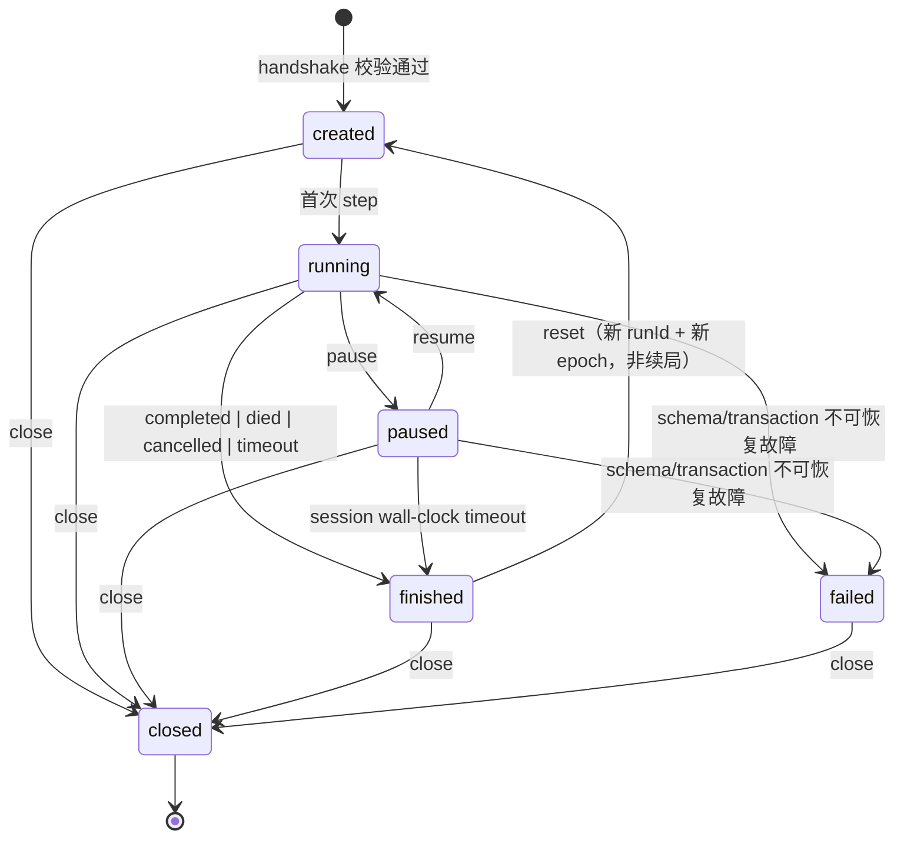

# AI-NATIVE-01 P0 — 权限与 Session 生命周期模型

> 状态：**P0 技术契约**，与 `docs/AI_NATIVE_PROTOCOL.md` 的 DTO schema v1 配套。
> 目标：同一权威核心上隔离 `PLAYER` / `COMPANION` / `DEVELOPER`，保证普通 AI Player 与未来 ECHO 不读隐藏信息、不调用开发能力，且正式玩家会话不能通过任何参数升级为 Dev。
> 本文不定义 ECHO 身份、记忆真相、剧情立场或世界观；只定义权限边界。
> 实现落点：`src/ai-native/protocol.ts` 的类型/校验由 Developer 实现，Gateway/Session Manager 负责策略执行。Architecture Worker 不写源码。

---

## 0. P0 收敛口径（Leader 裁决）

本节为三份契约的共同收敛口径，优先级高于正文里任何早期措辞：

- `actorId` 保持不透明，角色只由不可变 `actorRegistry` 绑定；`pause` / `resume` 接受为 `SessionCommandV1`，仍按权限矩阵由人类 UI / Gateway / Dev test 调用，PLAYER Agent / COMPANION 不得自行暂停或恢复。
- `SnapshotV1` / `ReplayV1` 是**服务端私有存储格式**，可承载内部生产状态用于服务端内部恢复；绝不作为 `PLAYER` / `COMPANION` 响应。仅 `DEVELOPER` + `kind:"test"` 可导出原始帧，不允许删去 `dev` 段后给 Player。Player 恢复走服务端内部路径，本轮不新增公开恢复凭据接口。
- `ObservationEvidenceV1` 统一带 `protocolVersion: 1`。
- P0 只交付类型、常量、schema 校验、canonical JSON、hash 字符串形状与纯比较；真实 tick 推进、幂等缓存、事件日志、restore / replay 执行留 P1–P3。文档中的运行时契约是后续实现边界，不代表 P0 已实现运行时。
- 不新增运行时或能力，不改旧存档 key/版本，不 commit、不切分支。
- P0 实现/验收范围以 `docs/AI_NATIVE_PROTOCOL.md` §0.1 实现状态表为准；对照当前 `src/ai-native/protocol.ts` / `protocol.test.ts`，未实现握手/AuthContext/devTicket/Gateway 命令、refs、audience/hash projection、新 guard、summary 投影及真实运行时统一列 P1–P3 计划，真实 Gateway 强制授权不降级。

---

## 1. 三角色与不可变绑定

| 角色 | 合法 session.kind | 观察域 | 世界动作 | 会话/Dev 命令 | 典型用途 |
| --- | --- | --- | --- | --- | --- |
| `PLAYER` | `production` 或 `test` | `self`：玩家合法可见信息 + 授权 Scan 证据 | P0 DTO 定义的合法玩家动作：`move/scan/jam/interact/shoot_guard/wait`；`move`/`wait` 是 adapter 级持续意图，不是现有 `SliceModel` 方法；`aim/fire/decoy` 在 `station-zero-r1-r2` 返回 `E_NOT_APPLICABLE` | 仅 `observe`、`get_events`、取消自己动作；不可 pause/resume/reset/close/snapshot/restore/replay/debug；浏览器退出/刷新恢复是 Gateway 内部路径，不是 AI 命令 | 人类或 AI Player 独立合法游玩 |
| `COMPANION` | `production` 或 `test` | `shared`：ECHO 自身与经授权共享的观察子集；P0 不拿完整玩家视野 | P0 单 Actor Station Zero 场景**无世界写动作**；后续双 Actor 测试场景由 `actorRegistry.allowedActions` 显式授予 | 仅 `observe`、`get_events`；不可 Dev/会话控制 | 未来 ECHO 第二 Actor 的最小隔离闭环 |
| `DEVELOPER` | **仅 `test`** | `debug`：完整内部状态、seed/RNG、fixture、全图、原始事件；仅显式 `inspect_state` 返回 | 不通过 `ActionRequest` 直接改世界；只能通过 `inject_fixture` 在 test 会话内标记注入 | 会话由 Gateway 内部 `create_test_session` + 带外 `devTicket` 创建；之后可 `step/inspect_state/inject_fixture/get_events/snapshot/restore/replay/close`，不调用 `observe` | 后台测试、故障复现、批量回放 |

硬规则：

1. `actorId` 是不透明 ID；角色、优先级、`allowedActions`、`observationScope` 只在创建会话时由 Gateway 写入不可变 `actorRegistry`。`AuthContextV1` 从已认证通道派生，请求体 `actorId` 只与 `principalActorId` 做一致性比对，不符即 `E_PERMISSION`；不得冒充同一 registry 内其他 actor。
2. `role` / `permission` / `asActor` / `impersonate` / `kind` / `debug` / `test` / `seed` / `fixture` 等**字段名**若出现在 `ActionRequestV1` / `StepRequestV1` / `SessionCommandV1` / `ObserveRequestV1` / `GetEventsRequestV1` / `CancelActionRequestV1` 等普通请求体，都是未知字段，必须 `E_SCHEMA` 拒绝；不禁止 `observationDetail` / `detail` 的合法字面量 `'debug'`，该字面量在阶段 6 统一处理。
3. `session.kind` 创建后不可变；`mode:"headless"` 只表示运行形态，**不是权限等级**。无头 AI Player 仍是 `kind:"production"` + `role:"PLAYER"`。
4. `DEVELOPER` 不得出现在 `kind:"production"`。外部 `CreatePlayerSessionRequestV1` 固定创建 production，且不得带 `kind` / `role` / `seed` / `fixtureRef` / `DEVELOPER` / `devTicket`；test 会话只能由 Gateway 内部 `create_test_session` 命令凭带外短期 `devTicket` 创建。任何参数升级路径都返回 `E_PERMISSION` / `E_SCHEMA`。
5. `actorRegistry.priority` 固定 `PLAYER=0`、`COMPANION=1`、`DEVELOPER=2`，用于同 tick 动作排序；不得由客户端调整，不得从 `actorId` 前缀推导。
6. `PLAYER` / `COMPANION` 的观察、错误、事件、StepResult 一律不得出现：`seed` / `rngState` / `RNG.state` / `bestSeed` / 隐藏全图 / 未探索房间 / 未来阶段 / `SaveData.*` / Dev fixture / `window.__game` / `SliceSnapshot` 内部字段；二者不导出 `ReplayV1`，授权轨迹只经 `get_events` 分页。完整黑名单见协议 §5.3。
7. 本文 `P3` / `P4` / `P5` 等均指 AI-NATIVE-01 工作包；RER §7 的 `P0–P7` 是单 tick 内部阶段，GDB / VS 文档的 `P0–P5` 是历史开发阶段，三者不得混用。

---

## 2. Session 隔离与命名空间

每个 Session 独占以下状态，禁止全局可变单例共享：

| 隔离项 | 说明 |
| --- | --- |
| `sessionId` | Gateway 生成的 `ses_<24hex>`；生命周期内稳定，关闭后不可复用 |
| `kind` / `mode` / `status` / `actorRegistry` | 创建时固定或由状态机迁移；不可由请求参数改写 |
| `epoch` / `runId` / `tick` | `reset`、新 run、显式 `restore` 都产生新 `epoch`，旧 `actionId` / `clientSeq` 失效 |
| GameState | 纯 TS 核心实例；不得跨 session 引用同一可变对象 |
| RNG / seed | Station Zero v1 玩法 RNG 为 `null`；未来若启用，seed 只存在 test/Dev 私有域，且每 session 独立 |
| Event log / `eventSeq` / `eventCursor` | 按 session/epoch 分段；`get_events` 只返回本 session 授权事件 |
| Observation evidence | 按 `sceneEpoch + roomId + actorId` 隔离；不同 session 不共享证据数组引用 |
| Idempotency cache / rate-limit counters | 按 `(sessionId, epoch, actorId)` 分段；关闭/重置即清理 |
| Snapshot / Replay namespace | 内存/导出命名空间 `ai-native/<sessionId>/<epoch>`；不写 `last_signal_station_zero_vs00_v1` / `last_signal_save_v1` |
| Permission set / fixture log | 从 `actorRegistry` 派生；Dev fixture 只记入 test 会话审计 |

跨 session 的 `restore` / `replay` / `actionId` / `actorId` 一律拒绝：不同 `sessionId` 或不同 `kind` 的 snapshot/replay 返回 `E_REPLAY_INCOMPATIBLE` / `E_SNAPSHOT_INVALID`，不尝试迁移权限。

---

## 3. 生命周期状态机

| 状态 | 允许 | 禁止 |
| --- | --- | --- |
| `created` | `observe`（初始快照）、`step`、`reset`、`close`、Dev test 的 `inject_fixture`/`restore` | 恢复 `finished(died)` 快照为续局；`snapshot`（尚无运行态） |
| `running` | `step`、`observe`、`get_events`、取消自己动作、人类 takeover | 直接 `snapshot`/`restore` 到运行中会话；必须先 `pause` 并新建 epoch |
| `paused` | `resume`、`close`、`get_events`、Dev test `snapshot/restore/inspect`（`snapshot` 仅 `paused`/`finished`，`restore` 仅 `created`/`paused`） | tick/TTL/冷却/动作 deadline 推进；离线补时；`timeout` 仅指 session 墙钟/空闲上限，不是 tick 超时 |
| `finished` | `get_events`、Dev 只读 `SnapshotV1` 审计、`reset` 开新局 | 继续 step；死亡态自动恢复最近 checkpoint；Player/Companion 不导出 `SnapshotV1` |
| `closed` | 无；资源已释放 | 复用 `sessionId`、接受迟到消息 |
| `failed` | `close`、Dev 只读审计 | 静默重启或自动清档 |

### 3.1 死亡、退出、刷新与新局

- **死亡是新局**：主 World 的 `finishRun(runId,false,…)` 删除本局 run，Station Zero 走廊致命失稳进入 `failed` 且清原型档；AI-Native 核心只把状态置 `finished(died)`，不自动 `restore` 战斗/checkpoint。再玩必须显式 `reset` → 新 `runId` + 新 `epoch` + R0 初值。
- **退出/刷新恢复最近安全点**是浏览器适配层已有行为，不等于 `reset`、不等于死亡续局，也不允许 AI 用 `restore` 绕过。Player 恢复统一走服务端内部路径，本轮不新增公开恢复凭据接口；`SnapshotV1` / `ReplayV1` 私有帧可作为服务端内部恢复载体，但不作为 Player/Companion 响应。
- `reset` 清临时效果、冷却、regen 余数、活动证据、幂等缓存、在途动作；保留 session 级审计日志但用新 `epoch` 分段，旧事件仍可由 Dev 按 epoch 过滤。
- `finished(completed)` 可 `reset` 开新局，但不得把完成态 snapshot 当 `active` 恢复继续操作。
- 所有墙钟/空闲超时先取消在途动作、置 `finished(timeout)`，再自动 `close` 释放资源；`finished` 是逻辑终态，`closed` 是资源终态，顺序固定，不是二选一。

### 3.2 命令权限矩阵

| 命令 | PLAYER | COMPANION | DEVELOPER | 备注 |
| --- | --- | --- | --- | --- |
| `create_session` | `CreatePlayerSessionRequestV1` 固定 production | 由 Gateway 在同一 production 会话内创建 | 仅 Gateway 内部 `create_test_session` + `devTicket` | 外部不指定 `sessionId`/`actorId`/`kind`/`role`/`seed`/`fixtureRef` |
| `step` | 自己会话 | 不允许推进世界 | test 会话 | 无头 Player 可 step，但动作仍受 Player 权限 |
| `observe` | `summary/standard` | `summary/standard` 共享域 | 否；仅 `inspect_state` 返回 `DebugInspectionV1` | `ObserveRequestV1.detail` / `StepRequestV1.observationDetail` 的 `debug` 字面量通过封闭 schema，阶段 6 一律 `E_PERMISSION` + `USE_INSPECT_STATE`（含 Dev），不是 `E_SCHEMA` |
| `get_events` | 授权事件 | 授权共享事件 | 全事件 + dev-audit | 分页/上限见协议 §11 |
| `pause` / `resume` | 人类 UI / Gateway | 否 | test 会话 | Leader 裁决：作为 `SessionCommandV1` 接受；调用者仍限人类 UI / Gateway / Dev test，PLAYER Agent / COMPANION 不得自行暂停或恢复 |
| `reset` / `close` | 人类 UI / Gateway | 否 | test 会话 | 关闭释放全部资源 |
| `cancel_action` | 仅自己 actionId | 仅自己 actionId | test 会话内可取消 | 终态幂等 |
| `snapshot` | 否；生产刷新恢复走 Gateway 内部状态，不导出 `SnapshotV1` | 否 | 仅 test + `DEVELOPER`，状态 `paused`/`finished` | `SnapshotV1` 仅 Dev/test 可见，含内部字段，不能当 Player 响应；违规状态 `E_PERMISSION` + `INVALID_SESSION_STATE` |
| `restore` | 否；浏览器退出/刷新恢复是 Gateway/适配层内部路径，非 AI 命令 | 否 | 仅 test + `created`/`paused` + `DEVELOPER` | 新 epoch；死亡态拒绝续局；控制命令只带 `SnapshotRefV1`（hash/ref/requestId）；`running` 必须先 pause |
| `replay` | 否；授权轨迹只经 `get_events` 分页 | 否 | 仅 test + `DEVELOPER` | Player/Companion 不导出 `ReplayV1`；跨 session/kind 拒绝 |
| `inspect_state` | 否 | 否 | 仅 test | 返回 `DebugInspectionV1` |
| `inject_fixture` | 否 | 否 | 仅 test | 必须写 `DEV_FIXTURE_INJECTED` 审计 |
| `run_scenario` / `run_batch` / `compare_runs` | 否 | 否 | P3+ test | 与 Player 通关证据分开统计 |

---

## 4. Dev / Test 会话隔离

`DEVELOPER` 权限仅存在于**独立、显式标记**的 `kind:"test"` session：

1. test 会话只能由 Gateway 内部 `create_test_session` 命令创建：固定 `kind:'test'`、actorSpec 含 `DEVELOPER`、带外短期 `devTicket` 校验通过。外部 `CreatePlayerSessionRequestV1` 没有通向 `kind:'test'` 或 `DEVELOPER` 的字段，`production` 路径不存在「传参打开 Dev」的分支。
2. `seed` / `fixtureRef` 只能出现在该创建请求；`ActionRequestV1` / `StepRequestV1` 永不允许携带。Dev fixture 注入必须走独立 `inject_fixture` 命令，标记 `fixtureId`、`actorId`、`tick`、`targetId` 并进入 dev-audit 事件。
3. Dev 可读完整内部状态、RNG/seed、全图、原始事件、碰撞结果、Guard 决策；这些字段只能出现在 `DebugInspectionV1`、`SnapshotV1` / `ReplayV1` 独立帧或 test 会话私有审计，不得混入 `ObservationV1` / `ErrorV1` / 任何 Player/Companion 可见响应。
4. `SnapshotV1` / `ReplayV1` 是服务端私有存储格式，可承载内部生产状态用于服务端内部恢复；其 `dev` 段和原始帧只保留在 test/Dev 私有域。Player/Companion 不导出这两种独立帧，任何把 `dev` 段写入非 Dev 对象、或删去 `dev` 段后给 Player 的尝试都返回 `E_PERMISSION`；不存在该导出路径。
5. Dev fixture、快进、指定 HP/Energy/门态、注入敌人等均标记为测试来源；**不得**计入 AI-NATIVE-01 P4「真实 Player 权限合法通关」证据，也不得写回生产存档。
6. Dev 工具与 Player 工具在未来 MCP Server 中分开授权；stdio `stdout` 只走协议帧，日志/审计走 `stderr`；API Key/凭据不进浏览器、不进任何外部 DTO、不进错误。`devTicket` 是带外短期本地票据，仅存在于 `gateway-internal.v1` 命令，不是 API Key 明文；校验后的不透明引用 ID 存在 `PreSessionAuthContextV1.ticketId`，`AuthContextV1` 继承该字段。
7. 一个 test session 不能把权限「继承」给 production session；`restore` 带 `sessionKind:"test"` 的 snapshot 到 `production` 返回 `E_REPLAY_INCOMPATIBLE`。

---

## 5. 人类接管、取消与超时

| 概念 | 规则 |
| --- | --- |
| 人类最高优先级 | rendered production 中任何真实人类有效输入立即覆盖同通道 Agent 意图，并发起 `takeover`；所有 pending/active Agent 动作置 `preempted`，清 intent |
| `YIELDED` | 只由人类 takeover 产生；不自动回切 Mode B/C，恢复委托必须显式新握手/让权 |
| 暂停/恢复/模式切换/不可逆选择/存档覆盖 | 人类独占；`PLAYER` Agent/`COMPANION` 不得通过参数调用 |
| `cancel_action` | 只允许取消 `pending`/`active`；终态重复取消幂等；清 intent、零资源写、发 `ACTION_CANCELLED` |
| 动作 `deadlineTick` | tick 级；`currentTick > deadlineTick` → `timeout`，清 intent；不得「按住不放」 |
| 传输请求超时 | `issuedAtMs + AI_NATIVE_LIMITS_V1.requestTimeoutMs` 只作用于 Gateway；过期 `E_ACTION_EXPIRED`，不进核心、不补时 |
| 心跳/断线 | 连续心跳丢失、WebSocket/stdio 关闭、schema 连续失败、动作连续超时 → 清 intent、在途动作 `cancelled`、降级到 Mode A Human；恢复需重新握手 |
| `pause` | 冻结 tick、Energy regen、TTL、冷却、动作 deadline；`resume` 清帧累加器，不补离线墙钟 |
| `reset` / `close` / epoch 变化 | 取消所有在途动作，清 idempotency cache 与 active intent；`close` 释放事件日志/快照引用 |

动作终态 `cancelled` / `preempted` / `timeout` 不是玩法失败；不得借此扣 Energy、改门/桥状态或生成扫描证据。

---

## 6. 资源限制与异常清理

资源上限数值与 enforcement 见协议 §11。权限层额外要求：

- `production` 会话的 `resourceLimits` 不可放宽；Dev/test 创建时只能收紧，不得超过硬上限。超限返回 `E_RATE_LIMIT` / `E_RESOURCE_LIMIT`，**不排队执行**，避免后台测试长期占满 CPU。
- 每 session 独立令牌桶；`AI_NATIVE_HARD_LIMITS_V1.maxSessions` / `maxConcurrentSteps` 由 Gateway 全局计数，关闭 session 必须释放计数。
- 事件日志、观察数组、snapshot、replay 都受字节/条数上限；截断必须显式记 `droppedEvents` / `truncatedObservation`，不得静默丢事件破坏 replay hash。
- `AI_NATIVE_LIMITS_V1.idleTimeoutMs` / `maxSessionWallMs` 到期先取消在途动作、置 `finished(timeout)`、再自动 `close`、最后释放内存；独立大帧走 `maxSnapshotFrameBytes` / `maxReplayFrameBytes`，普通控制帧与 `GatewayCreateTestSessionV1` 走 `maxPayloadBytes`。
- 任何 schema 连续失败、事务半提交、跨 session 状态污染、hidden info 泄漏、旧档覆写、重大回归都按 AI-NATIVE-01 停止条件立即报告，允许其他无依赖工作继续但不得掩盖。

---

## 7. ECHO / COMPANION 的非目标与后续门禁

- P0 不实现 ECHO 实体、记忆、台词、目标、分歧，也不定义身份或世界观。GDB 第 19 章 W-04 / A-01..A-06 / X-06 等保持未决。
- `COMPANION` 在单 Actor `station-zero-r1-r2` 场景里只是权限占位：`observationScope:'shared'`、`allowedActions:[]`；请求世界写动作返回 `E_PERMISSION`。
- 后续 AI-NATIVE-01 P5 若需要双 Actor，只允许**隔离的最小测试场景**：显式两个 `actorId`、独立观察域、独立记忆占位、合法共享事件、一次有理由的协作行为；不改主 World、不改正式关卡、不宣称完整 ECHO 玩法已完成。
- 无 LLM 时 COMPANION 可退化为确定性策略，但不得因此读取 seed/RNG/隐藏图/Dev fixture，也不得阻塞人类游戏。
- 若未来需要未批准的重大角色设计或身份真相，Leader 必须暂停该部分并提交所有者签核；本契约不代为决定。

---

## 8. 审计与不可否认性

| 审计对象 | 必须字段 | 可见范围 |
| --- | --- | --- |
| Session 生命周期 | `sessionId`, `epoch`, `kind`, `status`, `reason`, `tick` | Gateway/Dev；Player 只看授权事件 |
| Action 请求/结果 | `actionId`, `actorId`, `role`, `type`, `payloadFingerprint`, `code`, `cost`, `replayed` | Player 看自己脱敏结果；Dev 全量 |
| Permission denied | `code`, `requestId`, `actorId`, `tick`；无内部路径/值 | 对应 actor 脱敏错误；Dev 审计全量 |
| Dev fixture | `fixtureId`, `actorId`, `tick`, `targetId`, `sessionKind:'test'` | 仅 Dev/test |
| Snapshot/Restore/Replay | `snapshotId`, `epoch`, `stateHash`, `eventsHash`, `replayHash`, `kernelVersion` | Player/Companion 不导出独立帧；Dev 可关联 test 私有域 |
| Hidden redaction | `omittedFieldCount`、redaction 计数 | 不回显隐藏字段名，避免侧信道枚举 |

审计日志用 `eventSeq` 与 `eventId` 排序，不依赖墙钟；`issuedAtMs` 只作辅助时间线，不参与确定性判定。

---

## 9. 阻断判据汇总

| 级别 | 判据 |
| --- | --- |
| **P0 阻断** | `production` 出现 `DEVELOPER`；外部请求可凭参数创建 test 会话或绕过 `devTicket`；`actorId` 未绑定 `AuthContext` 而可冒充其他 actor；Player/Companion 收到 seed/RNG/隐藏图/Dev fixture/内部计时；`debug` 观察混入普通 Observation；跨 session 状态污染 |
| **P2/ECHO 阻断** | R9 观察证据在 restore 时被重扫/补全；adapter 把 `SliceModel.restore()` 重算 reveal 或 `snapshot().reveal.link` 当证据；旧观察自动升格为当前事实或 Canonical；COMPANION 读全图/存档/RNG；改 `PersistedSliceState` 形状却未同步 `src/slice/storage.ts:isPersistedSliceState` 与坏档锁写测试 |
| **运行期阻断** | Agent 直接写 Phaser/World/Player 内部对象；死亡被当 checkpoint 续局；旧存档 key/版本被改；重大测试回归；多 session 共享可变 GameState |
| **非阻断** | ALIGN-01 六报告在仓库外找到；其 `PENDING HUMAN VALIDATION`、暂缓 Agent Bridge/ECHO/Decoy、观察持久化 ADR 待批及本次授权范围需 Lead 确认；报告中的历史本地 `main` `d85784d` 与本任务 `origin/main` `c656f788227f44efec993315bfb65a323e398377` 不冲突；主 World 非完全确定性；ECHO 身份/世界观未决；旧 6/9 Bridge 工具名仍为历史候选；`aim/fire/decoy` 在 Station Zero P0 明确 `E_NOT_APPLICABLE` |
