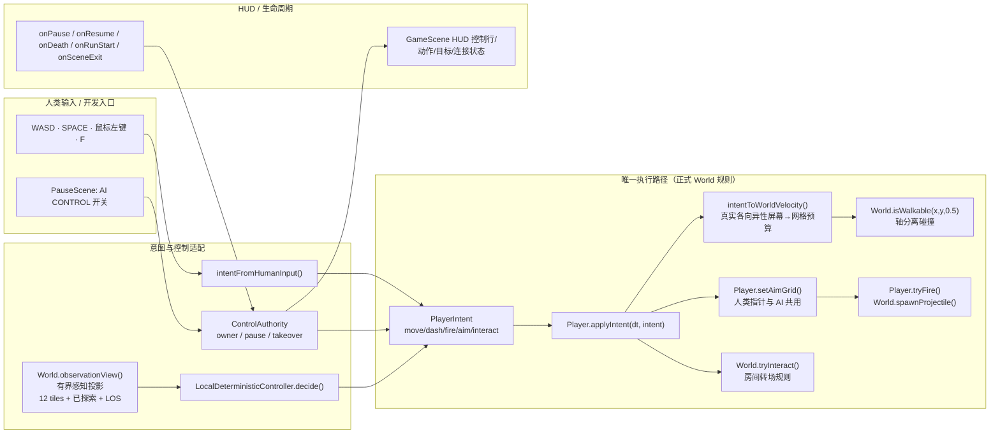

# AI-NATIVE-02 P0 / P1 — 正式 World 的控制接缝与本地演示

> 状态：P0 接缝核查 + P1 最小意图适配已实现；**仅本地确定性演示**。
> 本轮没有接入外部 LLM / Codex / MCP Agent，没有 Headless World、Replay 或逐帧确定性承诺。
> 基线：`860a0dd78fb741896c2f1433742603dd91e37fc8`（origin/main，AI-NATIVE-01 已合并）；分支 `feat/ai-native-world-integration`。

---

## 1. 这一轮实际交付了什么

在**正式浏览器 World**（`index.html` → `GameScene` / `World` / `Player`）里，人类与一个本地确定性控制器现在通过**同一个合法 `PlayerIntent` 执行路径**操作同一个玩家：

- 人类键盘/鼠标/指针 → `intentFromHumanInput()` → `PlayerIntent`；
- 本地控制器 → `World.intentView()`（有界感知投影 / `perceivedActors`）→ `LocalDeterministicController.decide()` → `PlayerIntent`；
- 两者都进入 `Player.applyIntent(dt, intent)`，使用同一套各向异性移动、轴分离碰撞、瞄准、开火、交互、冲刺、视觉与音效代码。控制器**不写坐标、不写 HP、不碰 Phaser 对象、不伪造 pointer**。
- 暂停菜单可开启/关闭 AI；任意移动/开火输入、暂停、死亡、升级弹层、新开局、场景退出都有明确控制所有权行为。
- HUD 明示 `CONTROL AI · LOCAL DETERMINISTIC`、最近实际动作/目标、`LOCAL DETERMINISTIC DEMO · EXTERNAL NOT CONNECTED`。

这不是第二套 `World` / 战斗规则，也不是把 Station Zero Headless 状态同步进 Phaser；它只是**最小局部迁移方案 A 的意图适配层**。

---

## 2. 接缝图（真实源码边界）



### 关键事实（P0 核查）

| 子系统 | 实际归属 | 本轮处理 |
| --- | --- | --- |
| World / 房间 / 敌人 / Boss / 弹丸 / 掉落 / FX / RNG | `src/world/World.ts`（Phaser + 玩法状态合一、变长 dt、含视觉随机） | 不改规则，只新增两个只读投影 |
| Player 移动/碰撞/开火/换弹/冲刺/受伤 | `src/entities/Player.ts` | 抽出 `applyIntent()` 单一执行入口；其余逻辑不动 |
| Enemy / Boss / Weapon / Projectile / Collision | `src/entities/*`, `src/config/weapons.ts`, `World.updateProjectiles()` | 未复制；AI 只发意图，由既有 `tryFire()` 生成弹丸 |
| Signal / 房间 / 传送门 | `World.currentRoom()` / `placePortal()` / `tryInteract()` | AI 只能感知 12 tiles 内、已探索且墙遮挡 LOS 通过的敌人/Boss/传送门**位置**；当前房间成员身份不充分，看不到目标房间号 |
| Input / Camera | `World` 注册 W/A/S/D/SPACE；`GameScene` 指针/ESC/I/F/Q/E | 人类指针转网格后走 `setAimGrid()`；AI 不触碰 camera/pointer |
| HUD | `GameScene` 屏幕锁定 HUD（`lockHud()`） | 右列新增 4 行 + 左下操作提示；五分辨率验证 |
| Save / Checkpoint / RNG / Tick | `SaveSystem` SAVE_VERSION=2、`World.captureCheckpoint()`、`RNG`、变长 delta | 死亡 `finishRun` 清 run、新局 R0；退出/刷新恢复最近 checkpoint；本轮不引入固定 tick |
| Event Bus | `src/core/eventbus.ts`（主游戏当前未使用） | 不新增订阅，避免把控制事件排序变成第二权威 |
| 既有 ai-native | `src/ai-native/protocol.ts`, `runtime.ts`, `sessions.ts`, `harness.ts`, `coop.ts` 等，均为 Station Zero Headless / MCP 侧 | 不 import 进 Phaser Scene；不宣称正式 World 可 replay |

---

## 3. 最小接口

```ts
// src/ai-native/control.ts —— 纯 TS，无 Phaser / DOM / RNG / 计时器
export interface PlayerIntent {
  move: Vec2;        // 屏幕方向，{0,0}=停止
  dash: boolean;
  fire: boolean;
  aim: Vec2 | null;  // 网格坐标；人类由 pointer 转换，AI 由目标转换
  interact: boolean;
}
export function intentFromHumanInput(input: HumanInputState): PlayerIntent;
export function intentToWorldVelocity(move: Vec2, speed: number): { x: number; y: number };
export function screenDirectionTowardGrid(dx: number, dy: number): Vec2;
export class ControlAuthority {
  owner: 'human' | 'ai'; aiEnabled: boolean; paused: boolean;
  enableAi / disableAi / pause / resume / humanTakeover / onDeath / onRunStart / onSceneExit / noteAiDecision / snapshot;
}

// src/ai-native/localController.ts —— 本地确定性演示，只返回意图
export interface LocalControllerView {
  ready: boolean; player; roomId; enemies; boss; portal: { x; y } | null;
  canWalk(x, y): boolean;  // createLocalProbe(): ±1.5 tiles、有限、已探索的局部探针；不是全图 isWalkable oracle
  timeSeconds: number;     // 用于本地防卡死记忆
}
export class LocalDeterministicController { decide(view): AiDecision; reset(); }

// src/ai-native/worldObservation.ts + worldPerception.ts —— 合法感知投影
// `WorldObservationV1` 是 controller 输入投影，不是安全边界（F-03 未修）：
// 仅自身位置/HP、roomId、被感知的敌人/Boss/传送门位置，带明确的 visibilityBasis。
// 感知 = 有界网格半径(12 tiles) + 已探索房间 + 墙遮挡 LOS；当前房间成员身份不充分。
// 不含：seed / RNG / 全图 / 未探索房间 / Boss phase / portal targetRoom / 内部状态。
export function buildWorldObservation(input): WorldObservationV1;
export function gridLineOfSight(target, options): boolean;   // 纯网格，无 camera
export function createLocalProbe(options): (x, y) => boolean; // 有界局部探针，非全图 oracle

// src/world/World.ts —— 只读适配，无 setter
observationView(): WorldObservationV1;
intentView(): LocalControllerView;      // canWalk 仅接受玩家 ±1.5 tiles 的有限、已探索探针

// src/entities/Player.ts —— 唯一写入口
setAimGrid(x, y): void;                 // 人类指针与 AI 共用
applyIntent(dt, intent): void;          // private，移动/碰撞/瞄准/开火/交互
requestInteract(): void;                // F 键排队，仍经 applyIntent 执行
clearHeldInput(): void;                 // 暂停/恢复/死亡/退出清残留

// src/scenes/GameScene.ts
toggleAiControl(): boolean;             // Pause 菜单开发入口
```

---

## 4. 操作说明（正式游戏内可用）

1. 启动正式 World（见 §7），从主菜单 **NEW RUN** 开局。
2. 游戏中按 **ESC** → 暂停菜单点 **AI CONTROL: OFF**（第 5 个按钮，逻辑坐标 640,540）→ 变为 `ON · LOCAL DEMO`。
3. 按 **ESC** 或点 **RESUME** 回到游戏；HUD 右列显示 `CONTROL AI · LOCAL DETERMINISTIC`、最近动作（如 `AI ACTION MOVE / ENGAGE / TRAVEL / INTERACT`）与实际目标。
4. **任意 WASD / SPACE / 鼠标左键开火 / F** 立即把控制权交还人类并关闭本地演示；覆盖层（背包 / 升级选卡 / 暂停菜单）期间同样有效，不需要先关闭覆盖层。覆盖层上的**可交互 UI 点击**（换装 EQUIP、升级卡片、菜单按钮）归 UI 所有，不算开火、不夺回；空白处点击才算开火/夺回。
5. 再按 ESC / I 可暂停或开关背包；暂停与背包都会冻结 authority、清理残留输入并把 HUD 刷成 `PAUSED`；关闭后若人类已在覆盖层里夺回，AI **不会自动抢回**。
6. `LOCAL DETERMINISTIC DEMO · EXTERNAL NOT CONNECTED` 是真实连接状态：**没有接外部 Agent**。
7. 死亡走既有 `finishRun` → 新 R0；退出/刷新仍恢复最近安全点。控制状态不写入存档，也不跨局继承。

HUD 左下常驻：`ESC PAUSE · ANY MOVE / FIRE / F TAKES HUMAN CONTROL`。800x600 等紧凑视口自动加大逻辑字号并拉开行距（最小状态行 ≥10 CSS px，提示行同色高对比），不隐藏提示、不靠 z-index；数值断言只是几何检查，可读性仍需人工看截图。

---

## 5. 真实性、所有权与生命周期

- `LocalDeterministicController` 只用 `PlayerIntent` 表达意图；没有 `setPosition`、没有 HP 写入、没有 Scene 访问。
- 移动预算是**正式 World 真实各向异性**：屏幕单位方向经 `intentToWorldVelocity()` 转为网格速度，再走 `World.isWalkable(...,0.5)` 轴分离碰撞；没有搬 Station Zero 的 `SLICE.MOVE_SPEED / canFit`。
- 瞄准不伪造 Phaser pointer：`aimFromPointer()` 把屏幕点转网格后调用 `setAimGrid()`，AI 用同一个方法。
- 目标选择只使用 `WorldObservationV1` 感知投影：有界网格半径 + 已探索房间 + 墙遮挡 LOS；同房间但远距/墙后的敌人不可见，从其他房间追进感知范围的敌人可见。Boss / 传送门位置也受同一范围约束；`targetRoom`、Boss phase、seed/RNG 不进入观察。
- `intentView().canWalk` 是**有界局部探针**：非有限、超出 ±1.5 tiles、未探索坐标统一返回 `false` 且不查询真实地形；只有控制器转向所需的近距合法探针到达 `World.isWalkable(...,0.5)`，因此不是全图碰撞 oracle。注意 `window.__game` 仍存在（F-03 未修），本投影是 controller 输入约束，不是页面级隐藏信息边界。
- 控制权转移：`enableAi` → `pause` → `resume` → `humanTakeover` → `disableAi` → `onDeath` → `onRunStart` → `onSceneExit`；暂停/背包/升级覆盖层都冻结 authority 并清理 `fireHeld`、方向键与交互排队；覆盖层内移动键 / 非 UI 鼠标 / F 均可夺回，夺回后关闭覆盖层不自动回切 AI。
- `captureCheckpoint()` 现在返回深拷贝（`cloneCheckpoint()`），避免内存持有者拿到会继续变化的活引用；已有单测和浏览器证据。
- 主 World 仍是变长 dt、含视觉随机（`Math.random()` 用于 bob/掉落/召唤），没有固定 tick、快照/Replay 或跨实例确定性承诺。固定 seed 仅用于复现证据。
- 不把浏览器自动化说成 Headless Agent，不把本地控制器说成 LLM/Codex，不把开发者自测说成独立验收。

---

## 6. 审查风险处置与遗留

| Reviewer 项 | 本轮处置 |
| --- | --- |
| R-03 checkpoint 活引用 | 已修：`cloneCheckpoint()` + 单测 + 浏览器捕获后变异验证 |
| R-04 感知投影 | 已建 `WorldObservationV1.perceivedActors`：按 12 tiles + 已探索 + LOS 过滤；隐藏敌人/Boss phase/portal targetRoom 不外泄；保留自身 HP、被感知的当前/邻房敌人、Boss 公开 HP |
| R-07 碰撞谓词 | 移动/轴分离碰撞仍经同一 `World.isWalkable(...,0.5)` 谓词（C1 纯 `stepPlayerMovement`）；控制器可见的 `canWalk` 是 `createLocalProbe()` 的 ±1.5 tiles 有界局部探针，不是全图 oracle |
| R-08 瞄准入口 | 新增共用 `setAimGrid()`；不伪造 pointer、不读 camera |
| R-10 三类冒充 | HUD/暂停菜单/本报告/测试报告均明示本地确定性演示与外部未连接 |
| R-01 纯权威核 / R-02 确定性 | **留 P2/P4 架构风险**：主 World 仍是 Phaser+规则耦合、变长 dt、玩法/视觉随机混合；本轮按 Lead 裁定只做意图适配，不重构、不宣称 Headless/Replay |
| R-05 运行时 actor 标签 / R-06 reset 换 seed | 属 Station Zero Headless 侧，**本轮未把 runtime 接进 Scene**；留 P2/P4 |
| F-01/F-02（P1 修复） | 已修：`worldPerception.ts` 有界半径/已探索/LOS；`World.observationView()` 按 `isPerceivable` 过滤敌人/Boss/portal；`createLocalProbe()` 拒绝远距、非有限、未探索查询；纯单测 + 正式 World Playwright 覆盖远距/墙后/未探索/Boss/portal/近距合法探针 |
| F-04/F-05（P1 修复） | 已修：背包与暂停/升级同样 `control.pause()` + 清输入 + 刷新 HUD；覆盖层内 W/A/S/D/SPACE、非 UI 鼠标、F 均可夺回；UI 点击用 `hitTestPointer` 判归覆盖层，不误判为开火；关闭后不自抢 |
| F-06（P1 修复） | 已修：紧凑视口放大右列与提示逻辑字号、提高提示对比度、拉开行距；测试改名为几何断言（≥10 CSS px）并保存截图供人工判读，不用阈值冒充可读性 |
| F-07（P1 修复） | 已修：本报告新增「P1 证据范围」表，逐类标注夹具与无夹具独立证据 |
| F-03（P2 阻断） | **未修**：`window.__game` 生产暴露仍在；感知投影不是页面级安全边界，外部 Agent 接入前必须收敛 |
| F-08/F-10 | F-10 已在 P1 修复中顺带完成（暂停/背包 HUD 刷新）；F-08 已在 C2 修复（restoreCheckpoint 深拷贝 + 负向测试） |
| F-09（C1 修复） | 已修：`intentToWorldVelocity` / `screenDirectionTowardGrid` 改用 `IsoMath.TILE_W/H` 并委托 `sim/rules.ts` 单一实现；未扩张其他历史清理 |
| C1（本轮） | 已实施：唯一纯规则模块 + Phaser 即时接线；**不是**完整状态集中/固定 tick/外部 Agent，详见 §6.5 |
| R-09 `onLoot` / `statsSnapshot()` 空实现 | 与 P1 意图适配无关，未处理，列为后续缺陷 |

**明确遗留**：集中 `SimulationState`、固定 60Hz tick、全玩法 seeded RNG、跨端 parity、World Replay/state hash、`WorldCore` parity 测试（C2）；外部 Agent 经正式 Player/MCP 通道接入（C3，**P2 完成条件**）；Human+ECHO 正式双 Actor、正式 World Signal 接入（总任务义务）；P5 后续分辨率/玩法范围扩展。当前 `Human + ECHO` 与正式 Signal 未实现，不能伪装可用；现有 `src/ai-native/coop.ts` 仍是隔离 Headless 测试实体。

---

## 6.5 C1 — 共享纯规则抽取与即时接线（状态所有权边界）

- 新增唯一纯模块 `src/world/sim/rules.ts`（无 Phaser / DOM / `Math.random`）：移动/轴分离碰撞/瞄准、武器 spec、弹丸创建（真实 `RNG`）、弹丸推进与扫掠命中、护甲伤害/击退、drone FSM、非 drone 共用移动与远程攻击描述符。`src/ai-native/control.ts` 的 `intentToWorldVelocity` / `screenDirectionTowardGrid` 改为调用该模块并复用 `IsoMath.TILE_W/H`（F-09）。
- C1 时 `Player.applyIntent()` / `setAimGrid()` / `tryFire()` / `hurt()`、`Enemy` 的 drone 分支 / `hit()` / 移动与攻击助手、`World.spawnProjectile()` / `updateProjectiles()` 已改为调用唯一纯规则；**已抽取规则**在适配层中唯一，但 `Enemy.legacyStateMachine`（非 drone）、`Boss.hit`、`World.spawnEnemyProjectile` 仍是 legacy，明确列入 C2 合并清单，不能读成「全 World 规则都已唯一」。渲染、音效、回调、精灵生命周期仍在适配层。
- **明确边界**：C1 不是完整权威核/Headless/Replay。可变状态仍分散在 `Player` / `Enemy` / `World` 对象上；`GameScene.update()` 仍是变长 `dt`，`World.rng` 仍由 World 持有，存档 `SAVE_VERSION=2` / `finishRun` / checkpoint 语义未改。集中 `SimulationState`、固定 60Hz tick、事件队列、全部玩法 RNG 归一是 **C2** 工作，C1 不以一组几何 helper 冒充完成。
- 首片是 `drone` + `pulse`；`buildWeaponSpec` / `createProjectileData` / `advanceProjectile` / `projectileHitsTarget` / `resolveEnemyHit` 对所有武器与敌人共用，scatter/plasma 等其他配置未回归；Boss.hit 仍保留自己的旧公式，不在首片内。
- 真实标签不变：仍是本地确定性演示，`EXTERNAL NOT CONNECTED`；**真实外部 Agent 经正式通道战斗依旧是 P2 完成条件**（C3），不得重定义为 P3，也不得用浏览器自动化/假 Headless 冒充。

## 6.6 Signal 支持状态（C1）

- **正式 World 当前不支持 Signal 玩法**：没有 Scan / Jam / Decoy / Relay / Bridge / Guard / Signal Energy / 设施状态机；`docs/SIGNAL_SYSTEM_DESIGN.md` 是设计提案，相关实现只存在于 Station Zero `src/slice/`。
- C1 只迁移真实存在的移动/碰撞/弹丸/drone 规则，没有发明、伪造或隐式引入 Signal。Signal 正式接入仍是 AI-NATIVE-02 总任务义务，后续阶段按真实设计另行实现。

## 6.7 C2 — 首片 SimulationState / 固定 tick / Node-Rendered parity

- **唯一写源**：`src/world/sim/core.ts` 的 `SimulationState` 拥有 player、drone、`targets[]`（非 drone/Boss 的 HP/位置）、player/enemy 弹丸、`tick`、连续 `rngState`、静态地图、`pendingPlayerHits`、`pendingCommands` 与 `nextProjectileId`。`registerTarget` 深拷贝调用者对象；`Enemy`/`Boss` 的 `wx/wy/_hp` 只读 core target，位置移动通过 `World.enqueueTargetMove` 命令在下一 tick 提交，HP 由 core 弹丸/命令写；不再暴露可写 target setter 或 legacy `hit()`。`World.projectiles` 是 core 弹丸只读副本（setter no-op，`resetProjectilesForTest` 严格 dev/test 门禁）。`Player.applyIntent/tryFire` 与 `World.spawnProjectile` 已删除；`GameScene` 只采样一次 `PlayerIntent`，再 `World.stepFrame(delta, intent)`。
- **固定 tick**：`SIM_TUNING` 60Hz、`TICK_MS=1000/60`、渲染累加器 `MAX_FRAME_DELTA_MS=250` / `MAX_TICKS_PER_FRAME=15`；core 只接受整数 `ticks`，不吃墙钟。`GameScene` 在暂停/升级/背包/AI 开关/死亡/新局时 `resetSimulationAccumulator()`，暂停期间不推进、恢复不追赶。250ms 用 epsilon+clamp 归为恰好 15 ticks，余量丢弃不累积。`stepSimulationTicksForTest` 是 `import.meta.env` 严格 dev/test 门禁诊断接口，**不是**官方 parity 证据（parity 走正常 `stepFrame`/累加器）。
- **RNG 边界**：core 使用连续流 `RNG(seed*7919+1)`，同一流按 C1 顺序消费 crit、击杀掉落两次 roll、下一发 crit **以及房间敌人种类、资源掉落种类、传送门目标（经 `room-enter` 命令在 tick 提交时消费）**；`World.rng` 仅留存档快照的 rngState 读写（存档兼容），不再消费于房间/资源/传送门生成；视觉未播种随机仍用于 bob/星空/音频噪声/新局 seed。**只承诺 core 的 crit+击杀掉落+房间生成顺序与 C1 一致；不宣称全玩法视觉 seeded RNG、全 run Replay/stateHash**。
- **有序事件**：core 先完成状态提交，再返回类型化 `SimEvent[]`（`player-moved/player-fired/projectile-spawned/drone-step/enemy-hit/enemy-died/player-hurt/player-death/player-healed/currency-gained/xp-gained/player-levelup/player-upgraded/projectile-wall`）；适配器只消费事件做精灵/伤害数字/音效/HUD/callback，不用事件回写 core 规则状态。B4：blocked hit 不发 `player-hurt`，同帧后续致命 hit 在首次死亡后丢弃，只产生一个 death。C1 debug 镜像已删除。
- **F-08**：`restoreCheckpoint` 先 `cloneCheckpoint(run)` 再赋值，`c2-parity.spec.ts` 负向断言「恢复后改输入帧不会改活玩家 HP/坐标」；`captureCheckpoint` 记录并恢复 core `tick/rngState/timers/nextProjectileId`，通过 `coreState` 校验。
- **parity harness（H1）**：永久 `src/world/sim/parity.test.ts` 用独立 legacy 公式与纯规则逐项对照；永久 `tests/c2-parity.spec.ts`（B1–B4/B6/H2/H3/H10 等）通过正常 `stepFrame` 受控意图队列产生 Rendered canonical/events；`scripts/c2-node-parity.ts`（8/8）、`scripts/c2-kill-parity.ts`（13/13）与新增 `scripts/c2-loot-pickup-parity.ts`（10/10，20 格远距掉落不结算、近距磁吸/拾取、pickupRange 缩放、X/Y/对角方向）。`npm run game:sim:parity` 可复现。
- **本轮事务化修复**：core 拥有击杀奖励（XP/货币/等级）与击杀掉落 RNG；`killEnemy`/`killBoss` 只做表现/结算回调；B4 同帧两次致命 hit 在首次死亡后丢弃、blocked hit 不发 hurt 事实；`registerTarget` 深拷贝，Enemy/Boss 的 target 只读、移动通过 `enqueueTargetMove` tick 命令提交，删除可写 setter 与 `hit()`；Boss target 半径恢复 `getRadius()+1`；`resetProjectilesForTest`/`clearEnemiesForTest` 严格 dev/test；非 Boss `enemy-hit` 消费 `hitFlash`。真实击杀 Node/Rendered kill parity 13/13。

- **第三轮事务化修复（0df1514 之后）**：`World.sim` 改为私有 `_sim`；对外仅暴露深拷贝冻结快照（`get sim()`、`get playerDataSnapshot()`）；`Enemy`/`Boss` 删除全部可写 `wx/wy/_hp` setter 与 legacy `hit()`，getter 只读 core target；`registerTarget` 深拷贝；外部对快照的写入不再改变核心状态。`World.projectiles` 保持只读核心副本（setter no-op，`resetProjectilesForTest`/`clearEnemiesForTest`/`setPlayerPositionForTest` 严格 dev/test，生产 preview 抛错）。
- **命令事务**：常规玩法写入（弹丸发射、Boss 召唤/激光、房间敌人生成、传送门传送、掉落拾取/治疗/货币/XP/升级）改为 `enqueueCommand`，在下一 core tick 提交并产生有序 `SimEvent`；`paused`/`stepFrame(0)` 不改变 canonical；仅 World 构造/存档恢复/新局可 owner 初始化；普通交互传送走命令并验证走格。命令队列计入 `pendingCommands`/canonical，重试与消费不重复。
- **击杀掉落**：击杀按 C1 顺序先消费两次掉落 roll 再加 XP；currency/heal 生成可见 `loot`，由 core `stepLoot` 磁吸/拾取，拾取时提交资源/HP 与 `loot-collected`；`killEnemy`/`killBoss` 不再直写 XP/货币/掉 RNG。资源房掉落同样经 core 命令。Phaser 只渲染/回调。核心 B11 回归：可见掉落、未拾取不结算、靠近拾取才结算；Node/Rendered kill parity 13/13 已含 canonical 掉落/货币/后续射击一致。
- **RNG**：core 唯一玩法 RNG `RNG(seed*7919+1)`（crit→击杀掉落两次 roll→下一发 crit）；`World.rng` 仅留存档兼容，不再消费于房间/资源/传送门；视觉随机不进 canonical。New core H2 测试用独立 RNG 参考序列对照。
- **验收**：`npm test` 397、全量 Playwright 44/44、冻结生产 P1 9/9、Node/Rendered parity 8/8、kill parity 13/13、loot pickup parity 10/10、房间分布 parity 220 seed。日志 `reports/ai-native-02/c2-final-seam/logs/`。C3-b 继续冻结。
- **范围（本轮已扩大）**：core 已覆盖全部 enemy kind/Boss 的弹丸碰撞、HP/位置、XP/货币奖励、升级材料化与击杀掉落 RNG；非 drone FSM 决策仍 legacy，但移动通过 `enqueueTargetMove` 命令在 tick 提交，不再直接写 target；portal/房间生成/资源掉落种类/存档策略/视觉仍 adapter。`Player.reset` 仅作为 World owner 初始化/房间切换边界，普通 adapter 不调用。**正式 World 仍无 Signal**；C3 真实外部 Agent 战斗仍是 **P2 完成条件**（不是 P3），HUD/菜单持续 `EXTERNAL NOT CONNECTED`。

---

## 7. 验证与启动

冻结快照 + 专属端口（无 HMR）：

```bash
npm run build
cp -r dist reports/ai-native-02/frozen-dist      # 仓库内冻结产物，仅用于取证
npx vite preview --outDir reports/ai-native-02/frozen-dist --port 5281 --strictPort
PORT=5281 LS_AI_EVIDENCE_DIR=reports/ai-native-02/evidence-frozen \
  npx playwright test tests/ai-native-world.spec.ts --reporter=list --workers=1
```

完整旧回归需要两个 dev 端口（`audit` 动态 import `/src`，`boss-room` 固定 5173，`canvas` 固定 5199，不能用 PORT 隔离）：

```bash
npm run dev -- --port 5173 --strictPort
npm run dev -- --port 5199 --strictPort     # 若已有同源码 dev server 也可复用
PORT=5173 LS_SHOT_DIR=reports/ai-native-02/screens npx playwright test --reporter=list --workers=1
```

单测/类型/构建：`npm run typecheck`、`npm test`、`npm run build`、`npm run game:mcp:build`。
完整输出位于 `reports/ai-native-02/*.log`；截图/连续取样/操作日志位于 `reports/ai-native-02/evidence-frozen/`。
P1 条件项修复的完整日志与证据在 `reports/ai-native-02/p1-fixes/logs/`、`reports/ai-native-02/p1-fixes/evidence-frozen/`；冻结快照端口 5283，命令见 `reports/ai-native-02/p1-fixes/REPORT.md`。

> 证据分三类：①开发者 spec 注入固定 seed / i-frames / addXp / spawnEnemy / `enteredRooms.add` / 临时 `tile.type='wall'` / `spawnBoss`+坐标 / `portal.wx/wy` / 合成伤害 / 第二武器等**夹具证据**，只证明控制流、几何、清理与感知投影；②独立 Tester 对父提交 `2d78e80` 的无夹具探针在 `reports/ai-native-02/tester/p1-final/`，对修复提交 `1aadd2e` 的无夹具探针在 `reports/ai-native-02/tester/p1-fixes-final/`（自然受伤、背包/恢复/不自抢、指针覆盖层等），均不是本提交之后的 C2 WIP 证据；③外部 Agent / Headless World / Replay 全部未实现。各类证据的真实 commit 归属见 `docs/AI_NATIVE_PHASE_REPORTS.md` 证据范围表。三类均不得宣称 Headless、LLM、Codex 或战斗胜利。

## C3-b 修复提交（8ec8758 之后）

- **ACK 语义（精确）**：`applied` = 合法意图被真实 core tick 提交了请求的整数 `ticks`（real `startedTick`/`completedTick`/`executedTicks`），**不保证**位移/命中/击杀/交互成功；`queued ≠ applied`；`executing` 表示按 tick 推进。
- **动作时长**：`move`/`fire` 的 `ticks` 由真实 core tick 计数（`World.stepFrame` 按实际 tick 扣减，一帧多 tick 不会多送意图，多帧累计同样计数）；`aim`/`interact`/`stop` 为 1 tick 合法提交；`fire` 只受真实 cooldown/ammo 约束。
- **异步生命周期**：控制器每次异步操作持 `generation + 局部 client + epoch`，每个 `await` 后重新校验；`degrade()/dispose()` 立即 `abortInFlight()` 并置空 client，迟到回调不得 heartbeat/ACK/push/重挂；`beforeFrame`/`afterFrame` 互斥。
- **观察裁剪**：`projectiles` 与 `drones/targets` 使用同一 `isPerceivable`（12 格 + 已探索 + LOS），墙后/他房/远距弹丸不返回。
- **独立 Agent 租约**：MCP 进程持 `leaseId + version + expiresAtMs`，后台续约；浏览器心跳不能续 Agent 权限；硬 `SIGKILL` 后期限到期 → 取消执行/排队动作、bump epoch、关会话、渲染侧 HUMAN/LOST；同一 session 仅一个 live 租约；旧 `leaseId` 不能续新授权；`world_list_sessions` 每次远端核对，死会话绝不 `attached:true`，且不自动重挂。
- **模式门禁**：`__LAST_SIGNAL_DEV_TEST__ = (mode === 'development' || mode === 'test')`；自定义 mode 按生产处理（不暴露 `__game`）。
- **token 文件**：POSIX `chmod 0600`；Windows 用绝对路径 `System32\icacls.exe /inheritance:r /grant:r *<SID>:F`，实测只剩当前用户 ACE；不打印 token、不进 URL/参数。
- **正式逐轮工具**：`npm run game:world:mcp-console`（官方 MCP stdio，`list/observe/act/raw/status/close`，`--json` 单次调用，工具 I/O 写入 `reports/ai-native-02/c3b-fixes/tool-io/`）。
- **仍未实现**：C3-c Headless same-core 实跑、真实 LLM 战斗、游戏内连接输入 UI（后续小提交）；常规演示目前仍需宿主页/控制台注入配置。

## C3c 修复：Player step 通道与 Dev snapshot 边界

- **Player `world_headless_step` 不接受 `intent`**：官方 MCP Player schema 根本不注册该字段（SDK strict schema 直接拒绝）；manager 非 Dev 再校验一次并返回 `E_PERMISSION / world.headless_intent_player_forbidden`，且在任何 tick/配额/队列变更之前返回。Player 必须 `world_action` 入队后再 `step`；未入队时 `step` 只推进 neutral（不移动、不开火）。Dev `step` 保留严格 `intent` 供 fixture/replay（未知字段/HP/seed 拒绝，`move` 超速归一化）。
- **Dev snapshot 仅在 ACTION BOUNDARY 可用**：session 无 active 执行、且无未处理排队动作时才允许 `world_headless_dev_snapshot`；否则返回 `E_NOT_APPLICABLE / world.snapshot_requires_action_boundary`，**不取消、不 ACK、不推进**。成功帧带 `boundary: "action"`；`restore` 只接受带该标记的帧，且当前 session 也必须处于 boundary（否则 `world.restore_requires_action_boundary`），epoch 严格递增。核心 `pendingCommands` 属于未来状态，随帧保存/恢复，不构成不完整。
- **失败导出**：`world_headless_dev_export_failure` 始终写 owner bundle，并附 `manager{boundary, replayable, active{remainingTicks,...}, queuedActions, ledger}`；执行中导出标 `mid_execution` / `replayable:false` 且 `note` 明确“INCOMPLETE”，只有 boundary 导出才带可恢复标记。Dev `inspect` 同步暴露 active/queued/ledger 供诊断。
- **日志**：`reports/ai-native-02/c3c-step-channel-fix/logs/`。
