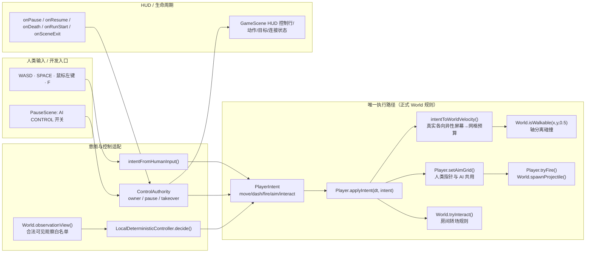

# AI-NATIVE-02 P0 / P1 — 正式 World 的控制接缝与本地演示

> 状态：P0 接缝核查 + P1 最小意图适配已实现；**仅本地确定性演示**。
> 本轮没有接入外部 LLM / Codex / MCP Agent，没有 Headless World、Replay 或逐帧确定性承诺。
> 基线：`860a0dd78fb741896c2f1433742603dd91e37fc8`（origin/main，AI-NATIVE-01 已合并）；分支 `feat/ai-native-world-integration`。

---

## 1. 这一轮实际交付了什么

在**正式浏览器 World**（`index.html` → `GameScene` / `World` / `Player`）里，人类与一个本地确定性控制器现在通过**同一个合法 `PlayerIntent` 执行路径**操作同一个玩家：

- 人类键盘/鼠标/指针 → `intentFromHumanInput()` → `PlayerIntent`；
- 本地控制器 → `World.intentView()`（白名单观察）→ `LocalDeterministicController.decide()` → `PlayerIntent`；
- 两者都进入 `Player.applyIntent(dt, intent)`，使用同一套各向异性移动、轴分离碰撞、瞄准、开火、交互、冲刺、视觉与音效代码。控制器**不写坐标、不写 HP、不碰 Phaser 对象、不伪造 pointer**。
- 暂停菜单可开启/关闭 AI；任意移动/开火输入、暂停、死亡、升级弹层、新开局、场景退出都有明确控制所有权行为。
- HUD 明示 `CONTROL AI · LOCAL DETERMINISTIC`、最近实际动作/目标、`LOCAL DETERMINISTIC DEMO · EXTERNAL NOT CONNECTED`。

这不是第二套 `World` / 战斗规则，也不是把 Station Zero Headless 状态同步进 Phaser；它只是**最小局部迁移方案 A 的意图适配层**。

---

## 2. 接缝图（真实源码边界）



### 关键事实（P0 核查）

| 子系统 | 实际归属 | 本轮处理 |
| --- | --- | --- |
| World / 房间 / 敌人 / Boss / 弹丸 / 掉落 / FX / RNG | `src/world/World.ts`（Phaser + 玩法状态合一、变长 dt、含视觉随机） | 不改规则，只新增两个只读投影 |
| Player 移动/碰撞/开火/换弹/冲刺/受伤 | `src/entities/Player.ts` | 抽出 `applyIntent()` 单一执行入口；其余逻辑不动 |
| Enemy / Boss / Weapon / Projectile / Collision | `src/entities/*`, `src/config/weapons.ts`, `World.updateProjectiles()` | 未复制；AI 只发意图，由既有 `tryFire()` 生成弹丸 |
| Signal / 房间 / 传送门 | `World.currentRoom()` / `placePortal()` / `tryInteract()` | AI 只能看到当前房间与传送门**位置**，看不到目标房间号 |
| Input / Camera | `World` 注册 W/A/S/D/SPACE；`GameScene` 指针/ESC/I/F/Q/E | 人类指针转网格后走 `setAimGrid()`；AI 不触碰 camera/pointer |
| HUD | `GameScene` 屏幕锁定 HUD（`lockHud()`） | 右列新增 4 行 + 左下操作提示；五分辨率验证 |
| Save / Checkpoint / RNG / Tick | `SaveSystem` SAVE_VERSION=2、`World.captureCheckpoint()`、`RNG`、变长 delta | 死亡 `finishRun` 清 run、新局 R0；退出/刷新恢复最近 checkpoint；本轮不引入固定 tick |
| Event Bus | `src/core/eventbus.ts`（主游戏当前未使用） | 不新增订阅，避免把控制事件排序变成第二权威 |
| 既有 ai-native | `src/ai-native/protocol.ts`, `runtime.ts`, `sessions.ts`, `harness.ts`, `coop.ts` 等，均为 Station Zero Headless / MCP 侧 | 不 import 进 Phaser Scene；不宣称正式 World 可 replay |

---

## 3. 最小接口

```ts
// src/ai-native/control.ts —— 纯 TS，无 Phaser / DOM / RNG / 计时器
export interface PlayerIntent {
  move: Vec2;        // 屏幕方向，{0,0}=停止
  dash: boolean;
  fire: boolean;
  aim: Vec2 | null;  // 网格坐标；人类由 pointer 转换，AI 由目标转换
  interact: boolean;
}
export function intentFromHumanInput(input: HumanInputState): PlayerIntent;
export function intentToWorldVelocity(move: Vec2, speed: number): { x: number; y: number };
export function screenDirectionTowardGrid(dx: number, dy: number): Vec2;
export class ControlAuthority {
  owner: 'human' | 'ai'; aiEnabled: boolean; paused: boolean;
  enableAi / disableAi / pause / resume / humanTakeover / onDeath / onRunStart / onSceneExit / noteAiDecision / snapshot;
}

// src/ai-native/localController.ts —— 本地确定性演示，只返回意图
export interface LocalControllerView {
  ready: boolean; player; roomId; enemies; boss; portal: { x; y } | null;
  canWalk(x, y): boolean;  // 由 World.isWalkable(x,y,0.5) 提供
  timeSeconds: number;     // 用于本地防卡死记忆
}
export class LocalDeterministicController { decide(view): AiDecision; reset(); }

// src/ai-native/worldObservation.ts —— 合法可见观察白名单
export function buildWorldObservation(input): WorldObservationV1;
// 仅：自身位置/HP、当前 roomId、当前房间存活敌人、当前房间 Boss（HUD 已显示的 HP）、传送门位置
// 不含：seed / RNG / 隐藏房间 / 未进入房间敌人 / Boss phase / portal targetRoom / 内部状态

// src/world/World.ts —— 只读适配，无 setter
observationView(): WorldObservationV1;
intentView(): LocalControllerView;

// src/entities/Player.ts —— 唯一写入口
setAimGrid(x, y): void;                 // 人类指针与 AI 共用
applyIntent(dt, intent): void;          // private，移动/碰撞/瞄准/开火/交互
requestInteract(): void;                // F 键排队，仍经 applyIntent 执行
clearHeldInput(): void;                 // 暂停/恢复/死亡/退出清残留

// src/scenes/GameScene.ts
toggleAiControl(): boolean;             // Pause 菜单开发入口
```

---

## 4. 操作说明（正式游戏内可用）

1. 启动正式 World（见 §7），从主菜单 **NEW RUN** 开局。
2. 游戏中按 **ESC** → 暂停菜单点 **AI CONTROL: OFF**（第 5 个按钮，逻辑坐标 640,540）→ 变为 `ON · LOCAL DEMO`。
3. 按 **ESC** 或点 **RESUME** 回到游戏；HUD 右列显示 `CONTROL AI · LOCAL DETERMINISTIC`、最近动作（如 `AI ACTION MOVE / ENGAGE / TRAVEL / INTERACT`）与实际目标。
4. **任意 WASD / SPACE / 鼠标开火 / F** 立即把控制权交还人类并关闭本地演示（升级弹层覆盖时也可用一个移动键夺回）。
5. 再按 ESC 可暂停/恢复；暂停时 HUD 与控制权冻结，菜单显示当前归属；点同一个按钮可把 AI 关回 OFF。
6. `LOCAL DETERMINISTIC DEMO · EXTERNAL NOT CONNECTED` 是真实连接状态：**没有接外部 Agent**。
7. 死亡走既有 `finishRun` → 新 R0；退出/刷新仍恢复最近安全点。控制状态不写入存档，也不跨局继承。

HUD 左下常驻：`ESC PAUSE · ANY MOVE / FIRE TAKES HUMAN CONTROL`。

---

## 5. 真实性、所有权与生命周期

- `LocalDeterministicController` 只用 `PlayerIntent` 表达意图；没有 `setPosition`、没有 HP 写入、没有 Scene 访问。
- 移动预算是**正式 World 真实各向异性**：屏幕单位方向经 `intentToWorldVelocity()` 转为网格速度，再走 `World.isWalkable(...,0.5)` 轴分离碰撞；没有搬 Station Zero 的 `SLICE.MOVE_SPEED / canFit`。
- 瞄准不伪造 Phaser pointer：`aimFromPointer()` 把屏幕点转网格后调用 `setAimGrid()`，AI 用同一个方法。
- 目标选择只使用 `WorldObservationV1` 白名单：只有当前房间存活敌人/当前房间 Boss；其他房间敌人、隐藏目标房间号、Boss phase、RNG/seed 不进入观察。
- 控制权转移：`enableAi` → `pause` → `resume` → `humanTakeover` → `disableAi` → `onDeath` → `onRunStart` → `onSceneExit`；每次都清理 `fireHeld`、方向键状态与交互排队，并重置控制器防卡死记忆。
- `captureCheckpoint()` 现在返回深拷贝（`cloneCheckpoint()`），避免内存持有者拿到会继续变化的活引用；已有单测和浏览器证据。
- 主 World 仍是变长 dt、含视觉随机（`Math.random()` 用于 bob/掉落/召唤），没有固定 tick、快照/Replay 或跨实例确定性承诺。固定 seed 仅用于复现证据。
- 不把浏览器自动化说成 Headless Agent，不把本地控制器说成 LLM/Codex，不把开发者自测说成独立验收。

---

## 6. 审查风险处置与遗留

| Reviewer 项 | 本轮处置 |
| --- | --- |
| R-03 checkpoint 活引用 | 已修：`cloneCheckpoint()` + 单测 + 浏览器捕获后变异验证 |
| R-04 观察白名单 | 已建 `WorldObservationV1`：过滤隐藏敌人/Boss phase/portal targetRoom；保留自身 HP、当前房间敌人、Boss 公开 HP |
| R-07 碰撞谓词 | AI 只经 `World.isWalkable(x,y,0.5)` 与 Player 同一路径；`ensureWalkable()` 仍为既有玩家的脱困逻辑，不由 AI 直接触发 |
| R-08 瞄准入口 | 新增共用 `setAimGrid()`；不伪造 pointer、不读 camera |
| R-10 三类冒充 | HUD/暂停菜单/本报告/测试报告均明示本地确定性演示与外部未连接 |
| R-01 纯权威核 / R-02 确定性 | **留 P2/P4 架构风险**：主 World 仍是 Phaser+规则耦合、变长 dt、玩法/视觉随机混合；本轮按 Lead 裁定只做意图适配，不重构、不宣称 Headless/Replay |
| R-05 运行时 actor 标签 / R-06 reset 换 seed | 属 Station Zero Headless 侧，**本轮未把 runtime 接进 Scene**；留 P2/P4 |
| R-09 `onLoot` / `statsSnapshot()` 空实现 | 与 P1 意图适配无关，未处理，列为后续缺陷 |

**明确遗留**：共享纯核、固定 60Hz tick、全玩法 seeded RNG、跨端 parity、World Replay/state hash、`WorldCore` parity 测试、外部 Agent 经正式 Player/MCP 通道接入、Human+ECHO 正式双 Actor、P5 后续分辨率/玩法范围扩展。当前 `Human + ECHO` 未实现，不能伪装可用；现有 `src/ai-native/coop.ts` 仍是隔离 Headless 测试实体。

---

## 7. 验证与启动

冻结快照 + 专属端口（无 HMR）：

```bash
npm run build
cp -r dist reports/ai-native-02/frozen-dist      # 仓库内冻结产物，仅用于取证
npx vite preview --outDir reports/ai-native-02/frozen-dist --port 5281 --strictPort
PORT=5281 LS_AI_EVIDENCE_DIR=reports/ai-native-02/evidence-frozen \
  npx playwright test tests/ai-native-world.spec.ts --reporter=list --workers=1
```

完整旧回归需要两个 dev 端口（`audit` 动态 import `/src`，`boss-room` 固定 5173，`canvas` 固定 5199，不能用 PORT 隔离）：

```bash
npm run dev -- --port 5173 --strictPort
npm run dev -- --port 5199 --strictPort     # 若已有同源码 dev server 也可复用
PORT=5173 LS_SHOT_DIR=reports/ai-native-02/screens npx playwright test --reporter=list --workers=1
```

单测/类型/构建：`npm run typecheck`、`npm test`、`npm run build`、`npm run game:mcp:build`。
完整输出位于 `reports/ai-native-02/*.log`；截图/连续取样/操作日志位于 `reports/ai-native-02/evidence-frozen/`。

> 证据中的 i-frames 刷新是**测试夹具**（防止无关战斗死亡打断控制流采样），由 Playwright 注入；死亡仍通过真实 `hurt()` 路径验证，夹具不修改 HP 或坐标，也不由控制器执行。
