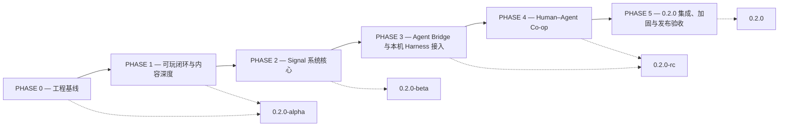

# LAST SIGNAL 项目路线图（PROJECT_ROADMAP）

> 本阶段只完成设计审计，未授权实现

> 本文件是本轮「0.2.0 Technical Design & Architecture Audit」交付的 6 个设计文档之一，只做技术设计、架构审计与路线图。
> 统一事实基座：`C:/Users/Rafae/AppData/Roaming/CindyGlobal/owners/c03ae4f95c31b1567007/bots/bot_1794172471377_k067bc/workspace/audit/FACTS.md`（下称 FACTS.md）。
> 本文件严格采用 FACTS.md §6「不虚构白名单/黑名单」与 §7「统一术语/编号约定」；所有路径、类、函数、测试名均已对照 `D:/Project/LAST_SIGNAL` 真实源码复核。

---

## 0. 文档头与授权边界

| 项 | 内容 |
|---|---|
| 版本路径 | `0.1.0` → `0.2.0`（当前 `0.1.0`，见 `package.json` 中 `version: 0.1.0`；计划版本 `0.2.0`） |
| 本阶段性质 | 「0.2.0 Technical Design & Architecture Audit」，只做技术设计、架构审计与路线图规划；**本阶段唯一交付物为 `docs/` 下 6 个新建设计文档；本文只写自身，不写 6 个文档之外的任何文件；不改源码、不装依赖、不初始化 Git、不提交 commit** |
| 技术栈 | Vite 5 + TypeScript 5 + Phaser 3.90（`Phaser.CANVAS` 渲染） |
| 游戏定位 | 2.5D 等距射击 Roguelite + Signal Manipulation + Native AI Agent Co-op |
| 愿景 | *A Game for Humans and Agents* |
| 状态标签 | `【已实现】` / `【需扩展】` / `【需新建】` / `TBD — Requires User Decision` |

**当前只完成设计审计，未授权任何实现。**

本阶段未修改任何游戏源码、未安装依赖、未删除文件、未创建 `.gitignore`、未提交 commit、未运行任何会写入项目文件的构建/测试命令；`dist/`、`test-results/`、`tests/screens/`、`node_modules/` 均未被写入。本文件列出的所有 `PHASE 0–5` 工作项均是**后续实现阶段的规划**，不是本阶段已做或已授权的动作。

**Git 初始化属于 PHASE 0 Task 0.1，本阶段未授权，需用户确认后执行。** 具体需要用户决定的问题：`TBD — Requires User Decision`（需用户决定是否授权 `git init`、远端仓库位置与分支/提交规范，以及 `.gitignore` 覆盖范围；见文末 TBD-02）。

事实基座中的阶段定义若与用户手上的总计划书原文不一致：`TBD — Requires User Decision`（需用户决定是否以总计划书原文为准重新对齐阶段编号；请以总计划书原文为准重新对齐阶段编号；见文末 TBD-16）。

---

## 1. 现状基线（`0.1.0`，已复核事实）

### 1.1 环境、Git、docs、脚本（FACTS.md §1）

- 执行环境：MINGW64 Git Bash（`MINGW64_NT-10.0-26200`），Node `v24.20.0`，npm `11.19.0`。
- `git -C D:/Project/LAST_SIGNAL status --short --branch` → `fatal: not a git repository (or any of the parent directories): .git`，退出码 **128**；`D:/Project/LAST_SIGNAL/.git` 与 `D:/Project/.git` 均不存在 → **当前不是 Git 仓库**。【已实现】状态：无版本控制、无 commit 历史、无 `.gitignore`。
- 本轮之前仅有 `docs/STYLE_GUIDE.md`（9791 字节，v1 美术风格指南，本轮不改）；**本轮新增 6 个设计文档**。
- `package.json`（`name: last-signal`, `version: 0.1.0`, `type: module`, `license: MIT`）真实脚本：`dev=vite`、`build=vite build`、`preview=vite preview`、`typecheck=tsc --noEmit`、`test=vitest run`、`test:watch=vitest`、`playwright=playwright test`。依赖 `phaser ^3.90.0`；devDependencies：`@playwright/test ^1.47.2`、`@types/node ^20.19.43`、`jsdom ^25.0.1`、`typescript ^5.6.3`、`vite ^5.4.8`、`vitest ^2.1.2`（实际安装 vite 5.4.21、vitest 2.1.9）。
- `src/main.ts` 注册 7 个场景：`BootScene, PreloadScene, MainMenuScene, GameScene, LevelUpScene, GameOverScene, PauseScene`，并导出 `game`、`saveSystem = new SaveSystem()`、挂 `(window as any).__game = game`。
- 配置基线：`tsconfig.json`（`strict:true`、`noEmit:true`、`isolatedModules:true`）、`vite.config.ts`（`base:'./'`、`build.outDir:'dist'`、`target:'es2020'`）、`vitest.config.ts`（`include:['src/**/*.test.ts']`）、`playwright.config.ts`（`testDir:'./tests'`、`fullyParallel:false`、viewport 1280×720、`projects=[chromium / Desktop Chrome]`）。`index.html` 为 `#game` + `#loader` + `window.error`/`unhandledrejection` 监听。

### 1.2 源码规模与内容清单（FACTS.md §2）

- **29 个 TS 文件，4164 行**。按目录：`src/config` 6、`src/core` 5、`src/entities` 3、`src/scenes` 7、`src/systems` 2、`src/world` 4、`src/types` 1、`src` 根 1。
- **7 个场景**、**4 把武器**（`pulse / scatter / plasma / arc`，`src/config/weapons.ts`）、**12 项升级**（`vitality, speed, power, critical, critDamage, rapid, magnet, datapad, armor, quickdash, pierce, regen`，`src/config/upgrades.ts`）、**5 类敌人**（`drone, stalker, sentinel, hunter, boss_warden`，`src/config/enemies.ts`）、**8 种 `RoomKind` 声明**（`start | combat | resource | elite | shop | event | boss | extraction`，`src/types/index.ts`）。
- 注意：`8 种 RoomKind` 只是类型声明；`assignRoles()`（`src/world/MapGenerator.ts`）实际只赋 7 种，`extraction` 从未被赋值且无任何运行时逻辑；`event` 与 `combat` 在玩法上无差异。
- 测试文件：`tests/audit.spec.ts`、`tests/canvas.spec.ts`、`tests/gameplay.spec.ts`（3 个 Playwright 文件）+ `src/core/runtime.test.ts`（1 个 Vitest 文件）。
- 关键真实模块：`src/core/eventbus.ts`（`EventBus` / `gameBus`）、`src/core/iso.ts`（`IsoMath`、`isoToScreen()`、`screenToIso()`）、`src/core/random.ts`（`RNG`）、`src/core/GraphicsFactory.ts`、`src/world/World.ts`（`worldToScreen()` / `screenToWorld()` / `tileAt()` / `isWalkable()` / `WorldCallbacks`）、`src/world/WorldRenderer.ts`、`src/world/MapGenerator.ts`（`assignRoles()`、`roomDepth()`、`guaranteeReachable()`）、`src/world/roomdepth.ts`（`RoomDepth`）、`src/entities/{Player,Enemy,Boss}.ts`、`src/scenes/*.ts`、`src/systems/{SaveSystem,AudioSystem}.ts`、`src/types/index.ts`（`SAVE_VERSION = 1`）。
- 已确认的架构事实：`gameBus` 在整个 `src/` 与 `tests/` 中只有定义处一次出现，无任何 import / 订阅 / 发布；`GameEventType` 与 `GameEvent` 在 `src/types/index.ts` 声明但无使用点；当前真正的解耦机制是 `WorldCallbacks`（`onLevelUp` / `onDeath` / `onRoomCleared` / `onRoomEntered` / `onLoot` / `onStats` / `onBossWin`），且 `GameScene.create()` 中 `onLoot: () => {}` 为空实现；`World` 内 `roomClearedHandlers`、`statsSnapshot()` 未使用。
- 已确认的遗留事实：`Player.getRadius()=0.5`、`Enemy.getRadius()=0.5`、`Boss.getRadius()=3.0` 为网格单位，而 `World.spawnProjectile()` 把 `ProjectileData.radius` 设为 `5`/`6`、`spawnEnemyProjectile()` 设为 `6`（像素量级），`World.updateProjectiles()` 直接比较 `e.getRadius() + p.data.radius` → **碰撞半径单位混用**；`GameScene.update()` 的 `cam.shake(100, world.shakeAmount * 8)` 把像素量级数当视口比例传入，靠 `WorldRenderer._clampCameraShake()` 在 `prerender` 钩子兜底 → **屏震根因未修**。
- 已确认的存档事实：`src/systems/SaveSystem.ts` 内 `const STORAGE_KEY = 'last_signal_save_v1';`（未导出），`src/config/game.ts` 另有同值导出常量 `SAVE_KEY`；`validate()` 为模块级导出纯函数；`SaveSystem` 单例在 `src/systems/SaveSystem.ts` 与 `src/main.ts` 各 `new` 一次；`SaveData` 无任何局内快照字段；`MainMenuScene` 的 `LOAD RUN` / `CONTINUE` 为禁用态，点击只弹 `暂未实现：读档尚未实现 (NOT IMPLEMENTED)`。

### 1.3 验证基线（FACTS.md §4.10）

本阶段**未执行**下列命令；以下退出码 0 是前置审计记录在 workspace 中的基线结果，仅作为后续回归对照引用（验证产物全部落在 workspace，项目文件 SHA256 清单验证前后一致，62 个文件无差异）：

| # | 真实验证命令 | 基线结果 |
|---|---|---|
| 1 | `npm run typecheck` | 退出码 0 |
| 2 | `npm test` | 退出码 0（1 文件 / **7 tests passed**，2.29s） |
| 3 | `npx vite build --outDir <workspace>/verify/build --emptyOutDir` | 退出码 0（31 modules、`assets/index-BREKIYzd.js` **1555.58 kB**、gzip 364.00 kB、有 chunk >500kB 警告） |
| 4 | `npx playwright test`（从 workspace 运行，`LS_SHOT_DIR` 与 `--output` 指向 workspace，同时启动 5173 与 5199 两个 Vite dev server） | 退出码 0，**4 passed (33.8s)**、`CONSOLE ERRORS: 0`、无 `pageerror` |

即：**4 项验证命令退出码 0**、**7 单测 / 4 Playwright**、生产包 **1555.58 kB** 单 chunk。

真实测试名清单（逐字准确，作为后续回归基线）：

- `src/core/runtime.test.ts`（Vitest，7 tests）
  - `describe('iso projection')`：`it('round-trips a grid point through screen space')`、`it('uses the 64x32 isometric grid')`
  - `describe('applyUpgrade')`：`it('actually mutates PlayerData for every one of the 12 definitions')`、`it('power raises damage, vitality raises maxHp and heals the delta')`
  - `describe('validate')`：`it('accepts a complete save')`、`it('rejects malformed permanent numbers and non-array unlocks')`、`it('rejects missing settings / stats instead of silently passing')`
- `tests/audit.spec.ts`（2 tests，`PORT=5173`, `SEED=424242`）
  - `test('fixed-seed playability regression: menu -> movement -> fire -> kill -> loot -> upgrade -> pause -> teleport', ...)`（13 步、约 81 个断言）
  - `test('P2 regression: boss bullets, screen-locked light, unlocked weapons, single UI sound', ...)`
  - 辅助函数 `gridToScreen(page,gx,gy)`、`worldState(page)`
- `tests/canvas.spec.ts`（1 test，硬编码 `http://localhost:5199/`）：`test('full HUD renders and stays locked during camera movement', ...)`
- `tests/gameplay.spec.ts`（1 test，`PORT=5173`）：`test('menu + gameplay render', ...)`；写 `tests/screens/errors.json` 与截图。

### 1.4 已知缺口（FACTS.md §5，10 项，均不得写成已解决）

| # | 缺口 | 现状标签 |
|---|---|---|
| 1 | 真实读档未实现（`LOAD RUN` / `CONTINUE` 为禁用态），`SaveData` 无局内快照 | `【需扩展】` |
| 2 | 从开局到 Boss 胜利的完整流程未做端到端验收（Boss 三阶段/血条/弹幕存在，但通关链路未验收） | `【需扩展】` |
| 3 | 房间类型玩法差异不足：`extraction` 未分配且无逻辑，`event` 与 `combat` 无差异 | `【需扩展】` |
| 4 | 4 把武器、12 项升级虽已配置，玩法差异仍不明显 | `【需扩展】` |
| 5 | 世界观未成体系（只有 UI 文案碎片：`SIGNAL LOST. SIGNAL REMAINS.` / `THE WARDEN` / `EXTRACT COMPLETE` / `SIGNAL LOST` / `You uncovered another truth.`） | `【需新建】` |
| 6 | 无任何本机 AI Harness 接口、无 WebSocket / MCP / Agent 相关代码 | `【需新建】` |
| 7 | 无 Git 仓库、无 `.gitignore`、无 commit 历史 | `【需新建】` |
| 8 | 屏震根因（intensity 单位被当成像素）与碰撞半径单位混用仍是历史遗留，靠 `WorldRenderer._clampCameraShake()` 兜底 | `【需扩展】` |
| 9 | `gameBus` / `GameEventType` 已声明但全项目无消费者；`onLoot` 回调为空实现；`roomClearedHandlers`、`statsSnapshot()` 未使用 | `【需扩展】` |
| 10 | 生产包单 chunk 约 1.56 MB（构建警告） | `【需扩展】` |

---

## 2. 阶段约定与验收命令基线

严格采用 FACTS.md §7.1 的 **PHASE 0/1/2/3/4/5 名称、顺序与内涵**（不得改名、不得换序、不得压缩内涵）：

1. **PHASE 0 — 工程基线**：Git 初始化（Task 0.1，**本阶段未授权**）、CI/脚本与基线回归固化、坐标/半径/屏震根因修复、生产包分包。
2. **PHASE 1 — 可玩闭环与内容深度**：真实读档与局内快照、从首房到 Boss 胜利的 E2E 验收、8 种房间类型玩法差异、4 把武器/12 项升级差异化、世界观设定。
3. **PHASE 2 — Signal 系统核心**：Signal 数据模型、确定性传播/falloff、Scan/Jam/Decoy、Signal Energy、敌人感知接入 FSM、环境设施状态、Signal 专属测试房间、单元与运行时测试。
4. **PHASE 3 — Agent Bridge 与本机 Harness 接入**：Local WebSocket Bridge、独立 Node stdio MCP Server、Observation/Action API、协议与 schema 验证、安全边界、测试客户端。
5. **PHASE 4 — Human–Agent Co-op**：Mode A/B/C、Input Arbitration、AI 状态面板、Physical Core / Signal Core 权限分工、协作专属内容、接管与断线降级。
6. **PHASE 5 — 0.2.0 集成、加固与发布验收**：性能/分包、回归矩阵、文档、发布验收。

每一阶段共用的**真实验收命令基线**（后续实现阶段才真正执行；本阶段不执行）：

- `npm run typecheck`
- `npm test`
- `npx vite build --outDir <workspace>/verify/build --emptyOutDir`
- `npx playwright test`（从 workspace 运行，`LS_SHOT_DIR` 与 `--output` 指向 workspace，同时启动 5173 与 5199 两个 Vite dev server）

要求：以上 4 项命令全部退出码 0；`src/core/runtime.test.ts` 的 7 个单测与 `tests/audit.spec.ts`、`tests/canvas.spec.ts`、`tests/gameplay.spec.ts` 的 4 个 Playwright 用例**在任何阶段都必须保持通过**。新增测试一律标注 `【需新建】`，不得冒充已有测试。

统一口径（FACTS.md §7.2 / §7.3 / §7.4，均为设计提案，非现状）：坐标铁律——所有 Signal 距离、传播、`falloff`、半径、感知阈值一律使用 `wx/wy` 网格坐标（tile-world units），与 `World.worldToScreen()` / `screenToWorld()` / `tileAt()` / `isWalkable()` 同一坐标系，禁止混用屏幕像素、`worldToScreen()` 输出；Signal 数据模型字段 `id / sourceId / type / position / intensity / radius / createdAt / duration / faction / metadata`；7 类信号候选 `player-noise`、`weapon-discharge`、`scan`、`jam`、`decoy`、`enemy-emission`、`environment-beacon`（命名 `TBD — Requires User Decision`，需用户决定 7 类候选名称与枚举是否采纳/增删；见 TBD-07）；Signal Energy 上限 `100`、恢复 `5`；三大能力 `Scan` / `Jam` / `Decoy`；三层架构 **Game Client / Local Agent Bridge / Harness Adapter**；链路 `Phaser Game <-> Local WebSocket Bridge <-> MCP Server <-> Local Harness`；双通道 = **MCP stdio + WebSocket**，MCP Server 为本地独立 Node stdio 进程，浏览器 WebSocket 只连 localhost；Observation API 6 工具 `observe_state`、`observe_entities`、`observe_map`、`observe_signals`、`observe_inventory`、`observe_events`；Action API 9 工具 `action_move`、`action_aim`、`action_fire`、`action_dash`、`action_reload`、`action_switch_weapon`、`action_interact`、`action_signal`、`action_wait`；消息类型候选 `hello / observation / action_request / action_result / event / error / takeover / ping`；安全铁律——**不把 MCP 塞进 Phaser 核心**；**不允许 Agent 直接操作 Phaser 内部对象**；**不暴露隐藏信息**；**不把 API Key 放前端**；观察数据必须由公开 DTO 生成，不得序列化 `Phaser.Scene` / `World` 内部对象；动作语义必须覆盖持续时间 / 超时 / 取消 / 人类接管；三种模式 **Mode A Human / Mode B Agent / Mode C Co-op**，**Mode A 为默认且无 AI 时可独立运行**；**人类最高优先级**；AI 状态面板 7 种状态 `OFFLINE` / `OBSERVING` / `PLANNING` / `EXECUTING` / `SIGNALING` / `YIELDED` / `FAULT`；**Physical Core / Signal Core 只做权限分工，不做人格**；**没有 AI 时游戏必须正常运行**。

---

## 3. 阶段路线图（基于当前源码，PHASE 0–5）

> 说明：以下「复用 / 扩展」一律使用 FACTS.md §6.1 的真实路径与真实名字；「新建」一律使用 §6.2 允许的**提案路径**，并显式标注当前不存在。凡写作 `【需新建】` 的文件/进程/测试，本轮均未创建，也不得冒充现状。

### 3.1 PHASE 0 — 工程基线

- **目标**：Git 初始化（Task 0.1，**本阶段未授权，需用户确认后执行**）、CI/脚本与基线回归固化、坐标/半径/屏震根因修复、生产包分包；把 §1.3 的 4 项验证命令固化为可重复回归基线。
- **前置依赖**：用户对 Git 初始化与仓库策略的确认（TBD-02）；本轮 6 个设计文档定稿；§1.3 基线结果作为回归对照。
- **复用·扩展·新建的模块（真实路径）**
  - `【已实现】` 复用：`package.json`（7 个 scripts）、`tsconfig.json`、`vite.config.ts`、`vitest.config.ts`、`playwright.config.ts`、`index.html`、`src/core/runtime.test.ts`、`tests/audit.spec.ts`、`tests/canvas.spec.ts`、`tests/gameplay.spec.ts`、`src/core/iso.ts`（`IsoMath`）、`src/config/game.ts`（`GAME.PIXEL_TO_TILE`）、`src/world/World.ts`（`worldToScreen()` / `screenToWorld()` / `tileAt()` / `isWalkable()`）。
  - `【需扩展】`：`src/scenes/GameScene.ts`（`update()` 中 `cam.shake(100, world.shakeAmount * 8)` 的 intensity 单位根因）、`src/world/World.ts`（`spawnProjectile()` / `spawnEnemyProjectile()` 的 `radius`、`updateProjectiles()` 中 `e.getRadius() + p.data.radius` 比较）、`src/world/WorldRenderer.ts`（`_clampCameraShake()` 兜底去留）、`src/entities/Player.ts` / `src/entities/Enemy.ts` / `src/entities/Boss.ts`（三个 `getRadius()` 单位统一）、`src/types/index.ts`（`ProjectileData.radius` 单位约定）、`vite.config.ts`（分包配置）。
  - `【需新建】`（当前不存在，均为提案）：`.gitignore`（PHASE 0 Task 0.1 范围内）、CI 工作流配置、基线回归脚本/清单。CI 平台、脚本命名、构建产物目录策略：`TBD — Requires User Decision`（需用户决定使用哪个 CI 平台、新增哪些 npm scripts、以及后续是否允许构建产物写入项目 `dist/`；见 TBD-06）。新增文件最终路径/命名：`TBD — Requires User Decision`（需用户确认提案路径定稿；见 TBD-15）。
- **版本交付**：`0.2.0-alpha` 的组成部分（与 PHASE 1 合并发布）。
- **验收标准（含真实测试命令）**：`npm run typecheck` → 0；`npm test` → 0（7 tests）；`npx vite build --outDir <workspace>/verify/build --emptyOutDir` → 0 且不再出现 chunk >500kB 警告；`npx playwright test` → 4 passed；`git -C D:/Project/LAST_SIGNAL status --short --branch` 不再返回 `fatal: not a git repository`（退出码非 128）且存在首个 commit；新增 `【需新建】` 单测断言半径单位一致与屏震 intensity 归一化；`tests/audit.spec.ts` 中 Boss 子弹速度 `2.5` / `1.875` tile/s 与 shake offset `< 20` 等断言不回归。
- **风险**：无 Git 导致改动不可回滚；分包改动可能影响 `index.html` 对 `/src/main.ts` 的加载与 Phaser 单实例初始化；单位修复直接触碰命中判定，可能破坏 `tests/audit.spec.ts` 的固定种子断言；`WorldRenderer._clampCameraShake()` 若直接移除而根因修复不彻底会重新触发全屏空白。

### 3.2 PHASE 1 — 可玩闭环与内容深度

- **目标**：真实读档与局内快照、从首房到 Boss 胜利的 E2E 验收、8 种房间类型玩法差异、4 把武器/12 项升级差异化、世界观设定。
- **前置依赖**：PHASE 0 完成；存档格式重大决策拍板（TBD-03）；房间/数值/世界观决策拍板（TBD-10）。
- **复用·扩展·新建的模块（真实路径）**
  - `【已实现】` 复用：`src/systems/SaveSystem.ts`（`load()` / `save()` / `validate()` / `_upgrade()` / `clear()` / `canPersist()`）、`src/config/game.ts`（`SAVE_KEY`、`DEFAULT_SETTINGS`、`xpForLevel()`、`basePlayerData()`）、`src/types/index.ts`（`SaveData`、`SAVE_VERSION = 1`、`RoomKind`、`PlayerData`、`WeaponState`）、`src/world/MapGenerator.ts`（`assignRoles()`、`roomDepth()`、`guaranteeReachable()`、`MapGenerator.generate()`）、`src/world/World.ts`（`onEnterRoom()`、`spawnForRoom()`、`spawnResourceLoot()`、`spawnBoss()`、`killBoss()`、`placePortal()`、`tryInteract()`、`WorldCallbacks`）、`src/scenes/GameScene.ts`（`create(config)`、`buildMap()`、`onBossWin()`、`onDeath()`）、`src/scenes/MainMenuScene.ts`、`src/scenes/LevelUpScene.ts`（`choose()`、`applyUpgrade()`）、`src/scenes/GameOverScene.ts`、`src/config/weapons.ts` / `upgrades.ts` / `items.ts` / `enemies.ts`、`src/entities/Boss.ts`、`src/core/random.ts`（`RNG`）、`tests/audit.spec.ts`。
  - `【需扩展】`：`src/systems/SaveSystem.ts`（局内快照读写与真正的版本分级迁移；现 `_upgrade()` 仅字段修补）、`src/types/index.ts`（`SaveData` 增加快照字段、`SAVE_VERSION` 升级）、`src/scenes/MainMenuScene.ts`（启用 `LOAD RUN` / `CONTINUE`）、`src/scenes/GameScene.ts`（`create()` 恢复快照）、`src/world/World.ts`（快照采集/恢复、`WorldCallbacks`）、`src/world/MapGenerator.ts`（`assignRoles()` 补 `extraction`，并解决 `GameScene.buildMap()` 对 `assignRoles()` 的重复调用）、`src/config/*`（4 把武器与 12 项升级差异化数值）、`tests/audit.spec.ts`（扩充通关 E2E 用例）。
  - `【需新建】`（当前不存在，均为提案）：通关 E2E 测试用例（当前无）、世界观设定集。`SaveData` 局内快照字段清单、`SAVE_VERSION` 是否升级到 `2`、迁移策略、单/多槽位以及 `LOAD RUN` 与 `CONTINUE` 的语义区分：`TBD — Requires User Decision`（需用户决定快照字段集合、版本号与迁移规则、按钮语义；见 TBD-03）。新增测试与设定集最终路径/命名：`TBD — Requires User Decision`（需用户确认提案路径定稿；见 TBD-15）。
- **版本交付**：`0.2.0-alpha` 完成（PHASE 0 + PHASE 1）。
- **验收标准（含真实测试命令）**：`npm run typecheck` → 0；`npm test` → 0（7 tests + `【需新建】` 存档快照/`validate()` 单测）；`npx vite build --outDir <workspace>/verify/build --emptyOutDir` → 0；`npx playwright test` → 4 passed 基线 + `【需新建】` 通关 E2E（首房 → 房间推进 → Boss 三阶段 → `GameOverScene` 显示 `EXTRACT COMPLETE`）；`LOAD RUN` / `CONTINUE` 不再显示 `暂未实现`；8 种 `RoomKind` 均有可区分的玩法判定；固定 seed `424242` 结果可复现。
- **风险**：存档格式变更与 `SAVE_VERSION = 1` 的兼容；`SAVE_KEY` 与 `STORAGE_KEY` 双定义、两个 `saveSystem` 实例可能造成读写不一致；`extraction` 引入与 `assignRoles()` 重复调用可能改变固定种子地图；`Boss.summonDrones()` 使用 `Math.random()`（非确定性）会干扰 E2E 复现；通关 E2E 目前未验收，是本阶段最大未知量。

### 3.3 PHASE 2 — Signal 系统核心

- **目标**：Signal 数据模型、确定性传播/falloff、Scan/Jam/Decoy、Signal Energy、敌人感知接入 FSM、环境设施状态、Signal 专属测试房间、单元与运行时测试。
- **前置依赖**：PHASE 1 完成；PHASE 0 的坐标/单位统一是**坐标铁律**的前提；Signal 相关决策拍板（TBD-07 / TBD-08 / TBD-09 / TBD-15）。
- **复用·扩展·新建的模块（真实路径）**
  - `【已实现】` 复用：`src/core/eventbus.ts`（`EventBus` / `gameBus`，目前无消费者）、`src/core/iso.ts`（`IsoMath`、`isoToScreen()`、`screenToIso()`）、`src/core/random.ts`（`RNG` 与固定 seed 思路）、`src/world/World.ts`（`worldToScreen()` / `screenToWorld()` / `tileAt()` / `isWalkable()` / `spawnEnemy()` / `updateRoom()` / `WorldCallbacks.onRoomEntered` / `WorldCallbacks.onRoomCleared`）、`src/world/roomdepth.ts`（`RoomDepth`）、`src/config/game.ts`（`GAME.PIXEL_TO_TILE`）、`src/config/weapons.ts`（`WEAPONS`）、`src/config/enemies.ts`（`ENEMY_STATS.aggroRange`）、`src/entities/Player.ts`（`tryFire()`）、`src/entities/Enemy.ts`（`detects()`、`enterDetect()`、`stateMachine()`、`stun()`、`data.stateTimer` / `targetId` / `stunTimer` / `spawnRoom`）、`src/world/MapGenerator.ts`（`assignRoles()`）、`src/types/index.ts`、`src/core/runtime.test.ts`。
  - `【需扩展】`：`src/entities/Enemy.ts`（以 `Enemy.detects()` 为**唯一感知入口**引入信号强度/阈值，复用 `detect / stun / reposition` 状态与 `data.targetId / stateTimer / stunTimer`，不改动 Phaser 对象模型）、`src/entities/Player.ts`（输入层预留能力触发）、`src/world/World.ts`（信号 tick 与 `WorldCallbacks` 扩展）、`src/scenes/GameScene.ts`（`setupHud()` / `refreshHud()` 显示 Signal Energy）、`src/config/weapons.ts`（现有 4 把武器**没有任何 signal 字段**，武器-Signal 映射属扩展）、`src/config/game.ts`（Signal Energy 常量）、`src/types/index.ts`（Signal 类型与 `id / sourceId / type / position / intensity / radius / createdAt / duration / faction / metadata`）、`src/core/eventbus.ts`（Signal 事件通道 `TBD — Requires User Decision`：若 `TBD-01` / `U-06` 的用户决定选择复用 `gameBus`，才首次接入消费者；否则新建 Signal 事件专线；本文件不预设结论；`TBD-01` / `U-06` 为 `ARCHITECTURE_DECISIONS.md`（ADR-01）/`IMPLEMENTATION_TASKS.md` 的跨文档事件通道决策编号，非本文件文末的里程碑日期 TBD-01）。
  - `【需新建】`（当前不存在，均为提案）：`src/systems/signal/`（Signal 系统目录）、Signal 专属测试房间、`src/systems/signal/*.test.ts` 与 `tests/signal.spec.ts`（FACTS.md §6.2 明确这些路径当前不存在，只能作为提案出现）。新增模块/测试文件最终路径与命名：`TBD — Requires User Decision`（需用户确认提案路径定稿；见 TBD-15）。
  - 待定决策：7 类信号命名与枚举 `TBD — Requires User Decision`（需用户决定是否采纳 7 类候选及最终枚举值；见 TBD-07）；Signal Energy 单位/恢复细则与 `Scan` / `Jam` / `Decoy` 的消耗、半径、持续、冷却、falloff 函数与墙壁影响 `TBD — Requires User Decision`（需用户决定具体数值与公式，含复用 `src/core/random.ts` 的 `RNG` 确定性方案；见 TBD-08）；武器-Signal 映射 `TBD — Requires User Decision`（需用户决定 4 把武器各产生何种信号/强度以及是否为 `WeaponDef` 新增字段；见 TBD-09）；上述均为核心玩法/协议相关，未拍板不得进入实现。
- **版本交付**：`0.2.0-beta`。
- **验收标准（含真实测试命令）**：`npm run typecheck` → 0；`npm test` → 0（7 tests + `【需新建】` Signal 单测：确定性传播、falloff、墙壁 `wall/lava/water` 影响、**坐标铁律**断言不得使用屏幕像素或 `worldToScreen()` 输出）；`npx vite build --outDir <workspace>/verify/build --emptyOutDir` → 0；`npx playwright test` → 4 passed 基线 + `【需新建】` Signal 运行时测试（Signal 专属测试房间内 `Enemy.detects()` 阈值行为）；固定 seed 下信号传播结果可复现；`tests/audit.spec.ts` 敌人行为断言不回归。
- **风险**：坐标铁律被破坏（混用屏幕像素/等距投影坐标）；`Enemy.detects()` 改动影响现有 FSM 与 `tests/audit.spec.ts` 中真实 `Enemy` 的断言；`gameBus` 长期无消费者，事件语义与订阅时序需先定；7 类信号与全部参数未定导致返工；Signal 目录全新建带来的集成风险。

### 3.4 PHASE 3 — Agent Bridge 与本机 Harness 接入

- **目标**：Local WebSocket Bridge、独立 Node stdio MCP Server、Observation/Action API、协议与 schema 验证、安全边界、测试客户端。
- **前置依赖**：PHASE 2 完成；协议与安全边界决策拍板（TBD-11 / TBD-12）；本机 Harness 可接入。
- **复用·扩展·新建的模块（真实路径）**
  - `【已实现】` 复用：`src/core/eventbus.ts`（`gameBus`、`emitDeferred()` / `flush()` 目前无外部调用者）、`src/entities/Player.ts`（`registerInput()`、`updateKeys()`、`setFireHeld()`、`aimFromPointer()`、`tryFire()`）、`src/world/World.ts`（`WorldCallbacks`、`statsSnapshot()` 目前未使用）、`src/scenes/GameScene.ts`（`paused`、`onPause()`、`onResume()`）、`src/main.ts`（`export const game`、`(window as any).__game`）、`src/types/index.ts`、`tests/audit.spec.ts`（`worldState(page)` 通过 `window.__game` 读运行时状态）、`package.json`。
  - `【需扩展】`：`src/entities/Player.ts`（输入层接收 DTO 动作，与人类输入同层）、`src/world/World.ts`（观察数据来源与 `WorldCallbacks`）、`src/scenes/GameScene.ts`（Bridge 可选旁路开关，保持对 Bridge 零依赖）、`src/types/index.ts`（公开 DTO 类型）。
  - `【需新建】`（当前不存在，均为提案）：Agent Bridge 客户端层、独立 Node **stdio** MCP Server 进程、Harness Adapter、协议 schema 文件、测试客户端、Agent 相关测试文件（FACTS.md §6.2 明确 `src/systems/agent/`、`src/bridge/`、`src/agent/`、`src/mcp/`、`server/`、`tools/` 等目录均未创建，只能作为提案路径出现）。新增模块/测试文件最终路径与命名：`TBD — Requires User Decision`（需用户确认提案路径定稿；见 TBD-15）。
  - 待定决策：JSON 消息类型最终清单（候选 `hello / observation / action_request / action_result / event / error / takeover / ping`）、schema 验证方案与协议版本、动作语义的持续时间/超时/取消/人类接管细则：`TBD — Requires User Decision`（需用户决定消息类型清单、schema 方案与库、协议版本、动作超时与取消规则；见 TBD-11）。Observation DTO 字段白名单、隐藏信息清单（未探索房间、敌人内部计时/巡逻点/状态、RNG 内部状态、种子与存档内部字段）、WebSocket 绑定地址/端口/鉴权、凭据存放位置、以及「不把 API Key 放前端」的落实方式：`TBD — Requires User Decision`（需用户决定白名单字段、隐藏信息边界、鉴权与端口策略、凭据存放；见 TBD-12）。上述为协议与安全重大未定决策，未拍板不得进入实现。
- **版本交付**：`0.2.0-rc` 的组成部分（与 PHASE 4 合并发布）。
- **验收标准（含真实测试命令）**：`npm run typecheck` → 0；`npm test` → 0；`npx vite build --outDir <workspace>/verify/build --emptyOutDir` → 0；`npx playwright test` → 在无 Bridge 情况下 4 passed；`【需新建】` 测试客户端验证 6 个 Observation 工具与 9 个 Action 工具、JSON schema 入参/出参校验、浏览器 WebSocket 仅连 localhost、MCP Server 为独立 Node stdio 进程、观察数据为公开 DTO 且不序列化 `Phaser.Scene` / `World`。
- **风险**：违反「不把 MCP 塞进 Phaser 核心」或让 Agent 直接操作 Phaser 内部对象；DTO 白名单遗漏隐藏信息；独立进程 + WebSocket 双通道（MCP stdio + WebSocket）调试与时序复杂；协议/安全全未定；全新建模块带来的集成风险。

### 3.5 PHASE 4 — Human–Agent Co-op

- **目标**：Mode A/B/C、Input Arbitration、AI 状态面板、Physical Core / Signal Core 权限分工、协作专属内容、接管与断线降级。
- **前置依赖**：PHASE 3 完成；Co-op 规则决策拍板（TBD-13）。
- **复用·扩展·新建的模块（真实路径）**
  - `【已实现】` 复用：`src/scenes/GameScene.ts`（`setupHud()`、`lockHud()`、`refreshHud()`、`update()`、`paused`）、`src/scenes/PauseScene.ts`（`create(config?: { mode?: 'pause' | 'inventory' })` 内局部 `const close = () => {...}`，由 RESUME / CLOSE / ESC 回调触发；`showSettings()`、`_button()`、`QUIT TO MENU`；**类无 `close()` 方法**）、`src/scenes/LevelUpScene.ts`（`choose()`）、`src/scenes/MainMenuScene.ts`、`src/entities/Player.ts`（`input`、`setFireHeld()`）、`src/systems/SaveSystem.ts`（`settings`）、`src/types/index.ts`。
  - `【需扩展】`：`src/scenes/GameScene.ts`（AI 状态面板 7 种状态 `OFFLINE` / `OBSERVING` / `PLANNING` / `EXECUTING` / `SIGNALING` / `YIELDED` / `FAULT` 的 HUD、`update()` 中的仲裁）、`src/entities/Player.ts`（人类输入最高优先级的落点；Input Arbitration 的 Player 输入层合并器 = `【需扩展】`，为主落点）、`src/scenes/PauseScene.ts`（接管/断线提示）、`src/scenes/MainMenuScene.ts`（Mode 选择）、`src/config/*`（协作专属内容）。
  - `【需新建】`（当前不存在，均为提案）：Mode A/B/C 状态机、AI 状态面板组件、协作专属内容、Co-op 测试文件。新增模块/测试文件最终路径与命名：`TBD — Requires User Decision`（需用户确认提案路径定稿；见 TBD-15）。
  - Input Arbitration 落点统一口径：Player 输入层合并器 = `【需扩展】`（见上，落在 `src/entities/Player.ts` 同一输入层）；独立 `src/bridge/InputArbitrator.ts` / 新服务仅为备选方案，是否新建 `TBD — Requires User Decision`（需用户决定是否提取独立仲裁服务；见 TBD-13、TBD-15），不预设为既定结论。
  - 待定决策：Mode A/B/C 切换规则、Input Arbitration 冲突判定窗口与人类抢占延迟、接管/暂停/恢复/断线降级时限、Physical Core / Signal Core 权限分工边界、协作专属内容范围：`TBD — Requires User Decision`（需用户决定上述具体规则、数值与内容清单；见 TBD-13）。
- **版本交付**：`0.2.0-rc` 完成（PHASE 3 + PHASE 4）。
- **验收标准（含真实测试命令）**：`npm run typecheck` → 0；`npm test` → 0；`npx vite build --outDir <workspace>/verify/build --emptyOutDir` → 0；`npx playwright test` → 4 passed 基线（Mode A、无 AI、无 Bridge）+ `【需新建】` Co-op 测试（人类输入冲突即覆盖、人类输入立即触发 `takeover`、`YIELDED` / `FAULT` 状态、断线自动降级到 Mode A、schema 出参无隐藏字段）；`src/core/runtime.test.ts` 与 3 个 Playwright 文件在无 Bridge 情况下仍全部通过。
- **风险**：Bridge 延迟破坏人类输入优先；断线降级不彻底导致卡死；隐藏信息经 DTO 或状态面板泄漏；Mode A 默认失效使无 AI 可玩性回归。

### 3.6 PHASE 5 — 0.2.0 集成、加固与发布验收

- **目标**：性能/分包、回归矩阵、文档、发布验收。
- **前置依赖**：PHASE 0–4 全部完成；发布验收门槛拍板（TBD-14）。
- **复用·扩展·新建的模块（真实路径）**
  - `【已实现】` 复用：`package.json`、`vite.config.ts`、`vitest.config.ts`、`playwright.config.ts`、`src/core/runtime.test.ts`、`tests/audit.spec.ts`、`tests/canvas.spec.ts`、`tests/gameplay.spec.ts`、`docs/STYLE_GUIDE.md`（不改）。
  - `【需扩展】`：`vite.config.ts`（分包/性能预算）、本轮新建的 6 个设计文档（PHASE 5 与最终实现对齐、纠正任何漂移；不属于 `0.1.0` 现状）、`src/scenes/GameScene.ts`（性能埋点）。
  - `【需新建】`（当前不存在，均为提案）：回归矩阵清单、发布验收清单、CHANGELOG。新增文件最终路径与命名：`TBD — Requires User Decision`（需用户确认提案路径定稿；见 TBD-15）。
  - 待定决策：0.2.0 发布验收门槛与回归矩阵深度（最低测试集合、chunk 体积阈值、性能预算、发布冻结条件）：`TBD — Requires User Decision`（需用户决定各项门槛数值与冻结条件；见 TBD-14）。分包策略与目标体积阈值：`TBD — Requires User Decision`（需用户决定 chunk 划分方案、Phaser 是否单独拆包、单 chunk 体积上限；见 TBD-05）。
- **版本交付**：`0.2.0` 正式版。
- **验收标准（含真实测试命令）**：`npm run typecheck` → 0；`npm test` → 0（7 单测 + 各阶段 `【需新建】` 单测）；`npx vite build --outDir <workspace>/verify/build --emptyOutDir` → 0 且无 chunk >500kB 警告；`npx playwright test` → 4 passed 基线 + 全部 `【需新建】` E2E/Co-op/Signal 用例；无 AI 接入时全流程（首房 → Boss 胜利 → `EXTRACT COMPLETE`）可玩；文档与实现一致；回归矩阵逐项通过。
- **风险**：文档与实现漂移；Signal / Agent 全新建模块在集成期出现回归；发布门槛未定导致验收无法判定。

---

## 4. 依赖关系图

严格串行主干（FACTS.md §7.1 顺序不可调换）：

可并行项（**仅限阶段内部或已解除前置的相邻阶段，不得改变 PHASE 0→5 的先后顺序与内涵**）：

| 可并行项 | 所属阶段 | 并行前提 / 约束 | 明确不得并行 |
|---|---|---|---|
| Git 初始化（Task 0.1）、CI/脚本固化、单位/屏震根因修复、分包 | PHASE 0 | Git 初始化需先经用户确认（本阶段未授权）；四项互不修改同一文件 | 不得早于用户确认执行 Git 初始化 |
| 读档与快照、通关 E2E、房间差异化、武器/升级数值、世界观设定 | PHASE 1 | 快照格式（TBD-03）需先定稿，E2E 与快照实现可共用接口并行 | E2E 验收不得早于读档/地图逻辑完成 |
| Signal 数据模型、传播/falloff、三大能力、FSM 接入、测试房间与新测试 | PHASE 2 | 坐标铁律依赖 PHASE 0 单位统一；接口先行后各子项并行 | FSM 接入不得早于信号模型定稿 |
| Local Bridge 客户端与独立 Node stdio MCP Server | PHASE 3 | 协议与 schema（TBD-11）冻结后两条链路可并行开发 | 二者不得早于协议冻结；不得与 PHASE 2 交换顺序 |
| AI 状态面板 UI 与协作专属内容 | PHASE 4 | 依赖 PHASE 3 的 DTO 与状态定义 | 不得早于 Action/Observation API 稳定 |
| 回归矩阵、文档对齐、分包加固 | PHASE 5 | 依赖 PHASE 0–4 全部完成 | 不得提前替代任何阶段验收 |

关键依赖理由：PHASE 2 的**坐标铁律**依赖 PHASE 0 的半径/单位统一；PHASE 2 的 `Enemy.detects()` 改动依赖 PHASE 1 稳定的 E2E 基线；PHASE 3 的 Observation DTO 依赖 PHASE 2 的 Signal 数据模型；PHASE 4 的 Input Arbitration 依赖 PHASE 3 的 Action API；PHASE 5 的回归矩阵依赖前 5 个阶段全部交付。

---

## 5. 版本交付节奏

| 版本 | 对应阶段 | 主要交付内容 | 计划日期 |
|---|---|---|---|
| `0.2.0-alpha` | PHASE 0–1 | Git/CI 基线、单位与屏震根因修复、分包、真实读档与局内快照、通关 E2E、房间/武器/升级差异化、世界观 | `TBD — Requires User Decision`（需用户决定 `0.2.0-alpha` 的具体日历日期与冻结条件；见 TBD-01） |
| `0.2.0-beta` | PHASE 2 | Signal 数据模型、确定性传播/falloff、Scan/Jam/Decoy、Signal Energy、FSM 接入、Signal 测试房间与新测试 | `TBD — Requires User Decision`（需用户决定 `0.2.0-beta` 的具体日历日期与冻结条件；见 TBD-01） |
| `0.2.0-rc` | PHASE 3–4 | Bridge/MCP/协议与安全、Mode A/B/C、Input Arbitration、AI 状态面板、接管与断线降级 | `TBD — Requires User Decision`（需用户决定 `0.2.0-rc` 的具体日历日期与冻结条件；见 TBD-01） |
| `0.2.0` | PHASE 5 | 性能/分包加固、回归矩阵、文档、发布验收 | `TBD — Requires User Decision`（需用户决定 `0.2.0` 正式版的具体日历日期与发布门槛；见 TBD-01、TBD-14） |

映射关系逐字一致：`0.2.0-alpha` = PHASE 0–1，`0.2.0-beta` = PHASE 2，`0.2.0-rc` = PHASE 3–4，`0.2.0` = PHASE 5。所有具体日期均为 `TBD — Requires User Decision`，本文件不预设任何日期。

---

## 6. 总计划书 7 个必答问题在路线图中的落点（FACTS.md §7.5）

| # | 必答问题 | 主要交付阶段 | 交付内容（阶段内的落点） | 验收落点（含真实命令） |
|---|---|---|---|---|
| 1 | **哪些模块复用 / 扩展 / 新建** | PHASE 0 建立清单 → PHASE 1–4 逐阶段落地 → PHASE 5 复核 | PHASE 0 固化 `package.json` / 4 个测试文件 / `vite.config.ts` 等基线；PHASE 1 复用 `src/systems/SaveSystem.ts`、`src/config/*`、`src/world/MapGenerator.ts`；PHASE 2 复用 `src/core/{eventbus,iso,random}.ts`、`src/world/World.ts`、`src/entities/Enemy.ts`，`【需新建】src/systems/signal/`；PHASE 3 `【需新建】` Agent Bridge 客户端层与独立 Node MCP Server 进程；PHASE 4 Input Arbitration 主落点为 `【需扩展】` Player 输入层合并器（独立 `src/bridge/InputArbitrator.ts` / 新服务仅为备选方案，`TBD — Requires User Decision`）、`【需新建】` Co-op 内容；PHASE 5 复核清单与文档一致 | 每阶段 §3 的「复用·扩展·新建」栏；`npm run typecheck` + `npm test` + `npx playwright test` 全绿；PHASE 5 回归矩阵逐项核对 |
| 2 | Signal 如何接 FSM | **PHASE 2** | 以 `Enemy.detects()` 为唯一感知入口引入信号强度/阈值，复用 `detect / stun / reposition` 状态与 `data.targetId / stateTimer / stunTimer`，复用 `ENEMY_STATS.aggroRange`、`World.spawnEnemy()`、`World.updateRoom()`、`WorldCallbacks.onRoomEntered/onRoomCleared`，不改动 Phaser 对象模型 | PHASE 2 `【需新建】` Signal 单测与运行时测试；`tests/audit.spec.ts` 敌人行为断言不回归；`npm test`、`npx playwright test` → 0 |
| 3 | Agent 如何不直接操作 Phaser 对象 | **PHASE 3**（PHASE 5 复核） | Action API 只发 DTO → Local Bridge → 落到 `Player` 输入层（`registerInput()` / `setFireHeld()` / `aimFromPointer()`，与人类输入同层）；Observation 由公开 DTO 白名单生成 | PHASE 3 `【需新建】` 协议/schema 测试客户端；断言不序列化 `Phaser.Scene` / `World`；`npm run typecheck` 与 `npx playwright test` → 0 |
| 4 | MCP 如何连本机 Harness | **PHASE 3** | MCP Server 为本机独立 Node **stdio** 进程，由 Harness 启动；浏览器 WebSocket 仅连 localhost；Bridge 双向转发；链路 `Phaser Game <-> Local WebSocket Bridge <-> MCP Server <-> Local Harness`；凭据只在 Harness/MCP 侧 | PHASE 3 `【需新建】` 测试客户端握手与 localhost 校验；`npx playwright test` 无 Bridge 4 passed |
| 5 | **如何保证人类输入优先** | **PHASE 4** 交付并验收（PHASE 3 提供 `takeover` 消息类型） | Input Arbitration 人类最高优先级、冲突即覆盖、人类输入立即触发 `takeover`、暂停/恢复/断线自动降级到 Mode A；落点 `src/entities/Player.ts` 输入层与 `src/scenes/GameScene.ts` 的 `update()` / HUD | PHASE 4 `【需新建】` Co-op 测试（冲突覆盖、`takeover`、`YIELDED` / `FAULT`、断线降级）；`npx playwright test` → 4 passed 基线 + 新增用例全绿 |
| 6 | **如何保证 AI 不拿隐藏信息** | **PHASE 3** 定义并初验 → **PHASE 4** 模式/面板验收 → **PHASE 5** 回归矩阵 | PHASE 3 Observation DTO 字段白名单 + schema 出参校验；不输出未探索房间、敌人内部计时/巡逻点/状态、RNG 内部状态、种子与存档内部字段 | PHASE 3 `【需新建】` schema 出参断言；PHASE 4 `【需新建】` Co-op 测试复核；PHASE 5 回归矩阵；`npm test`、`npx playwright test` → 0 |
| 7 | **如何保证无 AI 也能玩** | **PHASE 3** 建立可选旁路 → **PHASE 4** Mode A 默认/降级 → **PHASE 5** 发布验收（PHASE 0 已固化无 Bridge 基线） | Bridge 为可选旁路，`GameScene` / `World` / `Player` 对其零依赖；Mode A 默认；断线降级；`【已实现】` 的 4 个测试文件在无 Bridge 情况下持续通过 | 每阶段 `npm run typecheck` / `npm test` / `npx vite build --outDir <workspace>/verify/build --emptyOutDir` / `npx playwright test` 四项退出码 0；PHASE 5 无 AI 全流程通关验收 |

其中问题 1、5、6、7 是路线图层面的四条硬约束：**模块清单**在 PHASE 0 定基线、PHASE 1–4 逐阶段交付、PHASE 5 复核；**人类输入优先**在 PHASE 4 交付并验收；**AI 不拿隐藏信息**在 PHASE 3 定接口并由 PHASE 4/5 复核；**无 AI 也能玩**在 PHASE 3 起持续验收并作为 PHASE 5 发布门槛。

---

## 7. 风险登记表

| # | 风险（对应缺口） | 现状证据 | 影响 | 缓解 / 处置阶段 | 状态 |
|---|---|---|---|---|---|
| R1 | **无 Git 仓库、无 `.gitignore`、无 commit 历史** | `git status --short --branch` → `fatal: not a git repository`，退出码 128；两处 `.git` 均不存在 | 全部后续改动不可回滚、无法做版本 diff 与发布 tag | PHASE 0 Task 0.1；**本阶段未授权，需用户确认后执行**（TBD-02） | `【需新建】` |
| R2 | **生产包单 chunk 1555.58 kB（约 1.56 MB）** | `npx vite build --outDir <workspace>/verify/build --emptyOutDir` 有 chunk >500kB 警告、gzip 364.00 kB | 首屏加载慢、发布门槛不明确 | PHASE 0 分包、PHASE 5 性能加固与验收；阈值 TBD-05 | `【需扩展】` |
| R3 | **屏震根因与碰撞半径单位混用** | `cam.shake(100, world.shakeAmount * 8)`；`getRadius()` 为 0.5/0.5/3.0 而 `ProjectileData.radius` 为 5/6；靠 `WorldRenderer._clampCameraShake()` 兜底 | 命中判定/屏震行为不可预测，修复易破坏 E2E 断言；且是 PHASE 2 坐标铁律的前置 | PHASE 0 根因修复（方案 TBD-04），PHASE 2 复核坐标铁律 | `【需扩展】` |
| R4 | **`gameBus` 无消费者** | `gameBus` 全项目只定义一次；`GameEventType` / `GameEvent` 无使用点；`onLoot: () => {}` 空实现；`roomClearedHandlers`、`statsSnapshot()` 未使用 | 事件语义未定，PHASE 2/3 接入时可能丢事件或重复造轮子 | PHASE 2 依 `TBD-01` / `U-06` 的用户决定（`TBD — Requires User Decision`）接入或明确清理，不预设结论；PHASE 3 复核 | `【需扩展】` |
| R5 | **真实读档缺失** | `LOAD RUN` / `CONTINUE` 禁用、只弹 `暂未实现`；`SaveData` 无局内快照；`SAVE_VERSION = 1`；`SAVE_KEY` 与 `STORAGE_KEY` 双定义、两个 `saveSystem` 实例 | 存档格式变更牵动 `validate()` 与全部存档读写；兼容风险高 | PHASE 1；格式 TBD-03 | `【需扩展】` |
| R6 | **通关 E2E 未验收** | 从首房到 Boss 胜利链路无端到端用例；`Boss.summonDrones()` 用 `Math.random()` | 无法证明可通关；固定 seed 复现性存疑 | PHASE 1 `【需新建】` 通关 E2E；PHASE 5 回归矩阵 | `【需新建】` |
| R7 | **Signal / Agent 全新建带来的集成风险** | FACTS.md §6.2：`src/systems/signal/`、`src/bridge/`、`server/`、`tests/signal.spec.ts` 等均不存在；无任何 WebSocket/MCP/Agent 代码 | 三层架构 + 双通道 + 坐标铁律 + DTO 白名单同时引入，返工与回归成本高 | PHASE 2 → 3 → 4 分阶段交付，PHASE 5 集成加固；TBD-07/08/09/11/12/13/15 | `【需新建】` |
| R8 | 房间类型玩法差异不足 | `extraction` 从未被 `assignRoles()` 赋值且无逻辑；`event` 与 `combat` 无差异；`GameScene.buildMap()` 重复调用 `assignRoles()` | 8 种 `RoomKind` 声明与玩法不一致，影响固定种子 E2E | PHASE 1（TBD-10） | `【需扩展】` |
| R9 | 4 把武器 / 12 项升级玩法差异不明显 | 配置齐全但差异弱 | 内容深度不足，影响 Roguelite 可玩性 | PHASE 1（TBD-10） | `【需扩展】` |
| R10 | 世界观未成体系 | 仅 UI 文案碎片 | Signal / Agent 叙事与协议命名缺少依据 | PHASE 1（TBD-10） | `【需新建】` |
| R11 | 安全边界未定 | Observation/Action API、schema、DTO 白名单、隐藏信息清单均不存在 | 隐藏信息泄漏、API Key 前端暴露、Agent 越权 | PHASE 3 定义（TBD-11 / TBD-12），PHASE 4/5 验收 | `【需新建】` |
| R12 | 阶段定义与总计划书原文可能不一致 | FACTS.md §7 说明 3 份 HTML/PDF 报告不含 0.2.0 总计划书原文 | 6 个文档阶段编号需重排 | 需用户确认（TBD-16：请以总计划书原文为准重新对齐阶段编号） | `TBD — Requires User Decision` |

---

## 8. 本阶段未授权事项清单（明确边界）

本阶段唯一交付物为 `docs/` 下 6 个新建设计文档；本文只写自身，不写 6 个文档之外的任何文件；不改源码、不装依赖、不初始化 Git、不提交 commit

以下事项在本阶段一律**未执行、未授权**，仅作为 PHASE 0+ 的规划条目出现在本文件中：修改游戏源码；修改 `docs/STYLE_GUIDE.md`；写 6 个文档之外的任何文件；写入 `dist/`、`test-results/`、`tests/screens/`、`node_modules/`；安装依赖；删除文件；初始化 Git；创建 `.gitignore`；提交 commit；运行会写入项目文件的构建/测试命令。**当前只完成设计审计，未授权任何实现。** 所有临时验证输出只能在 workspace 目录。

---

## 本文件依据的源码文件

以下文件均在 `D:/Project/LAST_SIGNAL` 下，路径与内容经本轮逐字复核（含 `grep` / 行数统计复核）：

- 配置与入口：`package.json`、`index.html`（间接依据 FACTS.md §1）、`src/main.ts`、`src/config/game.ts`、`src/config/weapons.ts`、`src/config/upgrades.ts`、`src/config/enemies.ts`、`src/config/items.ts`
- 核心：`src/core/eventbus.ts`、`src/core/iso.ts`、`src/core/random.ts`（依据 FACTS.md §2/§4）、`src/core/runtime.test.ts`、`src/core/GraphicsFactory.ts`（依据 FACTS.md §2/§3）
- 实体：`src/entities/Player.ts`、`src/entities/Enemy.ts`、`src/entities/Boss.ts`
- 世界：`src/world/World.ts`、`src/world/WorldRenderer.ts`、`src/world/MapGenerator.ts`、`src/world/roomdepth.ts`（依据 FACTS.md §2/§4）
- 场景：`src/scenes/BootScene.ts`（依据 FACTS.md §2/§4.9）、`src/scenes/PreloadScene.ts`（同上）、`src/scenes/MainMenuScene.ts`、`src/scenes/GameScene.ts`、`src/scenes/LevelUpScene.ts`、`src/scenes/PauseScene.ts`、`src/scenes/GameOverScene.ts`
- 系统与类型：`src/systems/SaveSystem.ts`、`src/systems/AudioSystem.ts`（依据 FACTS.md §2/§3）、`src/types/index.ts`
- 测试：`tests/audit.spec.ts`、`tests/canvas.spec.ts`、`tests/gameplay.spec.ts`
- 文档与配置基线：`docs/STYLE_GUIDE.md`（仅确认存在与大小，未读取、未修改）、`tsconfig.json` / `vite.config.ts` / `vitest.config.ts` / `playwright.config.ts`（依据 FACTS.md §1）
- 统一事实基座（非项目源码，位于 workspace）：`C:/Users/Rafae/AppData/Roaming/CindyGlobal/owners/c03ae4f95c31b1567007/bots/bot_1794172471377_k067bc/workspace/audit/FACTS.md`（§1 / §2 / §4.10 / §5 / §6 / §7）

---

## 待用户确认事项

> 下列每一项均为重大未定决策，逐字标记 `TBD — Requires User Decision` 并写明需要用户决定的具体问题；未拍板前不得进入对应实现阶段。

1. **TBD-01｜里程碑日期**：`TBD — Requires User Decision`。需用户决定：`0.2.0-alpha`、`0.2.0-beta`、`0.2.0-rc`、`0.2.0` 四个版本各自的具体日历日期、发布窗口与冻结条件（本文件不预设任何日期）。
2. **TBD-02｜Git 初始化授权**：`TBD — Requires User Decision`。需用户决定：是否授权在 PHASE 0 Task 0.1 执行 `git init`；远端仓库位置与分支/提交规范；首个 commit 内容；`.gitignore` 覆盖范围。**Git 初始化属于 PHASE 0 Task 0.1，本阶段未授权，需用户确认后执行。**
3. **TBD-03｜存档格式（存档格式重大决策）**：`TBD — Requires User Decision`。需用户决定：`SaveData` 局内快照字段清单（是否含 seed / 房间 / 玩家 HP / 敌人状态 / 时间戳）、`SAVE_VERSION` 是否从 `1` 升级及版本分级迁移规则、单槽位还是多槽位、`LOAD RUN` 与 `CONTINUE` 的语义区分、`SAVE_KEY` 与 `STORAGE_KEY` 双定义及两个 `saveSystem` 实例是否收敛。
4. **TBD-04｜坐标/半径/屏震单位统一方案**：`TBD — Requires User Decision`。需用户决定：碰撞半径统一采用哪种单位口径、`ProjectileData.radius` 是否改为网格单位、屏震 intensity 如何归一化、以及是否保留 `WorldRenderer._clampCameraShake()` 兜底。
5. **TBD-05｜生产包分包策略与体积阈值**：`TBD — Requires User Decision`。需用户决定：chunk 划分方案、Phaser 是否单独拆包、是否使用动态 import、单 chunk 体积上限与总体积预算。
6. **TBD-06｜CI 与基线回归固化形式**：`TBD — Requires User Decision`。需用户决定：使用哪个 CI 平台、新增哪些 npm scripts、CI 工作流文件路径、以及后续实现阶段是否允许构建/测试产物写入项目 `dist/` / `test-results/` / `tests/screens/`（本阶段一律禁止）。
7. **TBD-07｜7 类 Signal 命名与枚举（核心玩法）**：`TBD — Requires User Decision`。需用户决定：是否采纳 `player-noise` / `weapon-discharge` / `scan` / `jam` / `decoy` / `enemy-emission` / `environment-beacon` 这 7 类候选，是否增删，以及最终枚举字面量。
8. **TBD-08｜Signal Energy 与三大能力参数（核心玩法）**：`TBD — Requires User Decision`。需用户决定：Signal Energy 上限 `100` / 恢复 `5` 的单位与是否按秒计；`Scan` / `Jam` / `Decoy` 各自的消耗、半径、持续、冷却；确定性传播所复用的 `RNG` 方案、falloff 函数形式与 `wall/lava/water` 墙壁影响系数。
9. **TBD-09｜武器-Signal 映射（核心玩法）**：`TBD — Requires User Decision`。需用户决定：现有 4 把武器（当前无任何 signal 字段）各产生何种信号与强度公式、是否为 `WeaponDef` 新增字段、以及 `Player.tryFire()` 的发射钩子如何接入。
10. **TBD-10｜房间差异化 / 武器升级数值 / 世界观（核心玩法）**：`TBD — Requires User Decision`。需用户决定：`extraction` 是否启用及其通关语义、`event` 与 `combat` 的差异化规则、8 种房间类型的具体玩法；4 把武器与 12 项升级的差异化数值；世界观设定（含 `extraction` 与 `EXTRACT COMPLETE` 叙事）与文案资产载体。
11. **TBD-11｜协议与 schema（协议重大决策）**：`TBD — Requires User Decision`。需用户决定：JSON 消息类型最终清单（是否扩充候选 `hello / observation / action_request / action_result / event / error / takeover / ping`）、协议版本号、schema 验证方案与所用库、动作语义中持续时间/超时/取消/人类接管的具体规则与数值。
12. **TBD-12｜安全边界（安全重大决策）**：`TBD — Requires User Decision`。需用户决定：Observation DTO 字段白名单的具体清单、隐藏信息边界（未探索房间、敌人内部计时/巡逻点/状态、RNG 内部状态、种子与存档内部字段）、WebSocket 绑定地址/端口/鉴权方式、Agent 凭据存放位置、以及「不把 API Key 放前端」的具体落实与审计方式。
13. **TBD-13｜Human–Agent Co-op 规则（核心玩法 + 安全）**：`TBD — Requires User Decision`。需用户决定：Mode A/B/C 切换规则、Input Arbitration 冲突判定窗口与人类抢占延迟、接管/暂停/恢复/断线降级时限、`OFFLINE`～`FAULT` 7 状态迁移条件、Physical Core / Signal Core 权限分工边界、协作专属内容范围。
14. **TBD-14｜发布验收门槛与回归矩阵深度**：`TBD — Requires User Decision`。需用户决定：`0.2.0` 的最低测试集合、chunk 体积阈值、性能预算、发布冻结条件与回归矩阵覆盖范围。
15. **TBD-15｜新增模块/测试文件的最终路径与命名**：`TBD — Requires User Decision`。需用户决定：`src/systems/signal/`、Agent Bridge 客户端层、独立 Node MCP Server 进程、测试客户端、Signal 专属测试房间、`tests/signal.spec.ts`、`src/systems/signal/*.test.ts`、通关 E2E 用例、回归矩阵清单、CHANGELOG 等**当前不存在的提案路径**的最终定稿（FACTS.md §6.2 规定这些只能作为 `【需新建】` 提案出现）。
16. **TBD-16｜阶段定义对齐**：`TBD — Requires User Decision`。需用户决定：本文件采用的 PHASE 0–5 名称/顺序/内涵是否与用户手上的 0.2.0 总计划书原文一致；若不一致，请以总计划书原文为准重新对齐阶段编号，并同步修正 6 个设计文档。
