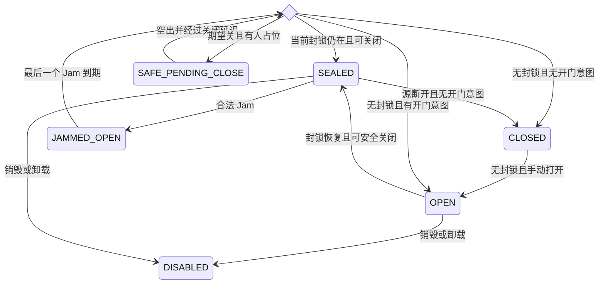
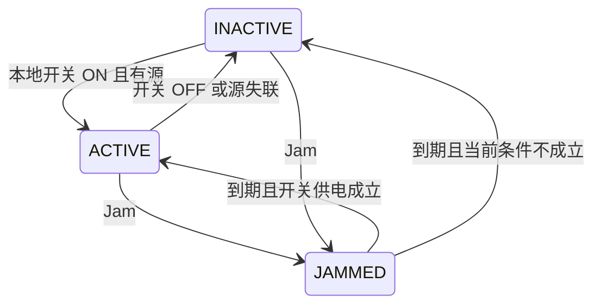
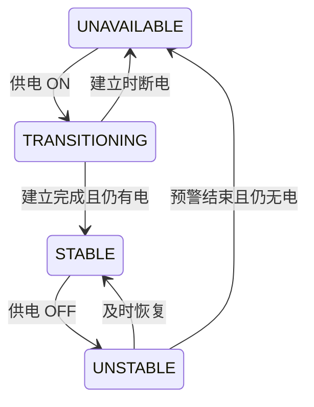
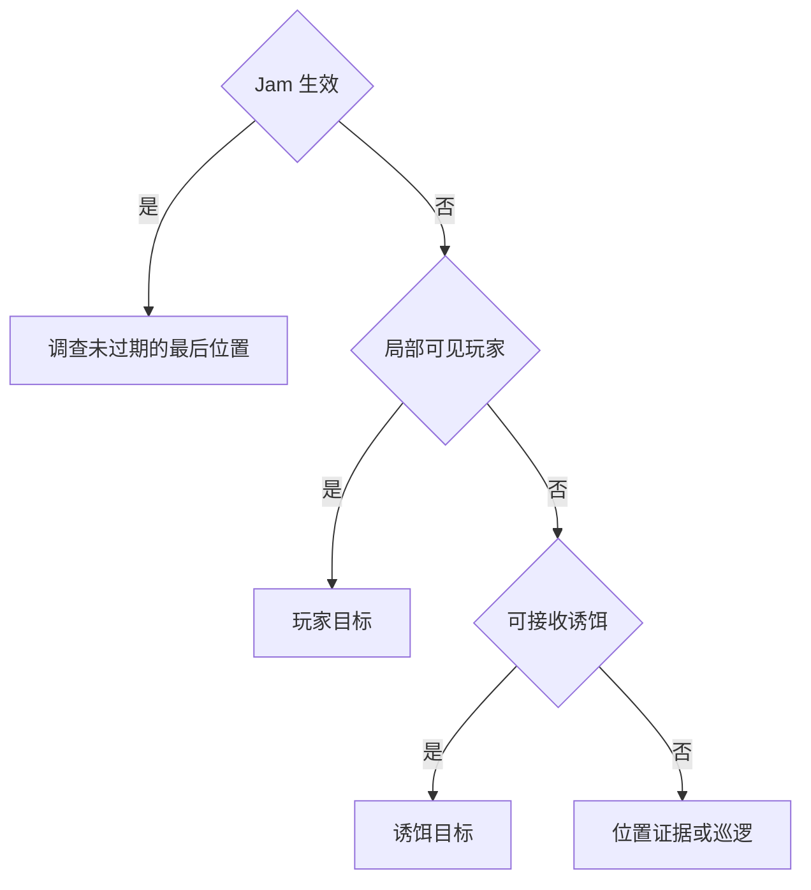

# GDD-02 — Reality Engineering 核心规则

本文件是首切片规则的单一推荐规格，关联[因果链](VERTICAL_SLICE_CAUSAL_CHAINS.md)、[测试规格](GDD_02_TEST_SPEC.md)、[决策登记册](DESIGN_DECISION_REGISTER.md)与[独立复核](GDD_02_REVIEW_REPORT.md)。本轮只设计，没有实现或执行玩法验收。

## 0. 批准层级与事实基线

| 决策 | 批准层级 | 范围 |
| --- | --- | --- |
| D1 | 明确批准 | 必须击败 Warden 才能进入结尾；常规战斗独立可胜；Signal 有可测量收益；没有绕 Boss 撤离 |
| D2 | 明确批准 | 只操纵门、中继器、预设桥梁、敌人感知连接；禁止自由地形与四高级协议解锁 |
| D4 | 仅原则批准 | 表驱动因果、恢复信号不回滚历史物理状态、非法零扣费、可理解失败与安全恢复 |
| D3、D5、D6、D7、D8、D9 | 仅原则认可 | 单 Energy、四类信息、预定义 ECHO、二选一持久后果、固定模板入口、三类验收；细节未冻结 |

下文全部新增细则为**建议冻结**。新增设计数值统一标为 **Prototype Tuning Values — 原型调参初值**，等待原型证据和用户签核；源码事实、章节编号及测试编号不属于调参。

本轮核对的分支为 main，起点 `48cd36fc58d1836754de860b777cd45143ad39fe`。源码事实与候选设计分开解释。

| 真实接口或限制 | 源码依据 |
| --- | --- |
| SAVE_VERSION=2，存储键仍为 last_signal_save_v1 | `src/types/index.ts`、`src/config/game.ts` |
| RunCheckpoint 保存玩家、位置、房间、掉落、RNG 和统计，没有 Signal、模板或选择字段 | `src/types/index.ts`、`src/systems/RunCheckpoint.ts` |
| captureCheckpoint 仅在安全清房状态、玩家存活且无 Boss/活敌/未清威胁时捕获 | `src/world/World.ts` |
| RNG 已有 snapshot/restore，玩法侧仍有 Math.random | `src/core/random.ts`、`Boss.ts`、`LevelUpScene.ts` |
| World 使用变长 dt；Enemy 直接获取 Player；Boss 为独立类 | `World.ts`、`Enemy.ts`、`Boss.ts`、`GameScene.ts` |
| gameBus 尚无消费者；没有 Signal、Reality、Bridge、ECHO 实现 | `src/core/eventbus.ts` 与当前 src 结构 |
| 原版和 economy 共用主存档 run 槽 | `docs/ECONOMY_MODE.md`、`src/economy/main.ts` |
| Boss 死亡经 onBossWin/finishRun 结算，目前无结尾选择界面 | `World.ts`、`GameScene.ts`、`SaveSystem.ts`、`GameOverScene.ts` |

源码中的检查点和永久进度是可复用能力，不能证明本规格已实现。完整 GDB、对齐报告、登记册、六份旧技术设计、STYLE_GUIDE 和 ECONOMY_MODE 均作为本轮阅读依据，旧文档历史快照不覆盖当前源码。

## 1. 最小对象合同与术语

这些是设计概念，不要求全部成为实际代码字段。

| 项目 | 规则 |
| --- | --- |
| Target ID | 模板内稳定 targetId；运行实例带 instanceId；场景会话带 sceneEpoch |
| Target Type | Door、Relay、Bridge、Enemy Perception Link 四种 |
| Physical State | 当前门碰撞、桥承重、设备外观和占位，区别于历史物理快照 |
| Signal State | 输入源、有效连接、发射状态与接收压制 |
| Allowed Operations | §5 的 Scan/Jam/Decoy 和明确支持的手动交互 |
| Preconditions | 存活、权限、实例、状态、距离、LOS、Energy、冷却和合法目标 |
| Transition Rules | §4 的解析函数，按 §7 全序执行；每 tick 只发布一次最终快照 |
| Duration | 整数逻辑 tick，有效区间为创建 tick 起至到期 tick 之前 |
| Recovery Rules | 当前输入重算、占位待关、安全送岸、重开和安全点恢复 |
| Energy Cost | 成功事务只扣一次；非法及重复投递无新增资源写 |
| Failure Reason | §9 的错误码与玩家可理解的原因 |
| Observable Feedback | 外观、声音、状态提示、合法观察 DTO 和动作回执与真实状态一致 |

`wx/wy` 一律表示网格世界坐标。`relay` 是设备，`RELAY` 是本切片未解锁的高级技能，两者不能互换。目标类型、信息访问类别、信号类型是三个不同维度，不从“四类目标”推导信号枚举。首切片只需要能力事件与设备控制/共享信息事件，完整信号命名仍按后续 ADR 对齐。

## 2. 五层状态

| 层 | 内容 | 生命周期与权威 |
| --- | --- | --- |
| 物理 | 玩家位置/HP、已出手弹丸、当前碰撞与承重 | 游戏物理与战斗层；Signal 不回滚旧位置、旧 HP 或旧弹丸 |
| 信号连接 | 模板边、源是否存活、当前输出、接收是否受压制 | 本 tick 从当前输入求解；连接恢复不复活已销毁源 |
| 临时效果 | Jam、Decoy、Scan 揭示、冷却 | 整数 tick 到期，暂停冻结 |
| 持续设备状态 | 门开门意图、relay 开关、桥状态、已发现端点 | 局内持续，按合法操作或当前依赖改变 |
| 剧情/跨局 | 二选一结果与已提交事实 | 独立持久区；本局确认后不可撤销，下一局的更新合同见 §11 |

设备可以改变当前碰撞，桥危险可以产生当前伤害和送岸。这些是当前状态转换的后果。禁止的是恢复 Jam 以前的历史物理状态。

## 3. 四类目标与模板约束

| 目标 | 操纵的部分 | 边界 |
| --- | --- | --- |
| Door | 封锁信号接收器与普通开门意图 | 不增加钥匙/破门系统 |
| Relay | 本地开关、有效发射及只读下游依赖 | 走廊设备两岸可操作且本地供电；Boss 护盾节点为维护封闭 subtype，不支持手动 OFF |
| Bridge | 预设承重状态 | 不能自由生成或删除地形，直接 Jam/Decoy 不适用 |
| Enemy Perception Link | 局部与共享信息接收 | 不直接写 AI 行动、不把 Jam 统一变为眩晕 |

Boss 护盾源属于 Relay，场地压力使用其输出连接或 Enemy Link，不新增第五类目标。模板信号图采用有向无环图，装载时校验端点、控制路径、两岸固定安全点和门前等待区。图有环、缺必经源或安全点时拒绝装载，保留现有进度并显示原因。

走廊本地供电不可被玩家破坏，开关不依赖其下游电路。首切片不支持破坏四类设备；销毁语义用于敌人死亡、卸载及生命周期测试。具体布局和尺寸由 GDD-03 决定。

## 4. 目标状态机

### 4.1 Door

使用 `OPEN / CLOSED / SEALED / JAMMED_OPEN / SAFE_PENDING_CLOSE / DISABLED`。`SEALED` 表示当前有有效封锁，不能普通交互绕过。

每 tick 先求有效封锁，再求期望开态。`jamActive` 时期望开；否则有封锁时期望关；否则按 manualOpenIntent。若原本可通行、现在期望关且有人占据门区，则安全待关。空出门区后再等 CLOSE_DELAY_TICKS，重算当前条件再关闭。重新占位重新等待，不能夹人或挤走玩家。

| 当前状态/输入 | 操作或事件 | 结果及反馈 |
| --- | --- | --- |
| 模板初始 | 装载 | 谜题门有封锁为 SEALED；对照门无封锁，默认 CLOSED，可正常手动打开 |
| 无有效封锁 | 手动开启/关闭 | 更新 manualOpenIntent，得到 OPEN/CLOSED；关闭仍受占位保护 |
| SEALED | 手动开门 | E_LINK_UNAVAILABLE，原意图不变，零 Energy |
| SEALED/CLOSED/OPEN | 合法 Jam | 接收器被压制，转 JAMMED_OPEN；不改发射源、不锁死原开门意图 |
| JAMMED_OPEN | 最后一个 Jam 到期 | 恢复接收，按当前源、意图和占位求解，可能 SEALED/CLOSED/OPEN/SAFE_PENDING_CLOSE |
| 任意未销毁状态 | 封锁源断开 | 有效封锁为 false，恢复普通开关能力，不强制回到 Jam 前状态 |
| 任意未销毁状态 | 封锁源恢复 | 有效封锁为 true，要求关门；占位时先安全待关 |
| SAFE_PENDING_CLOSE | 玩家离开且延迟结束 | 再次求解当前期望，不盲目执行旧关闭回调 |
| 任意 | 场景卸载/销毁 | DISABLED，禁新操作，丢弃旧事件，不影响其他实例 |
| 任意 | 新局/房间重开 | 模板初值或最近安全点快照，区别于 Jam 到期；新 epoch |

Jam 结束时门不一定关闭。源仍在、无人占位且延迟完成才关闭；源已断开时按当前普通开门意图。封锁存在时手动开门不能成为谜题旁路。

图为条件分支概览，其余状态的销毁/重开同样按表处理。R1 封锁源不可由玩家免费关闭；断源只作为模板控制事件或状态机测试输入。是否在教学中暴露此对照事件由 GDD-03 决定。

### 4.2 Relay

状态为 `ACTIVE / INACTIVE / JAMMED / DISABLED`。求解优先级为销毁 → 活跃 Jam → manualEnabled=false → 无存活输入源 → ACTIVE。前四种情况有效发射为 OFF，ACTIVE 为 ON。多个源取有效强度最大值，平局按 sourceId，再按事件 ID 排序；增加存活源不能覆盖手动 OFF 或 Jam。

| 当前状态/输入 | 操作或事件 | 结果 |
| --- | --- | --- |
| 初始 | 装载 | 走廊开关 OFF，Boss 护盾节点 ON；二者均有本地供电 |
| INACTIVE | 走廊本地开关 ON | 有存活源且无 Jam 则 ACTIVE，零 Energy |
| ACTIVE | 本地开关 OFF | INACTIVE，输出 OFF，两岸操作仍可用 |
| 任意未销毁状态 | 合法 Jam | JAMMED，输出 OFF，保留 manualEnabled 与源集合 |
| JAMMED | 切换走廊开关 | 更新 manualEnabled，仍 JAMMED；到期再用新值求解 |
| JAMMED | 最后一个 Jam 到期 | 依据当前源和开关转 ACTIVE/INACTIVE |
| 任意未销毁状态 | 源失联或恢复 | 按优先级重算，当前输出同步变化 |
| 任意 | 销毁/卸载 | DISABLED，从下 tick 的引用表移除，不接受延迟操作 |
| 任意 | 重开/恢复 | 模板初值或快照，不套用“恢复 Jam 前输出” |

relay OFF 在同一逻辑提交中使桥收到 OFF、共享感知断开、所连接的 Boss 护盾减弱。各下游使用自己的安全规则，不保持上一输出，也不回滚历史。图按拓扑序在候选快照内求解，所有下游一次发布。销毁端点按失联求解；模板结构无效在装载期拒绝。操作导致提交校验失败时连同扣费/冷却/新效果一起回滚，E_RETRYABLE。

### 4.3 Bridge

状态为 `UNAVAILABLE / TRANSITIONING / STABLE / UNSTABLE / DISABLED`。预设未建成桥的初态为 UNAVAILABLE。TRANSITIONING 是建立承重的预警，UNSTABLE 是失去承重前的预警，不能互相混用。

| 当前状态 | 条件 | 新状态与后果 |
| --- | --- | --- |
| UNAVAILABLE | 当前 relay 输出 ON | TRANSITIONING，设定建立截止 tick，暂不可走 |
| TRANSITIONING | 截止前输出 OFF | UNAVAILABLE，取消建立 |
| TRANSITIONING | 截止且输出 ON | STABLE，可承重 |
| STABLE | 输出 OFF | UNSTABLE，仍承重，开始失稳预警，不立即扣血 |
| UNSTABLE | 截止前或截止 tick 输出恢复 ON | STABLE，取消失稳，无伤害 |
| UNSTABLE | 截止且仍 OFF，无玩家 | UNAVAILABLE，不扣血 |
| UNSTABLE | 截止且仍 OFF，玩家在桥上 | 一次送到进入桥前最后一岸的固定安全点，扣 BRIDGE_DANGER_HP 后转 UNAVAILABLE |
| UNAVAILABLE | 任意第 N 次本地重启 relay | 再走建立流程，无恢复次数上限 |
| 任意 | 新局/房间重开或恢复 | 模板初态或安全点快照，新 epoch |

安全岸点在模板启动时验证，两岸都有本地控制，岸点无持续伤害、不可被可关闭门覆盖且不会被敌人占位阻断。无法验证则拒绝装载，运行时不临时搜索任意格。送岸只执行一次，单次流程有限时；不设置“三次后不再救援”的硬上限。扣血可导致正常死亡，随后按失败结算清本局 run、允许新开局，跨局结果与其他模式进度不变。非致命送岸不清档。

### 4.4 Enemy Perception Link

连接状态与 AI 行为分开。连接记录 sharedConnected、jammed 和当前合法信息；当前胜出信息决定目标，AI 再决定调查、追击或攻击。`LINKED / JAMMED / DISCONNECTED` 是连接状态，`DECOYED` 是当前目标来自诱饵的可观察标记，不能把共享断线误作局部失明。

优先级为死亡 → Jam → 局部可见玩家 → 局部可接收诱饵 → 未过期位置证据 → 巡逻。局部可见需要敌人当前感知半径和 LOS。共享信息不越过优先级直接强迫攻击。

| 输入 | 连接/信息变化 | AI 合法后果 |
| --- | --- | --- |
| 正常 | 本地视觉及在线共享消息可接收 | 玩家当前可见则优先于诱饵 |
| relay OFF | sharedConnected=false | 局部视觉仍工作；保留未过期最后位置 |
| Jam 命中接收器 | jammed=true，屏蔽新的本地视觉、诱饵和共享消息 | 只能调查 Jam 前已观察的固定位置，不实时追踪隐藏玩家 |
| Decoy 生效 | 产生有位置与生命周期的可接收信号 | 没有可见玩家时才可选诱饵；标记 DECOYED |
| Jam/Decoy 到期或源失联 | 删除当前效果，按当前输入重算 | 重新获取目标，不回放旧追击指令 |
| 玩家重新可见 | 更新合法玩家位置证据 | 切回玩家，不因诱饵而忽视眼前玩家 |
| 所有新信息不可得 | 最后位置按 TTL 到期 | 无有效位置则巡逻；不虚构目标 |
| 实例死亡/场景重开 | 停收信息、清旧回调或按快照重建 | 不能向新实例投递旧指令 |

位置证据只保存 wx/wy、observedAtTick、expiresAtTick，不保存可实时解析隐藏玩家的 targetId。多条证据取观察 tick 最新者，再按 senderId 排序。同 tick 攻击提交前检查合法目标，无当前可攻击目标则取消尚未出手的攻击；已有弹丸继续飞行，Jam 不删弹、不回退伤害、不写 stunTimer。

## 5. 操作矩阵

Scan 为一次以玩家为中心的扫描脉冲，扣一次费，可揭示所有符合距离/LOS 的合法目标。矩阵描述该脉冲对每类目标的结果，不按目标数量重复扣费。空扫仍合法且扣费，反馈“范围内未发现目标”，不能借免费目标探测获知隐藏物。

Jam 选择一个普通可见或仍有效揭示的门接收器、relay 或敌人连接，检查施法距离及 LOS。Decoy 在指定可走格点创建一个源，符合接收距离和 LOS 的敌人可收到；不按敌人数扣费。每玩家最多一个诱饵，新放置成功才替换旧源。三能力均不能在暂停、死亡、无权限时执行。

下表每个允许项还须通过 §9 的统一事务校验。距离均严格小于参数半径，信息权限与可走格校验独立执行。

| Target | Scan | Jam | Decoy |
| --- | --- | --- | --- |
| Door | 允许；距离/LOS；揭示当前封锁接收与合法边；一次脉冲10；8秒 TTL；冷却后重扫刷新；不改变下游；物理/控制差异叠层反馈 | 允许；距离/LOS/活接收器；压制接收；25；6秒；生效中重施失败零扣费；门安全求解；暂开/待关反馈 | 不支持，门不接收诱饵；0费、无效果/时长/重复副作用/连锁，E_NOT_APPLICABLE |
| Relay | 允许；距离/LOS；揭示当前发射及可扫描端点子集；10/脉冲；8秒；可刷新；无状态连锁；显示局部依赖 | 允许；距离/LOS；发射 OFF；25；6秒；不可刷新现有 Jam；桥/共享感知/护盾同步重算；压制及下游反馈 | 不支持，设备不进行目标调查；0费、无其他影响，E_NOT_APPLICABLE |
| Bridge | 允许；距离/LOS；揭示承重、预警与已发现控制端；10/脉冲；8秒；可刷新；不改承重；结构读数反馈 | 不支持，桥无直接信号接收器；0费、无其他影响，提示操作中继器 | 不支持，桥不感知诱饵；0费、无其他影响，E_NOT_APPLICABLE |
| Enemy Link | 允许；距离/LOS；揭示当前可观察信息来源类别；10/脉冲；8秒；可刷新；不读内部 FSM；感知图标 | 允许；距离/LOS/接收器存活；屏蔽新信息；25；6秒；不刷新；AI 根据已有合法信息行动；干扰反馈 | 允许；合法落点且敌人可接收；20/源；8秒；冷却后新源替换旧源；可能改变目标；落点、接收/未接收反馈 |

手动交互单独定义。走廊 relay 在两岸可达控制器处按交互键 ON/OFF，费用0、无冷却，按请求 ID 幂等，影响整组下游。Boss 护盾 relay 不支持手动操作，E_NOT_APPLICABLE。普通门在无有效封锁时可手动开关，费用0；封锁时 E_LINK_UNAVAILABLE。Bridge 和 Enemy Link 没有手动状态修改操作。

## 6. Energy 与原型初值

下表全部为 **Prototype Tuning Values — 原型调参初值**，不是已批准平衡参数。旧 SIGNAL 文档仍为上限100、恢复5且单位未定，示例“每 tick 恢复5”也未批准；本轮推荐5每逻辑秒。

| 参数 | 推荐初值 |
| --- | --- |
| Energy 上限/新局值 | 100 / 100 |
| 恢复 | 5/逻辑秒，60Hz 下每12 tick 恢复1；满值清恢复余数 |
| Scan | 消耗10，冷却2秒，揭示8秒，脉冲半径12格 |
| Jam | 消耗25，持续6秒，冷却8秒，施法距离6格 |
| Decoy | 消耗20，持续8秒，冷却10秒，施法距离5格，接收半径5格，最多1个源 |
| 逻辑频率/超长帧上限 | 60Hz / 250ms，每帧最多15个逻辑 tick |
| 门关闭延迟 | 1秒，门区清空后开始 |
| 桥建立/失稳预警 | 各1.5秒 |
| 桥危险扣血 | 20，允许正常死亡 |
| 最后位置证据 | 8秒，过期停止使用 |
| 普通可见与 ECHO 本地接收范围 | 12格且同房间、无遮挡 |
| Boss 护盾 ON/OFF 伤害倍率 | 0.5 / 1.0，保留现有最低伤害2 |
| Boss 配对收益 fixture | 相同有效命中20次，护甲后、护盾前单次伤害20，关闭暴击和阶段切换用于单位级对照 |

冷却从成功提交 tick 起计算，非法不扣费不设冷却。恢复在每正常 tick 的过期处理后、输入事务前执行。暂停、升级界面、结尾/结算冻结 TTL、冷却与 Energy；恢复游戏不补暂停或离线时间。跨房间继承资源；新局清临时效果、冷却与恢复余数，房间重试恢复安全点而不额外补满。

### 6.1 软锁防护

| 情形 | 有限恢复路径 |
| --- | --- |
| 门前耗尽 Energy | 门前必须有无持续伤害且敌人不可进入的等待区；运行时间从0到25最多5秒，可再试 Jam |
| Jam 到期人仍在门口 | 保留通行，空出后延迟再求解，不传送/夹人 |
| 桥上断电 | 完整预警，及时恢复可取消；到期送最后一岸并扣血，可再次开关重试；死亡可新开局 |
| 关闭 relay | 两岸本地开关不受下游供电约束；OFF/Jammed 后仍能操作开关，Jam 结束恢复生效 |
| 误用技能 | 资源自然恢复，冷却有界，非法操作无副作用；不能销毁必经设备或供电 |
| 死亡/重开残留 | 清本局临时状态与旧 epoch，重新装模板；不清其他模式进度或已提交跨局选择 |

## 7. 因果执行顺序与确定性

以下 P0–P7 仅表示一个逻辑 tick 的内部阶段，与项目开发阶段 P0–P5 无关。

| 阶段 | 操作 |
| --- | --- |
| P0 | 处理到期效果和上一 tick 的销毁引用；按 §6 累加器结算一次恢复步进，仅累计满12 tick 时恢复1 Energy |
| P1 | 校验 sceneEpoch 与实例存活；旧 epoch 和失效实例直接拒绝 |
| P2 | 读取同一份权威位置/占位输入；按 tick、操作者ID、requestId 排序；检查幂等及载荷一致性 |
| P3 | 校验权限、能力/目标、状态、距离/LOS、Energy 和冷却，形成含扣费/效果的候选事务 |
| P4 | 计算未过期效果并集与只读模板边，按拓扑序求 relay 输出、门/桥与共享连接候选快照 |
| P5 | 校验候选后一次提交状态、Energy、冷却、效果和回执；失败全回滚，消费者不读半成品 |
| P6 | AI 读取合法当前信息，取消尚未出手的非法攻击；物理层使用当前碰撞处理移动与已有弹丸 |
| P7 | 发布经过白名单裁剪的反馈与日志，不能再改本 tick 状态 |

创建于 T、持续 D 的 Effect 在 T+ D 的 P0 移除，D 必须大于0。瞬发 Scan 的观察动作不进入零时长效果集合，其揭示记录独立计时。同 tick 旧 Jam 到期、新 Jam 成功时不会出现中间关门帧，P5 只发布最终结果。多个合法 Jam 的压制取未过期集合并集，最后一个结束才恢复，不叠加强度；同一玩家对仍受 Jam 的同目标重施为 E_RETRYABLE，0费。

同 tick 源销毁先于新请求；本 tick 变为 DISABLED 的目标仅保留销毁标记，不继续输出。已在上一阶段合法提交的弹丸不因来源随后销毁而撤销。instanceId 仅在目标重建时改变，正常状态只增 revision，不使现有 Jam 自行失效。sceneEpoch 仅在切片装载、检查点恢复或新局/房间重开时改变；单目标重生不清整个场景效果。

帧累加器采用 `accumulatorMs += min(max(deltaMs,0),250)`，每满 `1000/60` 执行一个逻辑 tick，每帧最多15次。超过上限的整 tick 积压丢弃，保留不足一个 tick 的余数；暂停入口清帧累加器，恢复不补时。这个合同只为未来规则层接入而设计，现有 World 变 dt 没有因此成为确定性实现。

核心确定性保证针对相同初始规则状态、固定步长、权威位置快照序列、有序动作和 RNG 状态。只承诺受控模拟结果一致，不要求全游戏逐帧输入回放。规则求解不用随机数；若未来明确引入随机玩法项，必须从局内 RNG 消费并记录。

## 8. 几何、信息传播与 Boss

### 8.1 空间与连接图

技能距离采用网格坐标中心点距离，严格 `d < radius`，不加碰撞半径。空间能力配置要求 radius 为有限正数，0或负数在装载/校验时拒绝，不能进入公式。Scan/Decoy 接收使用线性 `I=max(0,1-d/radius)`，I>0 且 LOS 成立才接收；不提供零半径特例。Jam 单目标施法不按距离改变持续时间。模板连接是只读逻辑边，不按墙体距离切断，区别于玩家施法的空间 LOS。

LOS 先拒绝越界两端，再以格线 supercover 枚举经过格，去除两端目标格。wall/lava/water 阻断，floor/debris/spawn 不阻断。经过网格角点时两侧格都检查，任一阻断则失败，禁止穿墙角。使用 tile.type，不用 isWalkable 的实体半径采样充当视线。精确网格边界的端点归属使用 floor(wx/wy)，实现需以整数/有理格线比较保持平局一致。

### 8.2 Warden 的必要规则

护盾节点是维护封闭 Relay，有本地源、默认 ON，可被 Jam，不能被普通交互免费关闭。其他场地节点若影响压力，也归入 Relay/Enemy Link，具体布局和数量留 GDD-03。

保持现有护甲规则，护盾乘在护甲后伤害上，最后应用 `max(2, damageAfterArmor * multiplier)`。护盾 ON 的原型倍率0.5，OFF 为1.0，HP 不恢复、没有零伤害免疫。这里“有限护盾”指减伤有限，不引入新持续期或无限护盾回复。因此零 Signal 的常规战斗可以击败 Boss；该保证针对 Boss 战，不要求门谜题也零 Signal 完成。

固定输入配对实验中20次有效命中、护甲后单次20伤害，ON 总伤害200、OFF 为400，证明同输入有直接收益。它是机制对照 fixture，不冒充真实游玩 TTK。真实 E2E 还须记录相同规则下护盾状态、实际伤害及一次完整 Signal 辅助胜利；不强制全局 TTK 比值门槛。

Boss 死亡且玩家存活才提交胜利并解锁结尾。玩家死亡锁定结尾。受控同 tick 双方死亡采用失败优先的建议规则，结算只提交一次，不重复奖励。未击败 Boss 时无法借模板出口撤离。后续阶段只发布已进入的当前阶段，阶段一在进入战斗时可见，未来阶段脚本隐藏。

## 9. 失败与幂等合同

| 码 | 含义 |
| --- | --- |
| E_NOT_APPLICABLE | 能力/目标或 subtype 明确不支持 |
| E_ILLEGAL_TARGET | 越界、不可走诱饵点、范围/LOS 不符或不合法目标 |
| E_LINK_UNAVAILABLE | 当前封锁禁止普通开门 |
| E_ENERGY_INSUFFICIENT / E_COOLDOWN | 资源或冷却不足，分别反馈等待原因 |
| E_PAUSED / E_PERMISSION | 当前游戏状态或操作者权限不允许 |
| E_TARGET_DESTROYED / E_STALE_GENERATION / E_STALE_EPOCH | 目标销毁、实例已换或旧场景请求 |
| E_ID_PAYLOAD_MISMATCH | 同请求 ID 使用了不同载荷 |
| E_RETRYABLE | 仍在效果期或事务校验失败，状态与资源保持提交前值 |
| E_NO_FAR_SHORE | 仅装载期的无合法安全岸点错误，拒绝启动模板 |
| E_CHOICE_CONFLICT / E_SAVE_FAILED | 本局选择已提交另一选项或持久写入失败 |

成功回执用 OK。桥安全送岸等使用独立事件反馈，不作为“技能失败”假码。非法请求无扣费、无冷却变化、无新效果。错误首先按 epoch、生命周期、ID载荷、权限/暂停、支持性、目标几何、目标状态、Energy、冷却排序返回第一个原因。

缓存键为 `(sceneEpoch, actorId, requestId)`，记录规范化载荷和完整首次回执。相同载荷重复返回原回执并加 replayed=true、resourceWritesThisCall=0；原 energyDelta 是首次事务值，不表示本次又扣费。相同 ID 不同载荷拒绝。校验通过 epoch/实例后产生的失败也缓存；条件变化后的新尝试使用新 ID。缓存按会话生命周期清理，不跨 epoch 误命中。不同 ID 的同源同 tick 同能力同目标/落点重复在扣费前合并，不产生第二效果或第二扣费。请求者不能伪造 caster 坐标，权威位置由游戏读取。

## 10. Human / ECHO 信息可见性

四类是字段级访问政策，同一目标可以同时具有普通外观记录、扫描链路记录和 ECHO 事件记录；不把全部字段合并发布。

| 类别 | 玩家 UI 与 ECHO | 判定、失效与 Scan |
| --- | --- | --- |
| Ordinary Visible | 玩家直接看见；ECHO 可读同一公开表现 | 同房间12格内且 LOS；离开后停止 live 更新。只给 open/closed/held、承重/预警外观，不直接暴露 SEALED 原因 |
| Scan Revealed | 玩家叠层可见，ECHO 同权限可读 | 扫描范围/LOS 内合法端点与连接子集；8秒 TTL，当前 LOS/距离失效也停止 live。过期只保留带时刻的已发现摘要，再 Scan 才刷新 |
| ECHO Observable | UI 通过台词表达，ECHO 读取本地接收器事件 | 同房间12格内且信号 LOS；可知道粗粒度载波活动/变化，不知道隐藏源精确位置或完整依赖图；已发生事件保留历史，不当作 live 状态 |
| Hidden | 玩家 UI 与 ECHO 均不可读 | 未发现端点、未来阶段、内部计时/巡逻点、seed/RNG、原始 SaveData 等；Scan 只改变当前可揭示字段，其余仍隐藏 |

模板合法端点不自动等于已发现。普通观察建立实体发现，Scan 可新增范围内且 LOS 合法的端点；输出 inputs/outputs 只能是本次有权获知的子集。只读 World 内部完整图供求解，不把它序列化给 ECHO 或 Harness。

| 实例 | 普通可见 | Scan 揭示 | ECHO 可观察 | 仍隐藏 |
| --- | --- | --- | --- | --- |
| 实验室门 | 相同外观、一扇能开另一扇关闭 | 受控门有持续封锁接收、当前压制状态、本地合法连接 | 在合法范围先报告载波持续或改变；根据真实 Scan/开门事件形成假设 | 远端源坐标、全图连线、未观察状态 |
| 走廊 relay | 硬件、开关灯、桥承重及敌人可见反应 | 当前输出、桥/敌人已发现端点的关联子集 | 接收一次输出变化事件，可提醒同时有两类变化 | 完整依赖图、墙后未扫描节点、未来后果脚本 |
| Warden | 血条、护盾外观、已进入的阶段 | 护盾来源需 Scan 确认，才发布已发现源和当前连接 | 可报告当前载波变化，不能在 Scan 前直接报完整来源 | 未触发阶段、阶段阈值脚本、完整护盾图 |

观察 DTO 仅允许 targetId、可见网格位置、公开表现、observedAtTick、stale标记，以及获得 Scan 权限时的 signalPresent/suppressed/discoveredLinks。当前阶段按战斗公开事件提供，内部 revision/实例句柄只用于动作安全校验，不作为剧情信息。禁止直接返回 EnemyData、World、Phaser.Scene、raw targetId 引用、SaveData 或模板源对象。Hypothesis 始终与已观察事实分开，不自动成为 Canonical。

ECHO 为事件驱动预定义逻辑，规则层不执行其台词。动作由人类确认并走相同资源/冷却校验，模型不可用时保留本地观察与人类全部必要操作。至少一次合理目标分歧由 GDD-03 绑定真实事件；它不能阻止玩家合法选择、随机拒绝操作或读取隐藏答案。外部 Bridge 未实现，本轮只约束未来动作取消及 FAULT→OFFLINE+Mode A，YIELDED 仅人类 takeover。

## 11. 确定性与存档边界

### 11.1 当前接口与风险

现有 validate 校验 version=2 和固定基础字段，不拒绝未知字段；save 用 JSON.stringify 全量写回。_upgrade 从 emptySave 重建已知字段，未知字段可能丢失。_load 可删除无效 run。现有类型没有 Signal、Energy、临时剩余 tick、模板或持久选择字段，不能声称已能恢复它们。源码已支持 RNG snapshot/restore、合法安全房检查点与主模式永久进度。

### 11.2 推荐隔离与兼容策略

建议未来切片使用独立键候选 `last_signal_station_zero_save_v2`。原版/economy 的 last_signal_save_v1 不变。切片入口只能写切片适配器，禁止借主模式首写 expectedId=undefined 覆盖原 run。旧客户端不读取独立键，因此不会删除其扩展。读取主模式永久加成可作为新切片初值，切片奖励与选择不回写主模式，具体奖励归属留 GDD-03。

优先保留基础 SaveData.version=2，并在独立命名空间中加受校验的可选 reality 扩展、sliceSchema 和 templateId/templateRevision 判别。没有扩展的旧 v2 档不自动变成切片档。未来切片客户端遇到未知高 schema、坏扩展或不同模板时保留原始档、拒绝覆写并显示原因，只有用户选新开局才替换本切片 run。不能交给旧 _upgrade 直接丢弃。

单纯可选字段或双写不足以保证兼容；实现前必须验证基础档/缺省/损坏/高schema/旧客户端隔离/回滚/配额失败。若隔离扩展仍无法表达要求，后续 ADR 再提出升级理由与迁移/回滚设计，本轮不自动 Save v3，也不宣称永久禁止升版。

### 11.3 生命周期与恢复算法

| 数据 | 推荐保存与恢复 | 新局/房间重试 |
| --- | --- | --- |
| 主模式基础档与 run | 沿用现有主键 | 切片不改 |
| 切片玩家、房间、位置、掉落、统计、RNG | 独立 run 安全点快照 | 新局模板初值，重试最近安全点 |
| 门意图、relay开关、桥状态、已发现端点 | reality 可选扩展，同一原子快照 | 新局清，重试恢复 |
| Energy、恢复余数、冷却、Scan/Jam/Decoy余时 | 与 reality 同一快照，不使用墙钟截止时间 | 新局按§6，重试不额外补满 |
| 占位、渲染对象、AI目标对象引用、幂等缓存 | 不序列化，恢复后重算/清理 | 新 epoch 拒绝旧输入 |
| 二选一结果 | 切片独立永久区 | 新局/房间重试不清 |

写安全点继续要求 cleared、玩家存活、无 Boss/活敌/未清威胁，并且门桥不在危险转换。活跃临时效果可能在安全房存在，若捕获必须和全部余时同一快照；这不引入战斗内快照。关闭后恢复最近成功安全点，未保存实验进度可丢失但必须提示。

恢复先校验命名空间/模板，再装模板、应用持续状态和合法安全位置、恢复 RNG/Energy/恢复余数、按稳定 targetId 重绑新实例、重建效果和冷却、重算当前链路与占位，最后开放输入。存 savedTick 及各 remainingTicks，恢复从 savedTick 继续，deadline=savedTick+remainingTicks，离线时间不推进。新的 sceneEpoch 阻止旧回调，不能把新恢复的冷却误清零。0余时效果不恢复。模板无合法安全位置则拒绝恢复且保留档，不能用随机传送掩盖不兼容。

### 11.4 二选一持久合同

仅建议接口，选项文本、具体字段与两种后果表现留 GDD-03。commitChoice(runId, option) 仅接受同一获胜且玩家存活会话，两个合法不透明值之一。胜利会话凭据独立于 finishRun 已删除的 run，不能用任意历史 runId 授权。

同一局相同选项重试返回原成功回执，不重复奖励；同局不同选项 E_CHOICE_CONFLICT。本局确认不可撤销，下一局再次选择可在成功提交时替换这一个持久世界状态。写失败返回 E_SAVE_FAILED，保留选择界面与重试，不伪报已存、不提前应用后果。成功后 getCommittedChoice 才向下一局模板提供只读结果。新局清 run 不清持久结果，旧模式存档不受影响。

## 12. 对齐差异与待签核项

| 既有口径 | GDD-02 处理 |
| --- | --- |
| GDB 的撤离胜利候选 | D1 明确批准覆盖，必须击败 Warden |
| 高级技能/自由地形候选 | D2 明确限制首切片范围，relay设备不等于RELAY技能 |
| SIGNAL 每tick恢复5的示例测试 | 原方案时间单位未冻，本轮5/逻辑秒仅原型建议 |
| 旧 Jam 缩 aggro 或 stun 候选 | 推荐改信息接收合同，不改配置常量、不强制眩晕；待用户冻结 |
| Scan 只读与改变玩法 | 不改物理设备，改变可获得信息与后续决策，使用真实观察状态 |
| 旧存档v1/测试7与4记录 | 当前为Save v2；本轮仅静态核对当前接口，不把旧结果当实测 |
| 人格与权限层 | ECHO叙事/观察独立于输入仲裁，台词不改世界 |
| 原随机地图 | 固定模板旁路随机分配、复用World；模板接口尚需未来扩展 |

需要用户签核的规则包括安全转换、信息访问、原型参数、免费两岸控制与Boss节点手动限制、实例/epoch/事务顺序、独立切片存储及恢复合同。这些已有单一推荐，不留相互矛盾分叉。GDD-03 决定具体几何、敌人布置、ECHO台词、二选一内容与表现、试玩场景和最终关卡验收。实现前需事件通道/适配、存档扩展和权限 ADR；本轮不修改旧技术文档或GDB原文。

## 13. 架构边界、非目标与质量问题

纯规则层只接收普通数据快照，输出候选状态/回执/事件，不 import Phaser/World/MCP。游戏适配层读只读瓦片/位置/占位，统一提交设备碰撞和合法 AI 输入。现有 gameBus 只能作为候选提交后通知，handler 注册顺序不能成为因果权威。新监听归切片会话，SHUTDOWN 清理效果、队列与回调。

受控模拟在移动前采样位置，先提交碰撞状态再处理移动，防止关闭后又走进门内。多 tick 同帧各自采样受控位置。不承诺当前变 dt 全游戏已经可回放。

非目标包括自由地形、第五目标类、通用编辑器、四高级技能、全物理重构、多人/联网、真实LLM/MCP、全套ECHO记忆、完整剧情结局、自动Save v3、CI变更及GDD-03布局/功能实现。同 tick 多请求是重入验证，不代表增加多人系统。

| 质量问题 | 可定位回答 |
| --- | --- |
| Q1 为什么关门 | §4.1 当前有效封锁与占位保护 |
| Q2 Jam为何开门 | §4.1/§5 压制接收条件，设备重新求解 |
| Q3 到期发生什么 | §4.1 当前源/意图/占位重算，不回滚 |
| Q4 桥为何变化 | §4.2–4.3 relay输出决定预设承重状态 |
| Q5 敌人为何变化 | §4.4 共享信息可达性和合法目标解析 |
| Q6 如何发现 | 因果链§2、测试规格的预测与迁移证据 |
| Q7 ECHO凭什么知道 | §10 有限范围本地接收器和合法Scan |
| Q8 能否永久卡死 | §6.1 可恢复等待/两岸控制/预警送岸/死亡重开 |
| Q9 能否复现 | §7 受控步长、快照、动作全序和RNG |
| Q10 策略价值 | 门操纵控制条件；走廊同时影响桥与共享感知；Boss伤害收益有配对证据 |
