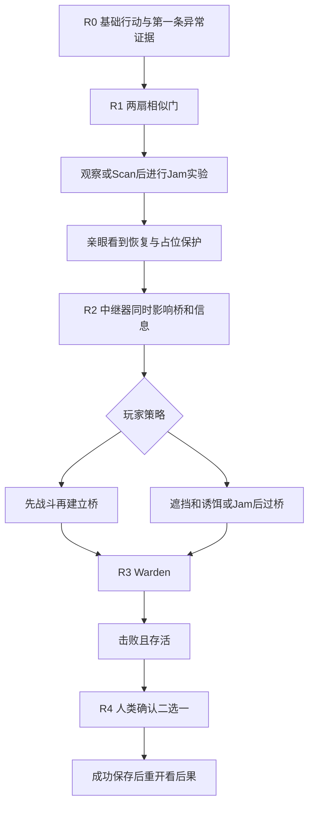

# GDD-03 — Station Zero 体验与教学流程

本文件是推荐设计，配套[白盒关卡](VERTICAL_SLICE_LEVEL_DESIGN.md)、[ECHO脚本](ECHO_VERTICAL_SLICE_SCRIPT.md)、[UI规格](VERTICAL_SLICE_UI_SPEC.md)和[验收规格](GDD_03_TEST_SPEC.md)。本轮没有实现或实测。GDD-02 的状态、距离、能耗与冷却继续按[原提案](REALITY_ENGINEERING_RULES.md)使用，不因本轮交付而获得批准。

## 1. 目标体验与计时口径

首次有效游玩目标为20–30分钟，中心预算24分钟；熟悉后推荐预期9–14分钟。它们是待试玩验证的预算，不是运行时限制、已测结果或必须等待的时长。快速完成者可以直接结束。

| 环节 | 首次预算 | 熟悉后预算 | 时间应花在哪里 |
| --- | --- | --- | --- |
| R0 苏醒舱 | 4分钟 | 1–2分钟 | 基础动作练习、一次短战斗、亲眼看到日志与信号读数差异 |
| R1 观测实验室 | 5分钟 | 1–2分钟 | 对照两门、Scan、提出或尝试假设、Jam与恢复观测；可选反事实自检 |
| R2 失稳走廊 | 6分钟 | 2–3分钟 | 观察中继器双影响、试一条路线、调整遮挡与诱饵位置；另一解可留重玩 |
| R3 共识核心 | 7分钟 | 4–5分钟 | 观察护盾、实际战斗和阶段应对、选择是否用Signal创造窗口 |
| R4 结尾与新局反馈 | 2分钟 | 1–2分钟 | 阅读两种后果、听取不同意见、确认选择、在下局检查变化 |
| 合计 | 24分钟 | 9–14分钟 | 熟悉后不强求达到首次目标 |

预算包含主动观察、思考、实验、合理移动与正常对话阅读；不把暂停、页面失焦、加载、试玩访谈、刻意空等或整局死亡重开算入一次成功路径时长。另报告从首次进入到最终成功的总墙钟时间与死亡重试次数，不能靠改变统计口径掩盖体验不足。

首轮试玩按每房记录观察/移动/战斗/实验/对话/无进展等待的秒数，禁止用延长对话、增加Boss HP或重复刷怪补足预算。若玩家已能独立解释规则且首次成功普遍不足20分钟，记录为节奏目标未达，先评审可选对照实验是否有真实价值；不设置强制倒计时。若超过30分钟，先检查谜题信息、路线可读性与死亡成本。

## 2. 完整体验顺序

路线推进取决于合法世界状态与玩家到达出口，不取决于播放完某句台词。R1出口不能被参考门旁路，R2出口不能要求清光敌人。边界、返回点与坐标以白盒文档为准。

## 3. R0 — 基础行动与可见的异常

醒来镜头建议不超过1秒，可立即按跳过键；镜头结束或跳过后同样进入可操作状态。移动、瞄准、开火、冲刺提示逐项轻量出现，重复开局允许关闭已见教学，不跳过真实门或战斗。

一个现有敌人种类承担短基础战斗，不新增训练机器人类型。为移动、开火、冲刺分别记录真实动作；教学建议不作为永久锁门条件。出口仅按白盒合法条件开放。

第一条异常依附已有出口门控制面。表面记录并列显示“本次苏醒标记 T+00:00”和“存档中的苏醒标记 T+17:00”；Scan发现设备仍在接收载波，与熄灭的表面指示不一致。它们是候选环境叙事文本，不冻结大静默年代、玩家轮回或ECHO身份真相。玩家可以自己读到证据，ECHO只比较本地记录并表达无法解释。

可选档案为该设备的信息页，不新增第五类可操纵目标。首个Scan在无威胁的位置使用，失败操作与空扫会清晰反馈，不用敌人攻击打断第一次理解。

## 4. R1 — 自主发现的主要验证场景

### 4.1 现象到理解

| 过程 | 设计信息与玩家可能行为 | 反馈与判断 |
| --- | --- | --- |
| 现象 | 两扇门外观相似，参考门可普通打开并通向小室；主线门拒绝普通开启 | 两门用相同外观语言，失败提示只说“当前封锁接收有效”，不直接要求按Jam |
| 观察 | 自发Scan，或先试其他合法操作 | 脉冲揭示本地接收状态和当前可见连接，不显示完整谜题答案或全图线 |
| 假设 | 门坏了、需要某个动作、存在外部持续控制等 | 允许错误假设；ECHO在H0不自动说出操作顺序 |
| 实验 | 对谜题门接收器Jam | 发射源仍在，接收受压制，门实际可通行；记录费用与真实状态变化 |
| 恢复 | 玩家通过或站在门区，Jam到期 | 同一规则在无人/占位两种条件下产生不同安全结果，HUD显示实际待关状态 |
| 再解释 | 比较原门、参考门和恢复后的信号 | 可说明“抑制接收改变了封锁条件”；仅按对按钮不能证明理解 |

### 4.2 可选反事实对照

建议增加一次固定模板自检事件 `R1_SOURCE_TEST`，不是可操作的新设备。它只有在玩家已经合法跨过谜题门并到达门后安全区后才可发生，因此不能成为首次解谜旁路。触发时先显示“控制链路自检”，在安全条件下使模板源OFF两逻辑秒，再恢复ON；可见字段按实际Scan权限裁剪。

玩家若返回门前，会发现无封锁时普通交互有效，有封锁恢复后又受控。仍有人占位则遵守待关。自检不强迫玩家等候，不要求回头才能继续，不把断源当成免费玩家技能。状态和已触发标记进入切片房间快照，恢复安全点不重复制造额外事件。该事件为本轮新增提案，需用户确认；不接受时保留参考门与Jam恢复对照，理解度测试仍使用合法受控fixture。

### 4.3 卡住与资源不足

门前安全区允许运行时间攒Energy。0到一次Jam所需25能量按GDD-02初值最多5秒，提示显示预计等待，不把暂停时间计入。重复Jam仍在生效时不扣费刷新；按当前状态反馈。普通门小室不能连接主线门后区域。

## 5. R2 — 多目标后果与两种解法

初见时能看到桥不可承重、relay灯处于OFF，以及一个守卫（drone）观察入口。先扫描能看到已发现桥端与共享信息端的关联子集，ECHO不能在扫描前直接报全图依赖。

路线A允许先战斗清除守卫，再开启relay过桥。路线B从实际入口对该守卫的感知接收器施放一次Jam，然后开启relay、等待桥建立并跨越，在守卫存活时到达东岸。具体范围和时限以白盒§5为准。Decoy只作可选信息实验，不保证能转移看得见玩家的守卫，也不构成另一条已经证明的过桥路线。恢复桥与恢复共享信息必须同tick发生；个人Jam不会被relay恢复覆盖。局部视觉不会因relay OFF自动消失，玩家可在安全位置比较桥与共享连接的反馈。

Jam relay造成桥失稳，是一次合法但可能不利的实验。必须先有1.5秒承重预警；允许及时恢复，或安全送最后一岸并扣血，不能无预警掉落。重复实验不因固定次数上限永久卡死。准确路线、射程与时间证明由白盒文档提供，实际可玩性仍需实现后测试。

首次成功只要求完成一种路线。第二条路线由可选重试、下次游玩或验收fixture覆盖，不强迫玩家重复清房凑6分钟。清怪路线不能让同一房间敌人复活，留敌路线不能被自动清房传送门封住。

## 6. R3 — 把观察应用于战斗

只复用现有Warden三阶段攻击及0.66/0.33阶段阈值的设计基础，增加一个真实Relay护盾来源。首切片不同时要求场地自由重构与多节点冲突。

玩家可始终靠普通战斗获胜。Scan确认护盾来源后Jam节点，原型伤害倍率从0.5变1.0；最低伤害沿用2。现场反馈必须显示当前护盾受控/被压制和实际伤害变化。配对机制实验与完整Boss胜利分别验收，不能把单位伤害fixture冒充实际TTK。

ECHO首次只说发现载波变化，未Scan不报源的位置；战斗中只播短句，不盖住瞄准区，不公布未触发阶段。Boss击败且玩家存活才进入R4，同tick双方死亡按GDD-02建议失败优先。

## 7. R4 — 分歧、保存与重开

两选项推荐为 Restore Power / Preserve Memory，具体语义见ECHO脚本。玩家可以听取观点、改变预选、取消确认返回选择；成功提交后本局不可撤销。ECHO不能代选。

只有成功写入独立切片永久区才退出选择。写失败保留选择UI与重试，禁止假报已保存。下一局在R0看到灯带/设备档案差异和不同台词，不修改HP、Energy、武器或门桥解法。后果是一个枚举状态的不同表现，不扩成完整分支剧情框架。

## 8. 分级提示合同

本任务使用H0–H4，防止与房间R0–R4及开发阶段混淆。H1之后的时间、失败数与冷却均为原型提示初值，尚未批准。

| 等级 | 内容边界 | 触发与重复 |
| --- | --- | --- |
| H0 | 无解法提示；保留真实设备反馈 | 默认状态，不能一进门自动跳级 |
| H1 | 指出当前可见异常 | 正常活动时间40秒没有语义进展可自动一次；也可玩家请求；每房最多一次自动 |
| H2 | 指出可观察对象，不给技能顺序 | 已见H1、再45秒无进展且至少一次合法失败，或显式请求更多；每房自动最多一次 |
| H3 | 提出可验证假设并说明不确定 | 已见H2后玩家显式请求；需有合法观察支持，不以主持人/脚本全知补数据 |
| H4 | 给出当前合法操作建议 | 已见H3且玩家点击“需要具体操作”；永不自动触发，即使重复失败也须确认 |

语义进展为新增合法Scan记录、改变设备状态、成功通过门/桥或获得新观察，不是走动几步或随意点击。计时只在该房间正常可操作、无战斗威胁、非暂停/对话选项模态时推进；发生进展重置无进展计时。手动请求一次只升一级，可以关闭主动提示。相同Hint ID每次进入房间最多播放一次，玩家主动重听走独立请求并记录。

提示目标只能来自Ordinary Visible或有效Scan Revealed。若不足以提出H3/H4，ECHO先说信息不足并建议观察当前可见区域，不泄漏护盾源或隐藏连接。所有提示级别与来源写试玩记录，H3/H4后的表现不能记为自主发现。

## 9. 跳过、失败与重试成本

| 情形 | 恢复位置/进度 | 原型时间预算与限制 |
| --- | --- | --- |
| 能量耗尽 | 原地安全区域，自然恢复 | 最多5秒恢复一次Jam需求；不要求回满100 |
| 非致命桥危险 | 进入桥前最后一岸 | 单次预警及位移有界，再次建立桥只需1.5秒；不设失败次数硬上限 |
| 手动退出/刷新 | 最近成功安全点 | 未保存实验可丢失，必须提前提示；无战斗内快照 |
| 路线B留活敌后退出 | 最近合法安全点，通常R1出口侧 | 重跑R2的熟悉路线约1–3分钟，再回Boss；不能伪称已存R3前安全点 |
| 玩家死亡 | 失败清本局run，新开R0 | 不自动续关；已见演出可跳，熟悉重跑至Boss约5–9分钟，属待试玩验证的风险预算 |
| Boss失败 | 同上 | 不新加Boss复活点。若成本不可接受，需要产品另批死亡续关语义，不能隐改GDD-02 |

新局可以跳已见镜头/对话、关闭已学按键提示，不能跳SEAL门、桥条件或Warden。首次故事也不强制停留读长文，候选档案始终可选。

## 10. 节奏与发现验收

自动化检查可验证连通、状态与等待上界，不能证明玩家理解。无提示试玩在完成或明确卡住之后，先开放提问“你认为刚才为什么能通过”，再进行预测与同构迁移；具体观察表见测试规格。

需要分别报告H0/H1下自主发现、接受H2后发现、H3/H4后完成、随机成功和未理解。若多数回答仍只有“Jam能开门”，回到门的对照与恢复反馈设计，不加更多解释台词替代可观察因果。首次时间、熟练时间与失败总成本均需记录实测后再确认。
