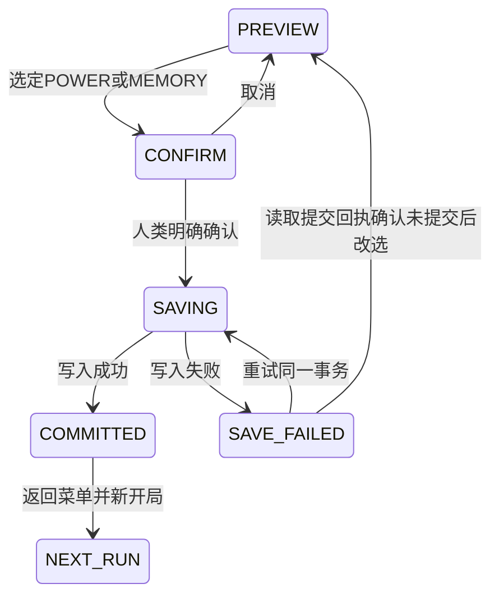

# GDD-03 — 首切片 UI 与反馈规格

本文件仅设计。视觉遵守[STYLE_GUIDE](STYLE_GUIDE.md)，状态语义引用[GDD-02](REALITY_ENGINEERING_RULES.md)，事件引用[ECHO脚本](ECHO_VERTICAL_SLICE_SCRIPT.md)，触发时序引用[体验流程](VERTICAL_SLICE_EXPERIENCE_FLOW.md)。新增键位、尺寸和动画值均为原型交互建议，尚未实现或批准。

## 1. 最小信息结构

| 区域 | 内容 | 状态权威与遮挡约束 |
| --- | --- | --- |
| 左上 | HP与数值、Signal Energy与数值 | 直接消费当前提交状态；不重复预测扣费 |
| 下方靠左 | Scan/Jam/Decoy图标、按键、冷却与有效源状态 | 输入可用、Energy不足、冷却、暂停分别显示，不只置灰 |
| 目标邻近 | 交互名、支持动作、当前可公开状态、失败原因 | 普通观察不泄漏SEALED内部原因；Scan后才给已授权字段 |
| 场景叠层 | Scan连接片段、Jam接收压制、Decoy接收状态、桥预警与安全方向 | 按本地可见/揭示权限裁剪，不渲染全图依赖 |
| 右下或边缘 | 单条ECHO短句与事实/推测标签、请求提示入口 | 避开玩家和瞄准区；Boss战减少低优先级文本 |
| 顶部中间 | Boss血条、护盾控制状态 | 只公开当前阶段；来源未Scan时不显示隐藏节点箭头 |
| R4模态 | 两选项、预览、确认/取消、保存中/失败/成功 | 规则时钟暂停；ECHO观点不改变默认选项或代提交 |

参考基准沿用当前1280×720与等距世界。布局相对视口锚定，兼容1440×900、1920×1080、缩放及不同宽高比；具体像素由实现原型验证。安全边距建议16显示像素，ECHO最大宽度约视口30%、最多两行，不能覆盖角色所在投影周边区域；发生覆盖时移至另一边缘。文字可调字号的支持是后续可读性需求，不能写成当前已有设置。

## 2. 输入与目标选择

保留现有WASD移动、鼠标瞄准/开火、Space冲刺、F交互、Q/E切枪、Esc暂停、I背包。推荐新增Z Scan、X Jam、C Decoy，避开现有键位。控制器支持和按键重绑定可作为后续适配，不列本轮既有能力。

Scan按一次以玩家为中心脉冲，范围内多目标仍只扣一次费；空扫也是合法施法，返回未发现。Jam按X进入目标预览，鼠标指向普通可见或有效Scan揭示的接收器，左键确认施法、右键/Esc取消；进入预览及取消不扣费，确认前拦截这次左键开火，退出预览后释放拦截。Decoy按C进入落点预览，鼠标选择可走且符合距离/LOS的点，同样确认/取消。按键连发与重复点击按请求幂等处理，不能扣两次。

目标预览不提供隐藏实体探测。无授权目标的光标只显示“未获得可操作目标”，不能依是否恰好指向隐藏对象泄漏信息。桥直接Jam/Decoy、Boss维护封闭节点普通F等返回明确不支持原因。不能把快捷键写死到叙事台词。

## 3. 事实、推测、验证与未知

| 标签 | 显示含义 | 允许的证据 |
| --- | --- | --- |
| 当前观察 | 当前合法可见/Scan窗口内的实况 | observedAtTick、当前权限、TTL/LOS；实时丢失时停止更新 |
| ECHO推测 | 对已观察信息的可验证解释 | 明确“可能/尚未确认”，不能用系统确认图标 |
| 实验已匹配 | 操作与状态变化构成可复核事件链 | 例如抑制接收后门打开；不等于玩家已理解，也不等于宇宙真相 |
| 未确认/历史记录 | 过期观察或尚无证据的假设 | 标观察时刻与过期，不能随后台变化更新为live |

Hidden字段根本不进入UI数据，不用灰色占位透露完整敌人数、连接数或未来阶段。Scan过期仅保留历史摘要，重新Scan才刷新。ECHO文本中的事实与推测分句显示，玩家可回看最近少量公开事件，不能打开完整世界调试数据。

## 4. 四类目标反馈

| 目标 | 普通表现 | Scan/Signal反馈 | 安全与失败反馈 |
| --- | --- | --- | --- |
| Door | 开/关/待关形状与通行性，参考门与谜题门基本同外观 | Scan后显示接收载波；Jam时接收段断续、源仍在；到期恢复当前连接 | 占位待关用保持开启图标和文字；封锁拒绝“当前封锁接收有效”，非法零扣费 |
| Relay | OFF/ON机械灯与开关状态，Boss subtype无F开关提示 | 只画已发现输出片段；Jam输出OFF，多个下游同tick状态一致 | 两岸开关可用；非法操作分别解释不可达、当前压制或不支持 |
| Bridge | 不可走、建立、承重、失稳各有独立轮廓 | 建立预警与失稳预警不同符号/文字，不只换色 | 失稳显示剩余预警和固定安全方向；送岸伤害回执一次，不能伪装瞬间坠落 |
| Enemy Link | 当前公开警觉/调查表现，不显示内部目标引用 | Jam图标表示新信息受阻；Decoy只有敌人实际接收才显示接收反馈 | 玩家可见优先诱饵；未接收时说明“尚未观察到接收”，不假报必定转移 |

状态名是内部合同，玩家文本使用可理解描述。HUD不得直接以EnemyData.stateTimer、巡逻点、RNG或原始SaveData驱动提示。来源未发现时连接线只能延至已授权边界，不能用完整虚线提前泄漏终点。

## 5. 资源、冷却与错误

Energy显示current/max，候选施法费用在确认前可见，成功后以实际回执更新。低能量显示“需要25，当前N，运行时间预计还需T”，T按实际恢复余数计算，不要求回满。暂停显示“暂停中，不推进恢复与冷却”。

冷却、技能持续、Scan揭示TTL分别显示，不能把Jam持续6秒和冷却8秒画成同一计时。Decoy显示当前源存在/剩余时间与是否观察到敌人接收；新源成功才替换旧源。无效操作提示不消耗Energy，重复回执不再次播放扣费动画。

| 错误类别 | 玩家文案建议 | 恢复动作 |
| --- | --- | --- |
| E_ENERGY_INSUFFICIENT | “Energy不足，当前N，需要M” | 安全区等待或改策略 |
| E_COOLDOWN | “能力冷却中，还需T” | 等待或用其他动作 |
| E_LINK_UNAVAILABLE | “当前封锁接收有效” | 观察/实验，不直接公布答案 |
| E_NOT_APPLICABLE | “此目标不接收这种操作” | 根据Scan和目标说明选择合法对象 |
| E_ILLEGAL_TARGET | “目标超出距离或被遮挡/落点不可走” | 分辨具体已知原因，移动或换落点 |
| E_STALE_EPOCH/实例已换 | “场景已变化，请重新选择” | 刷新预览，不扣费 |
| E_SAVE_FAILED | “尚未保存，请重试或保留当前界面” | 保留选项、再次提交 |

同类失败文本建议1秒去抖，但每次动作仍有清晰回执。紧急桥危险提示不因文本去抖被吞掉。错误反馈只说明当前合法可知信息，不以具体隐藏对象名称解释未知目标。

## 6. ECHO 与提示界面

单条短句附“观察”“推测”或“历史”标签。提示按钮默认为“请求提示”，一次请求只升一级；H4按钮明确写“需要具体操作”。H等级和手动/自动来源进入试玩记录，正常玩家无需看到调试计数。

玩家可关闭主动提示、跳过当前句、重听最近公开句。重听不执行对应设备操作或重复剧情提交。被跳过台词不锁门、不锁Boss、不锁结尾。战斗内低优先级句可丢弃，安全反馈由独立HUD承担。

## 7. Boss 护盾

血条与护盾分开显示。未Scan只显示“存在减伤控制”，不显示精确源位置。来源已合法确认时可显示该已发现节点与当前连接，按Jam效果显示输出OFF和剩余压制窗口。

实际命中伤害使用战斗回执，不用动画推测。可以在观察记录显示同武器条件下的变化，不能把暴击/护甲差异误记为护盾收益。未来阶段不提前列出；阶段切换只展示已经发生的变化。

## 8. 选择 UI 与保存状态机

PREVIEW无默认自动确认，两个候选选项并列展示即时代价、下局可观察后果以及ECHO观点。确认页重复所选项与“本局成功后不可撤销”，取消只回预览。SAVING禁止重复提交、变更选项和关闭界面误报成功；同局同选项重试沿用事务ID。失败后先按GDD-02的opaque选择接口读取同局已提交结果：存在结果则进入COMMITTED；明确未提交才允许回PREVIEW改选；读取也失败则保留SAVE_FAILED，只允许重试读取或原事务，不能以未知结果绕过幂等冲突。此读回策略是待实现的推荐恢复规则。

COMMITTED显示已保存及下局可观察内容，可主动返回菜单；不能只弹出一个图标就将失败当成功。主/economy已有检查点不会被进入切片或重开覆盖。未知schema/模板不兼容显示保留原档的原因，用户明确新开局才替换该切片run。

## 9. 风格与可读性

沿用STYLE_GUIDE的深海军底、青色系统/我方、红色敌对、橙色警示、金色奖励与紫色高威胁。GDB琥珀未知等语义不直接覆写现行规范，信息置信度使用文字、线型和图标区分。程序化几何材质复用现有生成器，本轮不生成正式美术资产。

连接至少使用源/接收方向和实线/断续/历史虚线标记；桥建立/失稳有不同图形与词语；错误有原因文字。关闭颜色后仍应能辨认主要状态。声音复用现有程序化AudioSystem的可扩展合成方式，但新增提示音均为待实现，不假称已有Scan/Jam音效。

Boss战同时强调的目标建议最多一个、提示线最多三条，其余折叠到当前Scan记录；这是原型可读性初值，不能因此删实际世界状态。ECHO不占据中央战斗区域。验收需包含不同分辨率、相机缩放、暂停/恢复、门桥占位、色觉差异与纯静音场景。

## 10. 当前复用与新增边界

现有GameScene.setupHud/lockHud/refreshHud可复用锚定方法，Player已有基础输入与瞄准，AudioSystem已有合成音。Signal栏、目标预览、权限裁剪、Hint调度、对话队列、护盾状态、选择模态和保存反馈均需新增/适配，不能当作当前已有UI。所有新键鼠监听要有SHUTDOWN清理，不能扩大现有重复监听风险。
